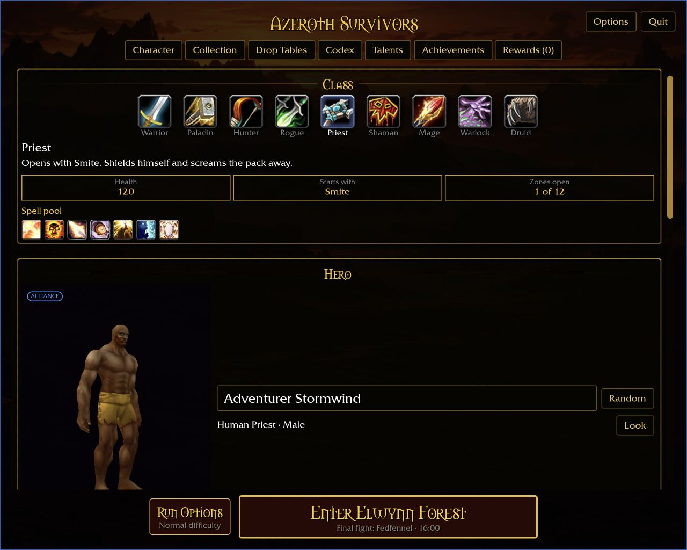
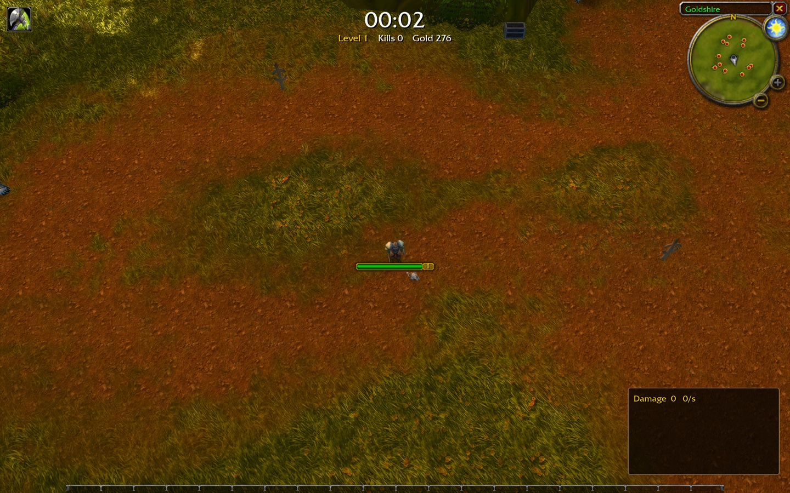
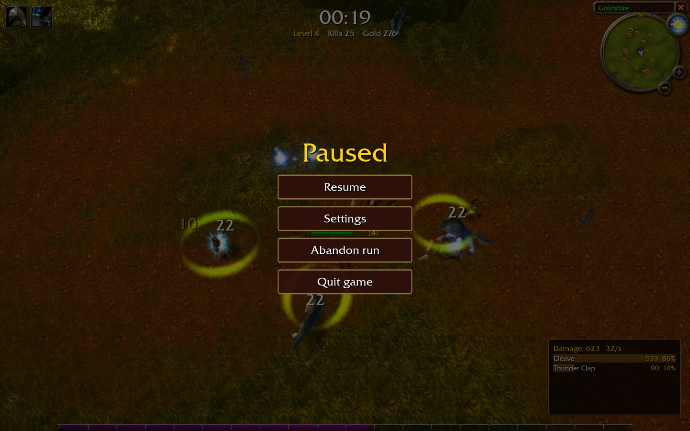
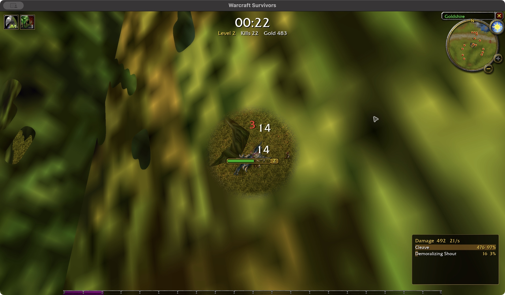

<div align="center">

# Azeroth Survivors

**An independent WoW survival-game implementation on a from-scratch WoW 1.12.1
client engine (Rust + Bevy), inspired by [Aethus’s Azeroth Survivors](https://wow.aethus.pl/).**

[](LICENSE-MIT)

</div>

This repository implements the design in [our intentions](docs/intentions/) and
[the Survivors specification](docs/SURVIVORS.md) on the benilla/wenilla engine. It is
inspired by Aethus’s game; it is not a build of that game's source code. Implementation
is ongoing; the [acceptance contract](docs/SURVIVORS-IMPLEMENTATION.md) tracks the intended
scope, including content and screens that are not complete yet.
Follow the concise [milestone changelog](docs/CHANGELOG.md) for feature summaries and screenshots.

## Interface gallery

Actual checkout captures, dated below. Many use isolated fixture accounts; a screenshot
shows the pictured state, not complete content or cross-platform acceptance. The
[intention images](docs/intentions/) remain the design reference. Earlier iterations
remain inline in the [changelog](docs/CHANGELOG.md) and [screenshot history](docs/SCREENSHOT-HISTORY.md).

Refresh the relevant page here for a visual milestone, and add its before/after or
responsive variants to the changelog. See [capture instructions](docs/SURVIVORS-DEVELOPMENT.md#readme-captures).


### Starter and Character

<table>
  <tr>
    <td width="50%"><strong>Starter</strong><br><br>2026-10-27 · Populated 1280×800 starter with bounded panel scrolling; synthetic collection.<br><a href="docs/images/screenshots/2026-10-27-starter-16-10/compact.png">Compact starter preview</a></td>
    <td width="50%"><strong>Character</strong><br><br>2026-10-27 · Synthetic raid loadout with independent appearance; raid world access remains gated.</td>
  </tr>
  <tr>
    <td width="50%"><strong>Hero management</strong><br><br>2026-10-27 · Labeled creation and direct class selection at 125%.</td>
    <td width="50%"><strong>Minimum viewport</strong><br><br>2026-10-26 · Character at 640×480; full figure and rotation controls.</td>
  </tr>
</table>


### Armory

<table>
  <tr>
    <td width="50%"><strong>Collection</strong><br><br>2026-10-27 · Separate Raid Epic row and active set thresholds; synthetic ownership; raid world access remains gated.<br><a href="docs/images/screenshots/2026-10-27-raid-browser/collection-640.png">Compact Collection preview</a> · <a href="docs/images/screenshots/2026-10-27-collection-800-125/unequipped.png">800×600 at 125%</a></td>
    <td width="50%"><strong>Drop Tables</strong><br><br>2026-10-27 · Raid finale armor odds and item inspection; Naxxramas readiness gate remains visible.<br><a href="docs/images/screenshots/2026-10-27-raid-source/drops-640.png">Compact scrolling preview</a> · <a href="docs/images/screenshots/2026-10-27-collection-800-125/source.png">800×600 source navigation</a></td>
  </tr>
  <tr>
    <td width="50%"><strong>Codex</strong><br><br>2026-10-27 · Scorpid Sting base values and its spell-specific amulet.<br><a href="docs/images/screenshots/2026-10-27-hunter-compact/codex.png">800×600 at 125%</a></td>
    <td width="50%"><strong>Talents</strong><br><br>2026-10-27 · Improved Scorpid Sting duration training; talent catalog incomplete.<br><a href="docs/images/screenshots/2026-10-27-hunter-compact/details.png">800×600 description at 125%</a></td>
  </tr>
  <tr>
    <td width="50%"><strong>Achievements</strong><br><br>2026-10-26 · Categories, progress and earned dates.</td>
    <td width="50%"><strong>Perks</strong><br><br>2026-10-26 · Staged upgrades and retained keyboard focus.</td>
  </tr>
  <tr>
    <td width="50%"><strong>Companions</strong><br><br>2026-10-26 · Independent saved companion looks.</td>
    <td width="50%"><strong>Tabards</strong><br><br>2026-10-26 · Cosmetic selection; catalog expansion remains open.</td>
  </tr>
</table>


### Browser source inspection


2026-10-27 · WebGPU at 1280×720; actual source-row selection. Naxxramas remains
locked pending world readiness. This capture does not establish raid gameplay.

### Options and upgrade previews

<table>
  <tr>
    <td width="50%"><strong>Options</strong><br><br>2026-10-27 · Starter Options retains the landscape; shown at 800×600 and 125% UI size.</td>
    <td width="50%"><strong>Spell and passive upgrades</strong><br><br>2026-10-26 · Green inline comparisons include trained values.</td>
  </tr>
  <tr>
    <td width="50%"><strong>Jewelry rewards</strong><br><br>2026-10-26 · Held preview cards for rapid UI iteration.</td>
    <td width="50%"><strong>Compact Talents</strong><br><br>2026-10-27 · Proportional talent art and aligned milestone icons at 640×720.</td>
  </tr>
</table>


### Additional responsive Character check

<table>
  <tr>
    <td width="50%"><strong>Character at 1024×768</strong><br><br>2026-10-27 · Dressed Night Elf model; appearance changes retain equipped gear.</td>
    <td width="50%"><strong>Scrolled equipment</strong><br><br>2026-10-27 · All nine slots and summed bonuses in the responsive single-column layout.</td>
  </tr>
</table>

<table>
  <tr>
    <td width="50%"><strong>Dressed Orc Warlock · 1280×720</strong><br><br>2026-10-27 · Three-column Character layout with independent gear looks.</td>
    <td width="50%"><strong>Gnome after restart · 640×720</strong><br><br>2026-10-27 · Compact appearance changes persist without replacing gear.</td>
  </tr>
</table>

### Interface sizing

Options → Graphics → **Interface size** adjusts readability from 75% to 125%
without changing render resolution. The setting is saved between launches.


Collection and Talents also support compact scrolling at enlarged interface size.


### Browser starter checkpoint

2026-10-27 · WebGPU package at `7aa09ef`: 1280×1024 talent trees reflow above
scrollable details, with green Combustion scaling and zero-point purchase blocking.
At 2560×1080, all three trees and complete details fit side by side; ultrawide
pointer acceptance remains open. In-map browser gameplay and Windows scene
acceptance remain unverified.


<table><tr>
<td width="50%"></td>
<td width="50%"></td>
</tr></table>

### Earlier gameplay captures

<table>
  <tr>
    <td width="50%"><strong>Combat HUD</strong><br><br>2026-10-24 · Historical Elwynn run-start capture.</td>
    <td width="50%"><strong>Pause</strong><br><br>2026-10-24 · Historical pause controls; settings have since changed.</td>
  </tr>
  <tr>
    <td width="50%"><strong>Results</strong><br><br>2026-10-24 · Historical defeat results; fresh end-to-end captures remain required.</td>
    <td width="50%"><strong>Foliage reveal</strong><br><br>2026-10-25 · Historical reveal sizing; not proof of the reported Windows occlusion fix.</td>
  </tr>
</table>

## In this build

- **A three-column front door and Armory** using client glue art, with character appearance,
  collection, talents and progression screens. The intended campaign lists **twelve zones**;
  destinations with missing world, encounter or drop content remain visibly locked. These
  screens are under development, and the full campaign is not yet playable.
- **Level-up cards** that deal in, tilt toward the cursor and lift on hover. Their WoW item-quality
  colour says how strong a pick is, and each card lists exactly what changes, like
  `Damage 20 » 26` or `Targets 2 » 3`.
- **A class movement spell on F** from level 5, aimed at the cursor: Blink, Charge, Sprint, Dash,
  Fade, Ghost Wolf, Aspect of the Cheetah, Blessing of Freedom, Howl of Terror.
- **A camera you can free:** locked top-down by default with the hero facing the cursor. **C**
  unlocks it to swing and tilt, and the wheel zooms from over the shoulder out to 70 yards.
- A light sharpen-and-colour pass over the picture (**G** toggles it).

## Play it

```bash
git clone https://github.com/erjdev/azeroth-survivors-re
cd azeroth-survivors-re
make build     # fetch game data + install toolchain + build the wasm (~5.5 GB download)
make start     # → open http://127.0.0.1:8090/
```

`make build` chains three re-runnable scripts, each skipping what's already done:

| Step | What it does |
| --- | --- |
| `scripts/fetch-data.sh` | downloads the WoW 1.12.1 client and extracts its MPQs |
| `scripts/web-setup.sh` | installs the wasm toolchain (wasi-sdk, wasm-bindgen, binaryen) |
| `scripts/web-build.sh` | builds the client into `web/dist/` |

**Prerequisites:** [Rust](https://rustup.rs/), `make`, `curl`, `unzip`, and a bash shell. On Windows, run the wasm scripts from Git Bash; PowerShell and cmd can't run them. The native game is the other way around: from Cursor's terminal, run `scripts\survivors.cmd`.

### Windows, native

```text
scripts\survivors.cmd
```

That runs `cargo survivors`: the `play` profile, release optimizations with incremental compilation. The first build compiles the engine. After that, an edit recompiles the crates that changed and leaves the rest of the stack in `target\play`. `cargo build --release` does not — it rebuilds the client crate from scratch, so it is the wrong daily loop.

The script points `WOW_DATA` at `wow-data\Data` when that folder is already there. The program it produces is `target\play\warcraft-survivors.exe`. Closing the window does not throw the build away; the next launch compiles only if the source changed.

Use `cargo survivors-rules` for the engine-independent rule tests. Native development builds
also reload `crates/survivors-core/tuning.txt` while running, so damage, movement, experience
and pickup multipliers can be adjusted without a Rust build. See
[development and distribution](docs/SURVIVORS-DEVELOPMENT.md) for cache boundaries, live
tuning validation, and the planned prompted updater.

Run `make` (or `make help`) to list every target.

## Controls

See [CONTROLS.md](CONTROLS.md). The short version: **WASD** to move, **Space** to jump, **F**
for your class's movement spell, the **mouse wheel** to zoom, **C** to unlock the camera, **Esc**
to pause, **1/2/3** to pick a level-up card.

In the starter or pause menu, a controller's **Start** opens Options. **D-pad up/down**
moves focus, **left/right** adjusts sliders, **south** selects, and **east** closes
Options. On the starter and Armory pages, **D-pad / arrow keys** move the focus
outline between controls; **south / Enter / Space** selects. Focus scrolls into
view automatically. **East** returns to the starter. Text entry still needs a
keyboard. Talents and milestones show descriptions when focused. **Backspace / controller
west** refunds one point from the focused talent, respecting row and prerequisite
requirements. Other hover details and controller gameplay remain unfinished.

## The game data (not in this repo)

This repo ships **no Blizzard content** — no art, models, sounds, maps, MPQ contents, or
FrameXML. The game reads a WoW 1.12.1 client's `Data` folder at runtime, which you supply.

`make build` (via `scripts/fetch-data.sh`) downloads the **English WoW 1.12.1 (build 5875)**
client from [archive.org](https://archive.org/details/WoW_1.12.1-5875) (~5.5 GB) and extracts the
MPQs into `wow-data/Data/` (git-ignored, resumable, skipped when already present). Or point at a
client you already have with `--data` / `WOW_DATA`.

### Changing the download source

If the archive.org item moves or you have your own mirror, override the URL without editing
anything:

```bash
make build WOW_DATA_URL=https://your-mirror.example/client.zip
```

Or set it permanently by editing the single clearly-marked `DEFAULT_DATA_URL` line at the top of
`scripts/fetch-data.sh`. Either way the URL must be a direct link to a zip holding the client's
`Data/*.MPQ` files.

## Talent implementation coverage

Check authored talent definitions against your explicit game-data folder:

```sh
cargo run -p survivors-audit -- wow-data/Data --talent-coverage
cargo run -p survivors-audit -- wow-data/Data --talent-gaps
```

The first command summarizes each class; the second lists pending node IDs/names.
Identity mismatches fail the command. Missing effects are reported as incomplete;
these counts do not establish combat or visual acceptance. Current counts and
remaining requirements are in the [implementation plan](docs/SURVIVORS-IMPLEMENTATION.md#talent-definition-coverage--2026-10-26).

## How it's built

The survivors mode is `crates/benilla-app/src/survivors/`, running on two upstream projects:

- [benilla](https://github.com/samwhosung/benilla) — a from-scratch WoW 1.12.1 client.
- [wenilla](https://github.com/Arnesen/wenilla) — benilla compiled to WebAssembly, with a local
  host and realm service.

## Legal

This independent fan project is inspired by **Aethus’s Azeroth Survivors**. It is not
affiliated with or endorsed by Blizzard Entertainment and ships no Blizzard game files. The screenshots in `docs/images/screenshots/`
show World of Warcraft art rendered from a user-supplied client; that art is © Blizzard
Entertainment. World of Warcraft is a trademark of Blizzard Entertainment, Inc. The engine code in
this repository is licensed under
[MIT](LICENSE-MIT) or [Apache 2.0](LICENSE-APACHE), at your option; the vendored components under
`third_party/` keep their own upstream licenses.
