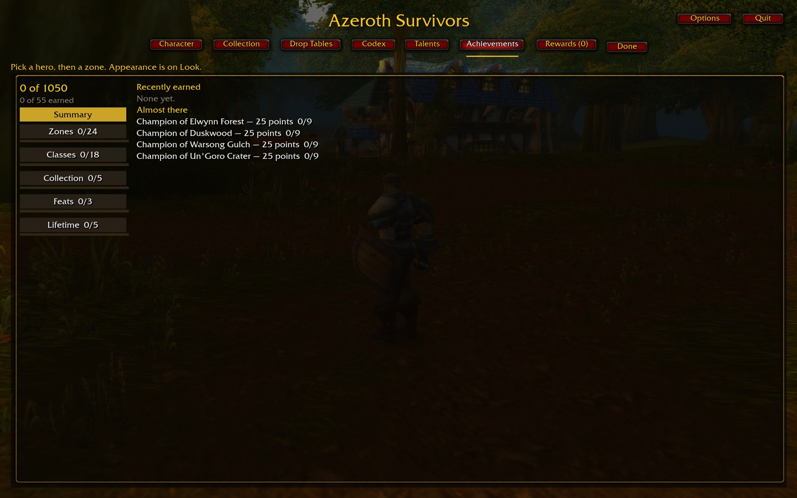
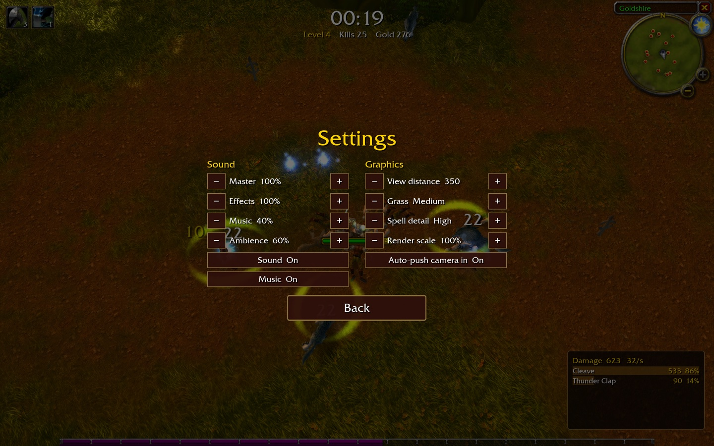
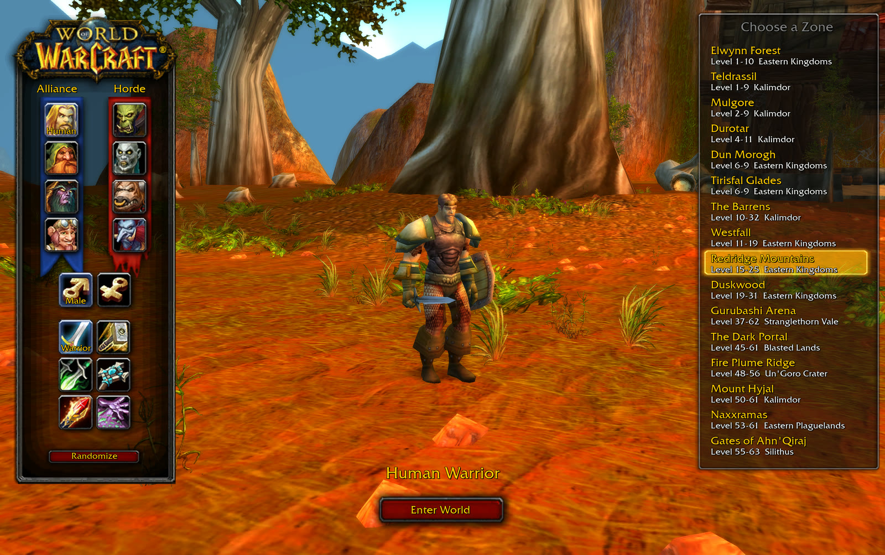
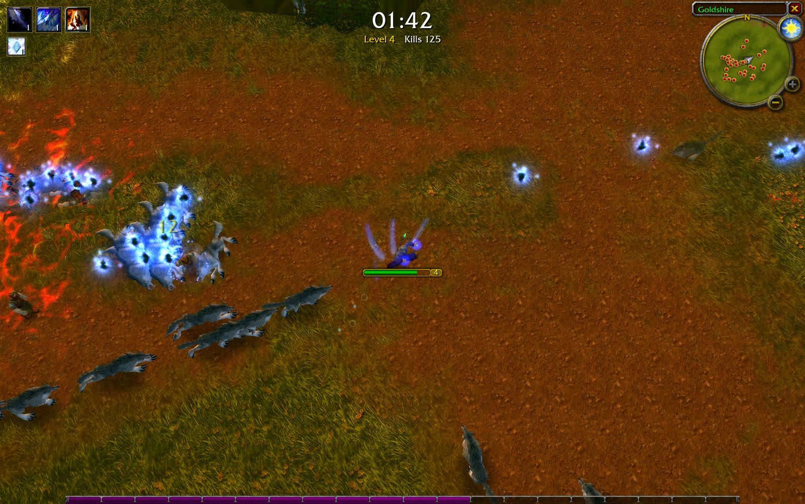
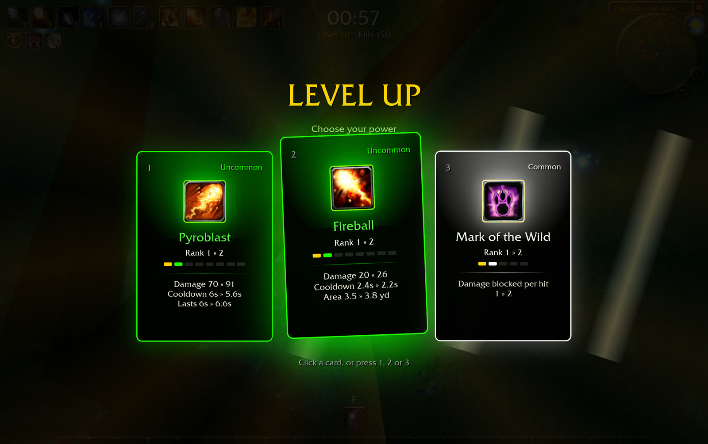
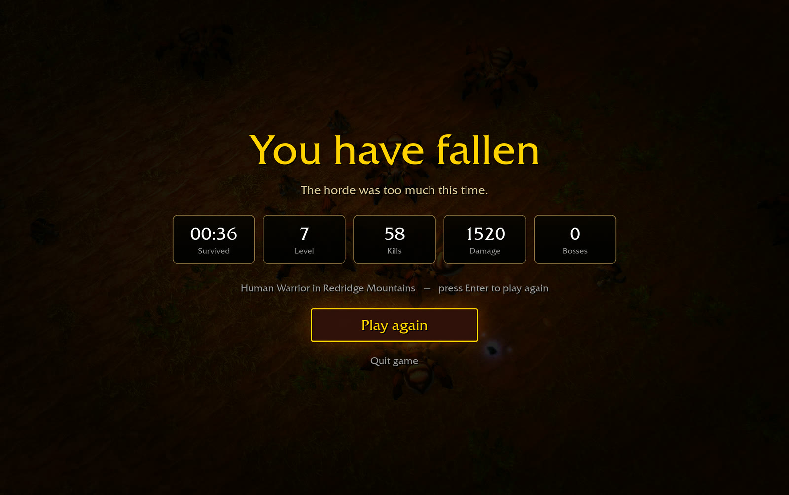

<div align="center">

# Azeroth Survivors

**An independent WoW survival-game implementation on a from-scratch WoW 1.12.1
client engine (Rust + Bevy), inspired by [Aethus’s Azeroth Survivors](https://wow.aethus.pl/).**

[](LICENSE-MIT)

</div>

This repository implements the design in [our intentions](docs/intentions/) and
[the Survivors specification](docs/SURVIVORS.md) on the benilla/wenilla engine. It is
inspired by Aethus’s game; it is not a build of that game's source code. Implementation
is ongoing; the [acceptance contract](docs/SURVIVORS-IMPLEMENTATION.md) tracks the intended
scope, including content and screens that are not complete yet.
Follow the concise [milestone changelog](docs/CHANGELOG.md) for feature summaries and screenshots.

Pick a class and a battleground, then survive: WASD to move, your abilities cast themselves,
enemies swarm in waves, you level up and pick upgrades, and a boss shows up every couple of
minutes. **No server, no login, no account** — fully offline and self-contained.

## Interface gallery

Actual checkout captures from **2026-10-24**, at a **1440 × 900 logical viewport**
(2880 × 1800 Retina render, UI scale 1.171875), exported to 1440 × 900 JPEGs.
These show the current implementation, including unfinished pages; they are not the
[intended designs](docs/intentions/) or proof of responsiveness at every resolution.
See [capture instructions](docs/SURVIVORS-DEVELOPMENT.md#readme-captures) to refresh them.

<table>
  <tr>
    <td width="50%"><strong>Front door</strong><br><br>Class, hero and twelve intended destinations; incomplete content is visibly locked.</td>
    <td width="50%"><strong>Character</strong><br><br>Equipped item icons, selection details and dressed preview on a seeded validation account, shown at 1440×900.</td>
  </tr>
  <tr>
    <td width="50%"><strong>Collection</strong><br><br>Slot and rarity catalog, item details and equipment controls on a validation account.</td>
    <td width="50%"><strong>Drop Tables</strong><br><br>Zone browser, encounter sources and shared item details; missing content remains.</td>
  </tr>
  <tr>
    <td width="50%"><strong>Codex</strong><br><br>Shared jewelry icons and green effect details at 720p; one ambiguous item and legendary amulet artwork remain unfinished.</td>
    <td width="50%"><strong>Talents</strong><br><br>Warrior tree presentation; this image does not imply every talent effect is implemented.</td>
  </tr>
  <tr>
    <td width="50%"><strong>Achievements</strong><br><br>Achievement categories and account summary.</td>
    <td width="50%"><strong>Rewards</strong><br><br>Current reward list and cosmetic categories.</td>
  </tr>
  <tr>
    <td width="50%"><strong>Appearance</strong><br><br>Per-hero race, sex and feature editing with live preview; shown at 1280×720.</td>
    <td width="50%"><strong>Run Options</strong><br><br>Currently displays a difficulty notice, not a dedicated options dialog.</td>
  </tr>
  <tr>
    <td width="50%"><strong>Combat HUD</strong><br><br>Elwynn at run start: health, experience, minimap, abilities and damage meter.</td>
    <td width="50%"><strong>Level-up cards</strong><br><br>Green scaling and next-rank previews; captured at 1440×900.</td>
  </tr>
  <tr>
    <td width="50%"><strong>Pause</strong><br><br>Resume, settings, abandon and quit controls.</td>
    <td width="50%"><strong>Settings</strong><br><br>Sound, graphics and the persisted auto-push camera toggle.</td>
  </tr>
</table>

[Warrior talent-effect milestone at 720p](docs/images/screenshots/2026-10-24-warrior-talents/talents-720.jpg).
Twenty-five Warrior nodes, including [defensive talents](docs/images/screenshots/2026-10-24-warrior-talents/defensive-talents-720.jpg), plus the
[Arms](docs/images/screenshots/2026-10-24-warrior-talents/arms-milestones-720.jpg),
[Fury](docs/images/screenshots/2026-10-24-warrior-talents/fury-milestones-720.jpg) and
[Protection](docs/images/screenshots/2026-10-24-warrior-talents/protection-milestones-720.jpg) milestones
have implemented effects; the complete class talent pass remains underway.


[Piercing Howl node](docs/images/screenshots/2026-10-24-warrior-talents/piercing-howl-node-720.jpg) · [Concussion Blow node](docs/images/screenshots/2026-10-24-warrior-talents/concussion-blow-node-720.jpg).

[Active Enrage HUD at 720p](docs/images/screenshots/2026-10-24-warrior-talents/enrage-hud-720.jpg): green damage bonus and remaining seconds, verified through front-door entry with a trained Fury spec.
[Trained shout card](docs/images/screenshots/2026-10-24-warrior-talents/trained-shout-card-720.jpg): current duration and green next-rank comparison include the selected talents.

[Deep Wounds ranks](docs/images/screenshots/2026-10-24-warrior-talents/deep-wounds-ranks-720.jpg) · [Improved Rend](docs/images/screenshots/2026-10-24-warrior-talents/improved-rend-720.jpg) · [Shout duration talent](docs/images/screenshots/2026-10-24-warrior-talents/shout-duration-720.jpg) · [Green talent rank comparisons at 720p](docs/images/screenshots/2026-10-24-warrior-talents/green-rank-preview-720.jpg).

World validation: [Warsong developer preview at 720p](docs/images/screenshots/2026-10-24-world-preview/warsong-720.jpg) · [reproduce the preview](docs/SURVIVORS-LOCATIONS.md#developer-instance-preview). Rendering verified; traversal remains pending.

Upgrade previews at 1280×720: [new spells and next rank](docs/images/screenshots/2026-10-24-codex-discovery/level-up-720.jpg) · [chest upgrades](docs/images/screenshots/2026-10-24-codex-discovery/chest-720.jpg).

Card lighting without the rectangular outer glow: [hover at 1280×720](docs/images/screenshots/2026-10-24-card-lighting/hover-720.jpg) · [after live resize to 1280×800](docs/images/screenshots/2026-10-24-card-lighting/hover-800.jpg).

Current inline upgrades use one unit per comparison and keep rank labels beneath the name.


Same hand after live resize: [1280×800](docs/images/screenshots/2026-10-24-inline-units/cards-800.jpg) · [1024×768](docs/images/screenshots/2026-10-24-inline-units/cards-1024.jpg).
[Area, cooldown and percentage comparisons at 1024×768](docs/images/screenshots/2026-10-24-inline-units/area-1024.jpg).
Cleave selection after resizing granted rank two. These captures cover sampled level-up
cards; chest/jewelry states and the full resolution/UI-scale matrix remain open.


Character comparisons: [inline race/sex controls](docs/images/screenshots/2026-10-24-character-appearance/orc.jpg) · [large weapon](docs/images/screenshots/2026-10-24-equipment-framing/weapon-appearance.jpg) · [1280×720](docs/images/screenshots/2026-10-24-equipment-framing/character-720.jpg).

Current victory/defeat results, reward claims, equipped appearances and responsive
viewport variants still need fresh captures. Earlier screenshots below are historical.

<details>
<summary>Earlier checkout captures</summary>

<table>
  <tr>
    <td width="50%"></td>
    <td width="50%"></td>
  </tr>
  <tr>
    <td></td>
    <td></td>
  </tr>
</table>

</details>

### In this build

- **A three-column front door and Armory** using client glue art, with character appearance,
  collection, talents and progression screens. The intended campaign lists **twelve zones**;
  destinations with missing world, encounter or drop content remain visibly locked. These
  screens are under development, and the full campaign is not yet playable.
- **Level-up cards** that deal in, tilt toward the cursor and lift on hover. Their WoW item-quality
  colour says how strong a pick is, and each card lists exactly what changes, like
  `Damage 20 » 26` or `Targets 2 » 3`.
- **A class movement spell on F** from level 5, aimed at the cursor: Blink, Charge, Sprint, Dash,
  Fade, Ghost Wolf, Aspect of the Cheetah, Blessing of Freedom, Howl of Terror.
- **A camera you can free:** locked top-down by default with the hero facing the cursor. **C**
  unlocks it to swing and tilt, and the wheel zooms from over the shoulder out to 70 yards.
- A light sharpen-and-colour pass over the picture (**G** toggles it).

## Play it

```bash
git clone https://github.com/erjdev/azeroth-survivors-re
cd azeroth-survivors-re
make build     # fetch game data + install toolchain + build the wasm (~5.5 GB download)
make start     # → open http://127.0.0.1:8090/
```

`make build` chains three re-runnable scripts, each skipping what's already done:

| Step | What it does |
| --- | --- |
| `scripts/fetch-data.sh` | downloads the WoW 1.12.1 client and extracts its MPQs |
| `scripts/web-setup.sh` | installs the wasm toolchain (wasi-sdk, wasm-bindgen, binaryen) |
| `scripts/web-build.sh` | builds the client into `web/dist/` |

**Prerequisites:** [Rust](https://rustup.rs/), `make`, `curl`, `unzip`, and a bash shell. On Windows, run the wasm scripts from Git Bash; PowerShell and cmd can't run them. The native game is the other way around: from Cursor's terminal, run `scripts\survivors.cmd`.

### Windows, native

```text
scripts\survivors.cmd
```

That runs `cargo survivors`: the `play` profile, release optimizations with incremental compilation. The first build compiles the engine. After that, an edit recompiles the crates that changed and leaves the rest of the stack in `target\play`. `cargo build --release` does not — it rebuilds the client crate from scratch, so it is the wrong daily loop.

The script points `WOW_DATA` at `wow-data\Data` when that folder is already there. The program it produces is `target\play\warcraft-survivors.exe`. Closing the window does not throw the build away; the next launch compiles only if the source changed.

Use `cargo survivors-rules` for the engine-independent rule tests. Native development builds
also reload `crates/survivors-core/tuning.txt` while running, so damage, movement, experience
and pickup multipliers can be adjusted without a Rust build. See
[development and distribution](docs/SURVIVORS-DEVELOPMENT.md) for cache boundaries, live
tuning validation, and the planned prompted updater.

Run `make` (or `make help`) to list every target.

## Controls

See [CONTROLS.md](CONTROLS.md). The short version: **WASD** to move, **Space** to jump, **F**
for your class's movement spell, the **mouse wheel** to zoom, **C** to unlock the camera, **Esc**
to pause, **1/2/3** to pick a level-up card.

## The game data (not in this repo)

This repo ships **no Blizzard content** — no art, models, sounds, maps, MPQ contents, or
FrameXML. The game reads a WoW 1.12.1 client's `Data` folder at runtime, which you supply.

`make build` (via `scripts/fetch-data.sh`) downloads the **English WoW 1.12.1 (build 5875)**
client from [archive.org](https://archive.org/details/WoW_1.12.1-5875) (~5.5 GB) and extracts the
MPQs into `wow-data/Data/` (git-ignored, resumable, skipped when already present). Or point at a
client you already have with `--data` / `WOW_DATA`.

### Changing the download source

If the archive.org item moves or you have your own mirror, override the URL without editing
anything:

```bash
make build WOW_DATA_URL=https://your-mirror.example/client.zip
```

Or set it permanently by editing the single clearly-marked `DEFAULT_DATA_URL` line at the top of
`scripts/fetch-data.sh`. Either way the URL must be a direct link to a zip holding the client's
`Data/*.MPQ` files.

## How it's built

The survivors mode is `crates/benilla-app/src/survivors/`, running on two upstream projects:

- [benilla](https://github.com/samwhosung/benilla) — a from-scratch WoW 1.12.1 client.
- [wenilla](https://github.com/Arnesen/wenilla) — benilla compiled to WebAssembly, with a local
  host and realm service.

## Legal

This independent fan project is inspired by **Aethus’s Azeroth Survivors**. It is not
affiliated with or endorsed by Blizzard Entertainment and ships no Blizzard game files. The screenshots in `docs/images/screenshots/`
show World of Warcraft art rendered from a user-supplied client; that art is © Blizzard
Entertainment. World of Warcraft is a trademark of Blizzard Entertainment, Inc. The engine code in
this repository is licensed under
[MIT](LICENSE-MIT) or [Apache 2.0](LICENSE-APACHE), at your option; the vendored components under
`third_party/` keep their own upstream licenses.
