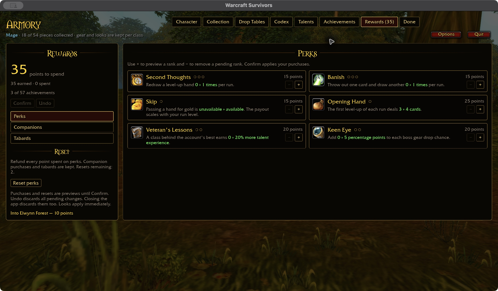
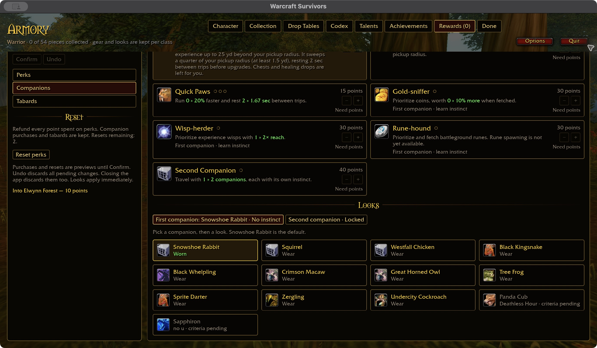
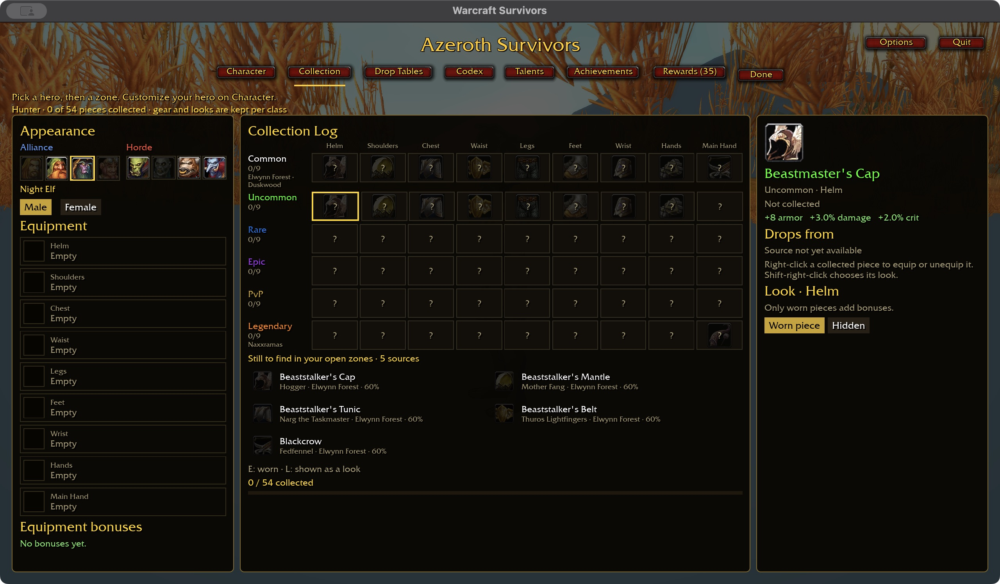

# Screenshot history

Archived README milestones through 2026-10-26. These are historical observations,
not current implementation claims. Dates, counts and limitations in individual
entries describe their original checkpoint. The [README](../README.md#interface-gallery)
shows representative page captures; [CHANGELOG](CHANGELOG.md) retains the full
inline milestone reporting. Original image files are preserved.

Character identity follows the selected gender, race and class.

Character portraits fit short windows with rotation controls visible.

Druid Restoration now includes individual Nature's Swiftness and Swiftmend effects.

Collection details can be selected directly from live UI preview files.

The starter shows worn equipment icons that open Collection details, the selected
zone's scheduled finale and progression locks. Narrow screens stack the three sections.

Starter portraits now show faction and class badges, with wide/compact checks.

Starter actions now use outlined cards with their supporting text inside the button.

Options opens shared audio, graphics and camera preferences without entering a run.

Talent descriptions follow directional focus before spending a point.

Talent focus and the green preview stay in place when buying or refunding ranks.

All nine Mage milestones now have implemented effects; individual pending nodes remain.

Shaman milestones add lightning, shock and totem build effects.

Shaman's first 13 individual talents now provide spell and defensive training.

Warlock's first 12 individual talents now train shadow, fire, curses and health.

Druid's first 12 talents add Balance, defensive and healing effects with explicit previews.

All nine Warlock milestones now have implemented Survivors effects.

Rewards keeps keyboard/controller focus while staging or undoing upgrades.

Achievements uses full-row category controls for pointer and keyboard navigation.

New achievements retain their earned dates; older saves keep undated history.

Achievement cards now have artwork themed to their requirements.

Jeweler’s Eye now tracks discovery across the full jewelry Codex.

Druid milestones now support Balance spells, Thorns defenses and Rejuvenation healing.

Legendary rewards a complete legendary gear collection for one class.

Tabard cards share Armory selection feedback and keyboard focus.

Rapid menu navigation followed by selection now applies in the same frame.

Fast preview files can open Rewards and Achievement categories directly.
See [the preview guide](SURVIVORS-DEVELOPMENT.md) for reusable requests.

Achievement cards retain consistent widths on incomplete rows.

Druid Restoration training previews explicit healing, cooldown and defensive benefits.

Companion looks share the selection styling and keep locked appearances visibly unavailable.

Companion appearance unlocks are checked when loading; valid independent choices persist across restart.

Hunter Survival milestones preview poison/trap damage, defensive absorbs and control.

Codex details describe healing and defensive spells with their actual effects.

Talent artwork keeps its painted proportions at wide and compact sizes, without padded blank edges.

Paladin Retribution now includes Sanctity Aura and a timed Vengeance damage bonus.

A completed class collection now grants its cloak feat at all 54 pieces.

Live preview presets can pin a talent description for repeatable visual checks.

Range talents explain which attacks reach farther without increasing area size.

Jewelry offers have live wide/compact preview presets, with resolved legendary spell names and icons.

Divine Shield's legendary amulet now improves its recharge, with matching card and Codex benefits.

Character retains the reference's three-pane layout on wide screens and stacks a
proportional preview, appearance and equipment on narrow screens. Captures use an
isolated synthetic account; saved appearance and tab-return scrolling were checked.

Collection stacks into readable sections on narrow screens and retains its three-pane
layout at wider sizes. Item actions and tab return preserve narrow scrolling.

Gear now has distinct [slot stat progressions](SURVIVORS-GEAR-STATS.md). Higher
quality strengthens existing stats and adds one; duplicates add no power. Initial
tuning shown here uses synthetic collected equipment.

Drop Tables now wraps zone choices on narrow screens and preserves scrolling through
item selection and tab return. Wide screens retain source and item details side by side.

Codex distinguishes legendary jewelry with spell badges and highlights the selected
entry, with larger detail art. Discoveries below are synthetic preview data.

Talent trees now use the available page height, closer to the intention layout.

Saved Talent builds were exercised across Warrior/Mage switching and restart;
resetting one spec preserves the other builds.

Talent panels reflow at 640×720; scrolling reaches the lower tree and spec controls.
Spend/refund and tab-return scroll continuity were exercised with an isolated Warrior.

Rewards now groups currency and reset controls beside illustrated Perk cards.
Purchase/refund and narrow stacking were checked in an isolated account; staged
purchases and the remaining Rewards pages are still in progress.

Companion cards now show green inline upgrades, rank pips and the destination for
instinct purchases. Live purchases and narrow scrolling were checked; the expanded, achievement-gated
Looks catalog remains unfinished.

Companion appearances now have illustrated tiles and a green Worn state. Each slot's
look remains independent of its instinct; narrow layout and restart persistence were checked.

The Companion catalog now lists thirteen looks. New accounts unlock Westfall Chicken
with Veteran; existing saves retain access. Panda Cub and Sapphiron are locked behind
**Deathless Hour** and **no u**.
These achievements are visible placeholders; their criteria will be defined later.

Long Leash and the remaining five mismatched looks now use the intention's icon artwork.

Tabards now show illustrated Wear/Remove choices, with immediate account-wide saving.
The current catalog contains one verified Guild Tabard.

Rewards purchases now preview before **Confirm**, with **Undo** to discard pending
changes. Confirmed purchases persist; unconfirmed choices are discarded on app close.

Each card also lets you undo one pending upgrade without discarding the rest.

Scarlet Monastery now draws its authored building minimap, including zoom and enemy
markers. The candidate zone stays locked pending navigation and full encounter acceptance.
[Outdoor minimap regression](images/screenshots/2026-10-25-indoor-minimap/elwynn.png)
(the close camera remains a separate unresolved issue).

Ahn'Qiraj outdoor roster milestone: an isolated accelerated Warrior run exercises the
new Legendary armor encounters. The zone remains locked pending world acceptance;
this screenshot does not establish normal progression or balance.

Defeat results at 1280×720, captured with an isolated save and temporarily reduced damage/XP
tuning to reach defeat quickly. This validates the displayed results, not gameplay balance.

Results resize live: [640×720](images/screenshots/2026-10-24-results-layout/narrow-720.jpg)
and [480×720 with wrapped stat tiles](images/screenshots/2026-10-24-results-layout/wrapped-720.jpg).

Un'Goro location investigation: early combat on the southern candidate, after moving away
from its central tree. Full traversal, camera and encounter acceptance remain open; the zone
stays locked. [Earlier free-camera view](images/screenshots/2026-10-25-ungoro-candidate/world-preview-720.jpg).

Elwynn tree investigation: [approach](images/screenshots/2026-10-24-tree-contact/approach.jpg),
[forward contact](images/screenshots/2026-10-24-tree-contact/contact.jpg),
[sidestep](images/screenshots/2026-10-24-tree-contact/side.jpg).
This trunk blocks the observed approach but obscures the hero; broader collision validation remains.

Scenery cutaway now reveals the hero and nearby combat through foliage, with a saved toggle
independent of camera auto-push. Initial 720p validation, with temporary XP tuning:

The viewport-scaled reveal also stays centered after zooming farther out (1280×720,
retained renderer). [Same-camera on](images/screenshots/2026-10-25-cutaway-sizing/on.jpg) /
[off](images/screenshots/2026-10-25-cutaway-sizing/off.jpg).

Earlier fixed-radius validation:

Same paused scene: [cutaway on](images/screenshots/2026-10-25-cutaway/retained-on.jpg) /
[off](images/screenshots/2026-10-25-cutaway/retained-off.jpg).
The ordinary model renderer also passes: [gameplay](images/screenshots/2026-10-25-cutaway/ordinary-gameplay.jpg),
[on](images/screenshots/2026-10-25-cutaway/ordinary-on.jpg) /
[off](images/screenshots/2026-10-25-cutaway/ordinary-off.jpg).
Interior visibility, colored silhouettes and the full zoom/resolution matrix remain unfinished.

[Fresh run after Play again](images/screenshots/2026-10-24-defeat/replay-720.jpg):
paused at 00:02 with full health and zero damage, using the same isolated validation setup.

Pick a class and a battleground, then survive: WASD to move, your abilities cast themselves,
enemies swarm in waves, you level up and pick upgrades, and a boss shows up every couple of
minutes. **No server, no login, no account** — fully offline and self-contained.

Un'Goro source milestone: nine timed encounters now cover all uncommon slots and share
their schedule with the drop browser. The earlier capture below shows the first six.
The zone remains world-locked while arena validation continues.

[King Mosh item detail](images/screenshots/2026-10-25-ungoro-drops/final-item-720.png)

Feralas candidate: a terrain-supported forest corridor with nearby root and tree hulls.
This free-camera preview establishes rendered geometry, not gameplay-camera or traversal
acceptance; the zone remains locked.

Feralas live validation: an accelerated Warrior fixture reached 219 enemies and persisted
four Rare armor drops in an isolated save. This level-up capture is from a 1280×720 logical
window (Retina pixels); it is not a performance or complete-zone acceptance result.

Collection content milestone: the uncommon armor row now has real item identities for
all nine classes. Hunter item details and pending-source messaging were checked at
1280×720 and 1024×720. Slot headings are centered and separated at both sizes.

[Narrow collection layout](images/screenshots/2026-10-25-collection-headings/collection-1024.png)

Rare armor milestone: all nine classes now have eight named Rare armor pieces, bringing
the catalog to 27 of 54 identities per class in this capture. The subsequent nine-weapon
addition brought it to 28 of 54; the Epic identity tier now brings the catalog to 37 of 54.
This isolated Warrior fixture seeds ownership to inspect
the UI. Rare sources now have a Feralas encounter table, while the zone remains locked
pending world acceptance; this older capture predates those source labels.

[Human male armor preview](images/screenshots/2026-10-25-rare-armor/character-720.png)
is a visual checkpoint, not complete race/sex or attachment acceptance.

Chest rewards now use verified item artwork. This isolated accelerated fixture holds
chest choices for inspection: [rings and amulet](images/screenshots/2026-10-25-chest-item-icons/rings-and-amulet.png),
then trinkets after manual selections. Mark of the Champion now explicitly uses vanilla entry 23206's artwork.

Combat-text placement checkpoint: [paused chest with preserved damage numbers](images/screenshots/2026-10-25-combat-text-cache/chest.png).
Repeated identical overlap solves are cached; resumed combat was checked. A later foreground
probe held about 90 FPS at a chest and measured 45–75 FPS in short combat samples.
Earlier background FPS was not representative of attended play; see the
[profiling method](SURVIVORS-DEVELOPMENT.md#measure-attended-performance-explicitly).
Full crowd and zone performance acceptance remains open.

Gurubashi live checkpoint: an isolated accelerated Warrior run starts at 10:00 with
max-rank abilities. The captured defeat at 10:36 reports six bosses and 409 kills; this
is not a full-length run or balance acceptance. Slow combat samples remain under investigation.

Catalog coverage: every class now has all **54 collection cells named and mapped**.
This completes identity coverage, not acquisition or gameplay acceptance: missing drop
sources, live appearance checks and raid-set mechanics remain tracked in the plan.

PvP identity milestone: this isolated Warrior fixture seeds all 54 owned cells and equips
the PvP row to inspect names and bonuses. It was launched before the Gurubashi schedule
change, so its zone-lock wording is historical. Ownership is seeded, not earned here;
full appearances, acquisition and raid-set powers still require acceptance.

Epic identity milestone: this capture shows 37 of 54 named cells; the subsequent Legendary
armor addition brings every class to 45 of 54. This isolated
Warrior account seeds the Wrath set and Ashkandi to inspect equipped names and bonuses;
Epic drops, raid variants/set powers, and full appearance acceptance remain unfinished.

Hunter talent milestone: Mortal Shots has a green next-rank preview, and spending/resetting
Spec 2 leaves Spec 1 intact. Verified at 1280×720 and after a live resize to 1024×720;
the saved allocation also survived relaunch. Thirteen Hunter nodes have explicit effects;
remaining nodes, pets and milestones are unfinished.

[Independent second spec](images/screenshots/2026-10-25-hunter-talents/spec-two-720.jpg) ·
[Narrow talent layout](images/screenshots/2026-10-25-hunter-talents/mortal-shots-1024.jpg)

Mage talent milestone: green rank previews at 1440×900 and 1280×720. Permafrost
compares both slow strength and duration. Refunding a rank, closing directly from
Talents, and relaunching preserves the edit; the separate Fire spec stays intact.
These captures verify the UI, not live combat or completion of every Mage talent.

Winter's Chill spending/refunding and the [maximum-rank description](images/screenshots/2026-10-25-mage-talents/winters-chill-max-720.png)
were checked at 720p with an isolated Mage account; combat feel remains under validation.

Frost Nova's longer description, including trained shield and immunity, fits at
1280×720 and [1024×768](images/screenshots/2026-10-25-mage-talents/frost-nova-card-1024.jpg).
Selecting the same hand after resizing grants rank two; live defensive timing remains open.

[Shatter](images/screenshots/2026-10-25-mage-talents/shatter-preview.png) ·
[Improved Blizzard](images/screenshots/2026-10-25-mage-talents/blizzard-preview.png) ·
[Ignite in spec two](images/screenshots/2026-10-25-mage-talents/ignite-spec-two.png) ·
[Frostbite](images/screenshots/2026-10-25-mage-talents/frostbite-720.png) ·
[Allocation after relaunch](images/screenshots/2026-10-25-mage-talents/reloaded-spec-720.png)

Warsong Gulch now has an authored faction-survival roster and nine Uncommon boss
reward sources. This isolated full-pool Mage run verifies early rendering at 720p;
the zone remains locked pending traversal, camera, complete encounters and balance.

Arathi Basin now has ten faction wave entries and nine Rare boss reward sources.
This isolated full-pool Mage run verifies early rendering at 720p; the stables-area
candidate remains locked pending traversal, camera and complete encounter validation.

Alterac Valley's central candidate adds ten wave entries and nine bosses with PvP-band
rewards. This 720p preview confirms early terrain, enemies, spells and HUD rendering;
full encounters, traversal and camera validation remain open.

[Inline upgrade comparisons during the Alterac run](images/screenshots/2026-10-25-alterac-roster/upgrades-720.jpg).

Native development can now open a specific starter page directly with
`WOW_SURVIVORS_UI_PAGE=collection`, without a gameplay session.
[Direct Collection preview](images/screenshots/2026-10-25-ui-preview/collection-direct.jpg)
· [preview instructions](SURVIVORS-DEVELOPMENT.md#starter-ui-iteration-priority).
Use `python3 scripts/survivors-ui-fixture.py partial` to prepare an isolated account
for UI checks; [fresh, partial and collected fixtures](SURVIVORS-DEVELOPMENT.md#deterministic-account-fixtures)
avoid earning test progress through gameplay.

All eight playable races now have authored Survivors bonuses, with exact rules
shown on the starter. Initial values still need combat balance testing.

Sixteen Rogue talents now have explicit effects and truthful rank previews.
Rogue coverage is still incomplete. Imported specs that exceed earned points retain
their saved ranks, but talent effects stay inactive until the point budget is repaired.

The Collection detail card groups item identity following the intention design;
long names wrap with the available panel width. Equipment comparisons preview
gains and losses, including the worn-set bonus. Shift-right-click selects a collected
look independently of worn gear; native macOS validation retained the common
helmet’s bonuses while selecting its legendary appearance.

Character appearance controls use bordered, responsive rows based on the intention
design. The counters update in place, preserving compact-page scroll position.
A focused Look section keeps appearance actions visible, with selected-item
navigation to Collection for full equipment details.

Priest now has nineteen individual talents and nine tree milestones with scoped previews.
Fortitude, Inner Fire and Spell Warding now provide health, armor and damage reduction.

Blackout adds a stun chance to Shadow hits and Pain ticks, shown inline on cards.

Vampiric Embrace heals from Shadow damage, with both improvement ranks implemented.

Shadow Weaving builds a separate, expiring vulnerability on each enemy.

Long ground, chain and damage-over-time cards have checked [wide](ui-previews/long-cards-1280.txt) and [compact](ui-previews/long-cards-640.txt) preview presets.

Card layouts can be opened and resized without a run using the [live UI preview](SURVIVORS-DEVELOPMENT.md).

Upgrade cards now state effective casting distance separately from area radius.

Talent-triggered healing is included inline, with its once-per-cast limit.

The reloadable preview can use the selected character's starting build, without a
combat session. High-rank talent healing fits on compact cards.

Saved talent specs now follow the catalog's class, rank, row and prerequisite rules.
Invalid specs retain their ranks for repair and grant no talent effects.

Compact hero switching restores each hero's saved appearance and class gear.

## Interface gallery

Actual checkout captures from **2026-10-24**, at a **1440 × 900 logical viewport**
(2880 × 1800 Retina render, UI scale 1.171875), exported to 1440 × 900 JPEGs.
These show the current implementation, including unfinished pages; they are not the
[intended designs](intentions/) or proof of responsiveness at every resolution.
See [capture instructions](SURVIVORS-DEVELOPMENT.md#readme-captures) to refresh them.

<table>
  <tr>
    <td width="50%"><strong>Front door</strong>  Class, hero and twelve intended destinations; incomplete content is visibly locked.</td>
    <td width="50%"><strong>Character</strong>  Equipped item icons, selection details and dressed preview on a seeded validation account, shown at 1280×720.</td>
  </tr>
  <tr>
    <td width="50%"><strong>Collection</strong>  Slot and rarity catalog, item details and equipment controls on a validation account.</td>
    <td width="50%"><strong>Drop Tables</strong>  Zone browser, encounter sources and shared item details; missing content remains.</td>
  </tr>
  <tr>
    <td width="50%"><strong>Codex</strong>  Shared jewelry catalog and legendary spell badges at 1280×720; undiscovered entries are dimmed and one item icon remains unresolved.</td>
    <td width="50%"><strong>Talents</strong>  Warrior tree presentation; this image does not imply every talent effect is implemented.</td>
  </tr>
  <tr>
    <td width="50%"><strong>Achievements</strong>  Illustrated achievement cards, account points and progress.</td>
    <td width="50%"><strong>Rewards</strong>  Emphasized points, full-width categories and compact perk controls.</td>
  </tr>
  <tr>
    <td width="50%"><strong>Appearance</strong>  Per-hero race, sex and feature editing with live preview; shown at 1280×720.</td>
    <td width="50%"><strong>Run Options</strong>  Currently displays a difficulty notice, not a dedicated options dialog.</td>
  </tr>
  <tr>
    <td width="50%"><strong>Combat HUD</strong>  Elwynn at run start: health, experience, minimap, abilities and damage meter.</td>
    <td width="50%"><strong>Level-up cards</strong>  Green scaling and next-rank previews; captured at 1440×900.</td>
  </tr>
  <tr>
    <td width="50%"><strong>Pause</strong>  Resume, settings, abandon and quit controls.</td>
    <td width="50%"><strong>Settings</strong>  Sound, graphics and the persisted auto-push camera toggle.</td>
  </tr>
</table>

[Warrior talent-effect milestone at 720p](images/screenshots/2026-10-24-warrior-talents/talents-720.jpg).
Twenty-five Warrior nodes, including [defensive talents](images/screenshots/2026-10-24-warrior-talents/defensive-talents-720.jpg), plus the
[Arms](images/screenshots/2026-10-24-warrior-talents/arms-milestones-720.jpg),
[Fury](images/screenshots/2026-10-24-warrior-talents/fury-milestones-720.jpg) and
[Protection](images/screenshots/2026-10-24-warrior-talents/protection-milestones-720.jpg) milestones
have implemented effects; the complete class talent pass remains underway.

[Piercing Howl node](images/screenshots/2026-10-24-warrior-talents/piercing-howl-node-720.jpg) · [Concussion Blow node](images/screenshots/2026-10-24-warrior-talents/concussion-blow-node-720.jpg).

Reactive talent status: [active Flurry at 720p](images/screenshots/2026-10-24-reactive-buffs/flurry-720.jpg) · [cleared after expiry](images/screenshots/2026-10-24-reactive-buffs/expired-720.jpg). Enrage, Flurry and Blood Craze show their effect values and remaining seconds; dedicated icons remain pending.

[Active Enrage HUD at 720p](images/screenshots/2026-10-24-warrior-talents/enrage-hud-720.jpg): green damage bonus and remaining seconds, verified through front-door entry with a trained Fury spec.
[Trained shout card](images/screenshots/2026-10-24-warrior-talents/trained-shout-card-720.jpg): current duration and green next-rank comparison include the selected talents.

[Deep Wounds ranks](images/screenshots/2026-10-24-warrior-talents/deep-wounds-ranks-720.jpg) · [Improved Rend](images/screenshots/2026-10-24-warrior-talents/improved-rend-720.jpg) · [Shout duration talent](images/screenshots/2026-10-24-warrior-talents/shout-duration-720.jpg) · [Green talent rank comparisons at 720p](images/screenshots/2026-10-24-warrior-talents/green-rank-preview-720.jpg).

World validation: [Warsong developer preview at 720p](images/screenshots/2026-10-24-world-preview/warsong-720.jpg) · [reproduce the preview](SURVIVORS-LOCATIONS.md#developer-instance-preview). Rendering verified; traversal remains pending.

Upgrade previews at 1280×720: [new spells and next rank](images/screenshots/2026-10-24-codex-discovery/level-up-720.jpg) · [chest upgrades](images/screenshots/2026-10-24-codex-discovery/chest-720.jpg).

Distinct chest and banish validation at 1280×720:
[before banish](images/screenshots/2026-10-25-banish/before-720.png) ·
[replacement with neighbors preserved](images/screenshots/2026-10-25-banish/after-720.png) ·
[single-card chest](images/screenshots/2026-10-25-banish/single-chest-720.png) ·
[jewelry replacement](images/screenshots/2026-10-25-banish/chest-replacement-720.png).
These captures preceded the chest subtitle correction to “Choose your chest reward.”

Card lighting without the rectangular outer glow: [hover at 1280×720](images/screenshots/2026-10-24-card-lighting/hover-720.jpg) · [after live resize to 1280×800](images/screenshots/2026-10-24-card-lighting/hover-800.jpg).

Current inline upgrades use one unit per comparison and keep rank labels beneath the name.

Same hand after live resize: [1280×800](images/screenshots/2026-10-24-inline-units/cards-800.jpg) · [1024×768](images/screenshots/2026-10-24-inline-units/cards-1024.jpg).
[Area, cooldown and percentage comparisons at 1024×768](images/screenshots/2026-10-24-inline-units/area-1024.jpg).
Cleave selection after resizing granted rank two. These captures cover sampled level-up
cards; chest/jewelry states now have separate 720p evidence above. The full resolution/UI-scale matrix remains open.

Character comparisons: [inline race/sex controls](images/screenshots/2026-10-24-character-appearance/orc.jpg) · [large weapon](images/screenshots/2026-10-24-equipment-framing/weapon-appearance.jpg) · [1280×720](images/screenshots/2026-10-24-equipment-framing/character-720.jpg).

Current victory/defeat results, reward claims, equipped appearances and responsive
viewport variants still need fresh captures. Earlier screenshots below are historical.

Earlier checkout captures

<table>
  <tr>
    <td width="50%"></td>
    <td width="50%"></td>
  </tr>
  <tr>
    <td></td>
    <td></td>
  </tr>
</table>

