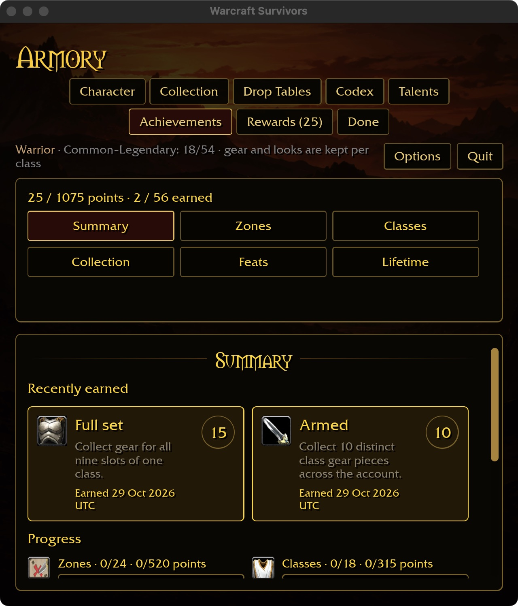
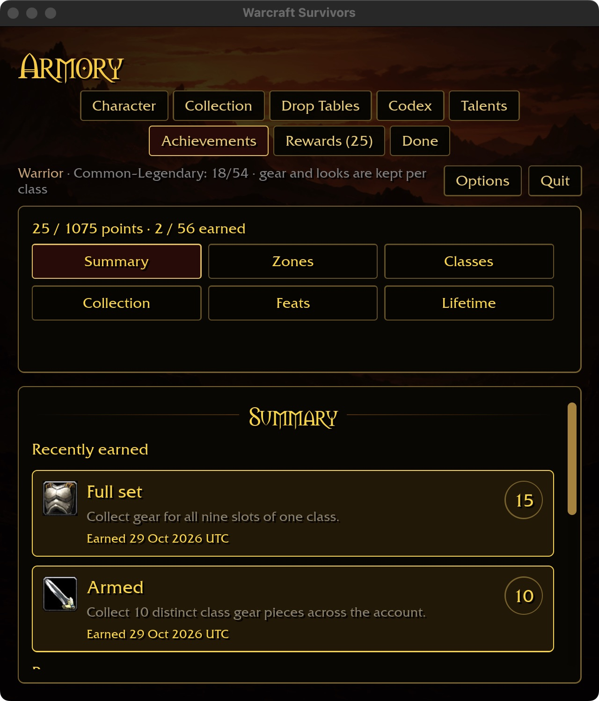
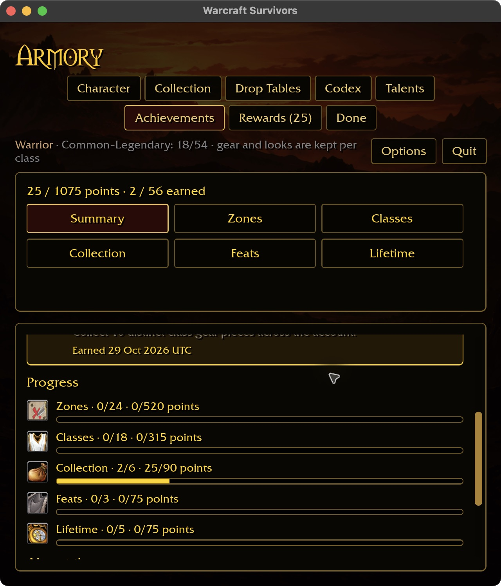
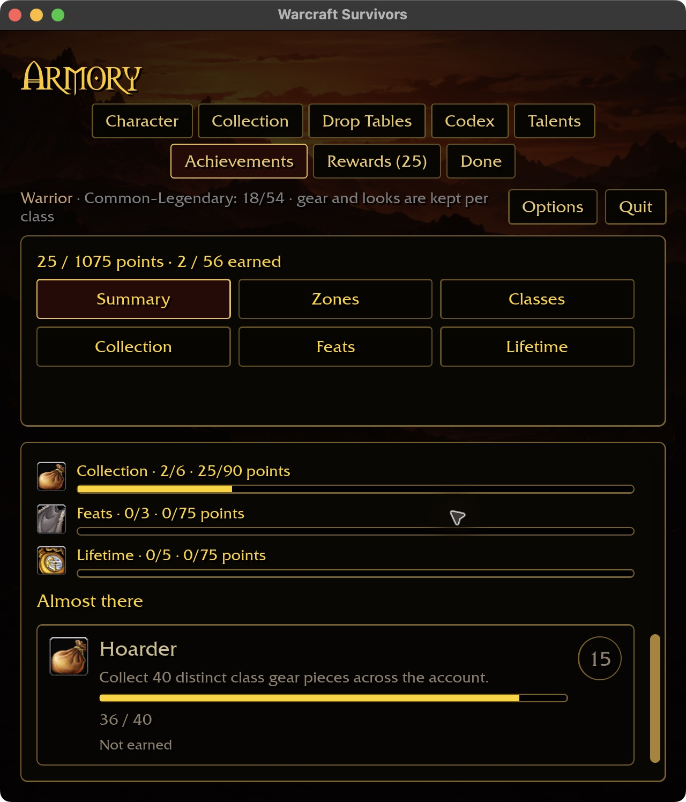

# Achievement card readability

Reference: `docs/intentions/survivors_achievements_tab_summary.png` and the Zones
reference. The wide design uses two aligned columns; responsive layouts must keep
names, descriptions, point badges, progress and earned dates readable.

The old 48%-basis flex cards kept two narrow columns at 640×720 / 125%, wrapping
short descriptions over several lines and the earned date onto another line.
The new grid selects one column below 568 logical content pixels (two 280-pixel
reading columns plus their gap), otherwise two equal fractional columns. It uses
the grid's computed width and inverse scale factor, not physical monitor width.
Incomplete rows stay one column wide on wide panels. Summary progress uses the
same rule; category cards share the same grid. No reward or save rule changes.

## Native evidence

An isolated fixture with 36 account pieces, two earned achievements and 25 points:

- 640×720 / 125%: full-width recent cards; descriptions and dates fit without the
  previous wrapping. Page Down reaches all five category progress rows; End reaches
  the full Hoarder progress card (36/40).
- 1280×720 / 100%: two equal columns; the single Hoarder card retains one-column
  width. A fresh launch provided the complete wide capture after hot-resizing
  left the macOS window partly outside the visible capture area.
- 640×480 with requested 125% and existing short-window auto-fit: Feats remains
  scrollable. End reaches Deathless Hour and no u with full companion labels and
  Criteria pending. A transient UI-tool focus error cleared by raising the same
  live window; the application did not need restarting for this check.

Presets: `achievements-summary-640-125.txt`, `achievements-summary-1280.txt` and
`achievements-feats-640x480-125.txt` under `docs/ui-previews/`. Native play build:
1m57s. Windows and other resolution/body/content combinations remain open.

The eight-package scoped formatting, Clippy and test gate passes, with 31
optional-addon skips. No full cross-platform acceptance is implied.
