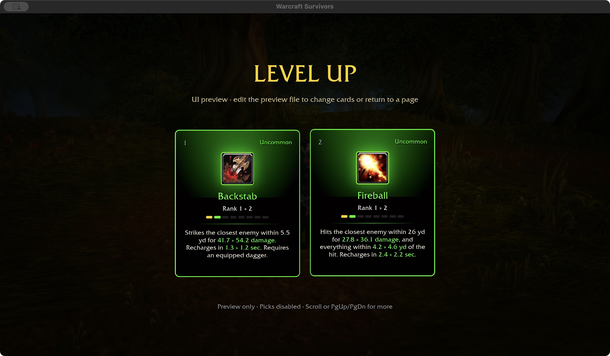
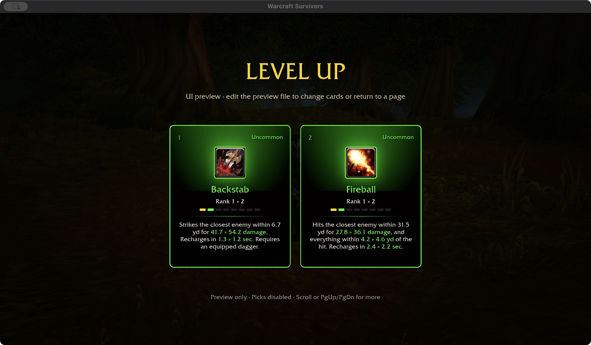
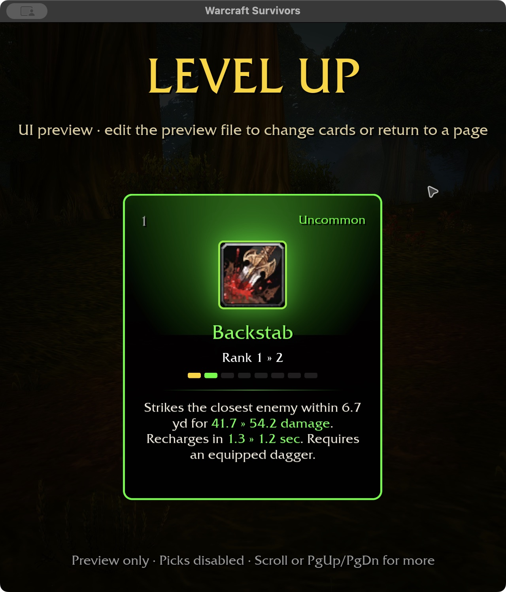
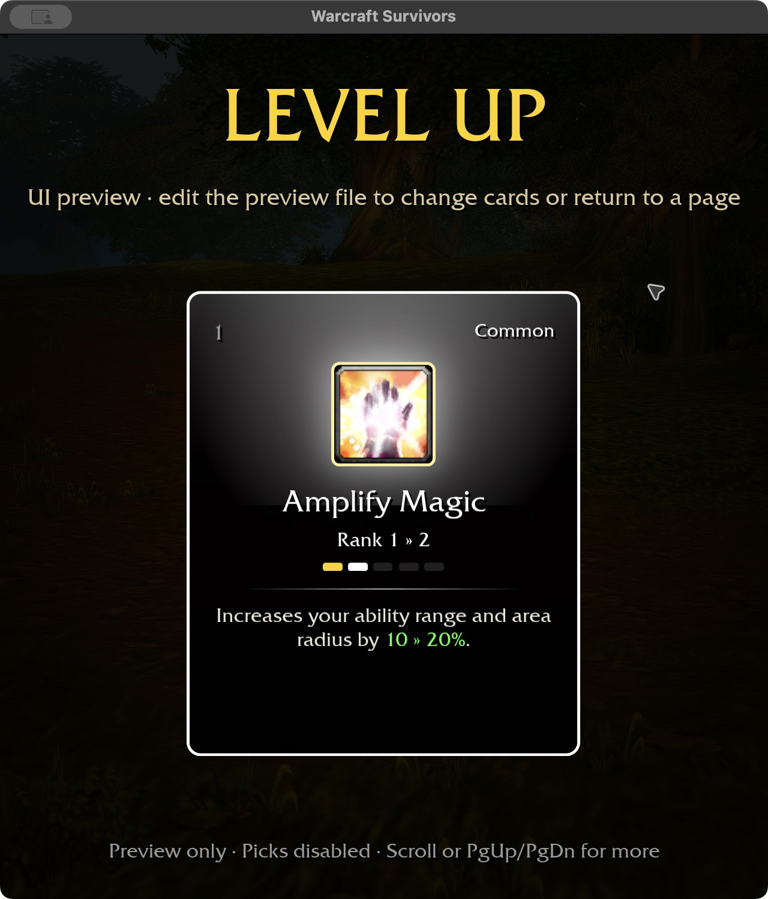

# Area-scaled ability range — 2026-11-02

The approved [combat policy](../SURVIVORS-COMBAT-POLICY.md) requires the area
stat to increase ability range. Shared cast parameters now calculate targeting
range as `(base range × talent multiplier + talent yards) × area multiplier`.
Radius retains its existing separate rank/talent/area calculation. The same
parameters feed casting and selected-build card descriptions.

Paladin Weapon Attack and permanent Cat Claw/Bear Maul also scale their authored
reach by the attack-scoped area multiplier. Enemy radius/contact allowances stay
separate. Area does not add targets, change damage or recovery, or turn a
single-target attack into an AoE. Zero-range self spells remain self-centered.
Existing pet leash/locomotion distances are not owned-ability targeting ranges.

Amplify Magic passive descriptions, area-stat labels and the Gnome racial summary
now explain range as well as radius. Spell-specific amulet area applies only to
its matching spell. Talent flat-yard bonuses are included before area scaling.

Tests cover every owned ability at ranks one/eight, unchanged target counts and
recovery/damage, actual melee boundary checks, Paladin/Cat/Bear automatic attacks,
flat/percentage talent composition and scoped amulets. Hunter's Mark still gains
no damage or radius, but its targeting range now scales too. This supersedes its
old test expectation that area could not change range.

## Visual evidence

The isolated preview uses Rogue hero 4 with its existing selected equipment
(+21% area). Fireball is deliberately shown beside Backstab to compare ranged
and melee parameters; this is a UI fixture, not a legal Rogue draft or a combat
session. Before the change, range remains 5.5 yd / 26 yd despite the area bonus.

The final selected-build preview shows 6.7 yd / 31.5 yd, matching the 21% area
bonus after rounding. Damage, recovery and Fireball's existing splash radius are
unchanged by this correction. Native captures cover 1280×720 / 100% selected
melee/ranged cards and 640×720 / 125% melee and Amplify Magic descriptions.
Picks remain disabled; no attended combat or acquisition claim is made.

The ten-package formatting/Clippy/test gate passes with 31 optional-addon skips.
Native incremental build: 22.17 seconds; WebGPU check: 6.84 seconds. Existing
native unwind-size and six WebGPU warnings remain. Early validation caught a test
initializer style issue and a mismatched helper argument; both are corrected.
Windows, controller and attended combat remain unverified. No save format changed.
