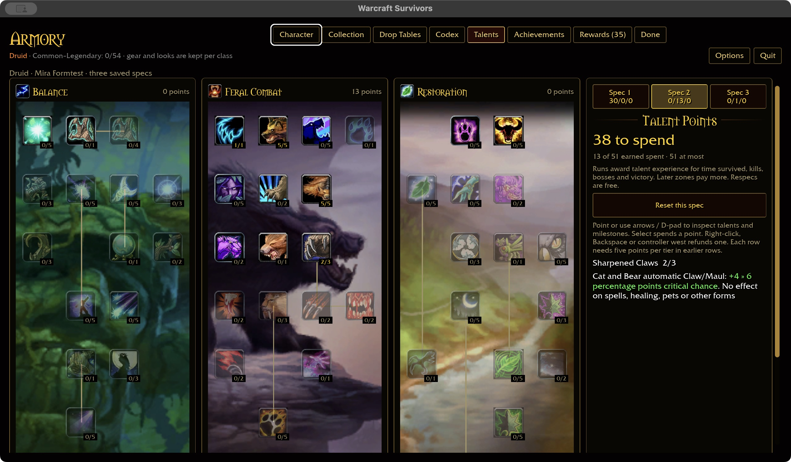
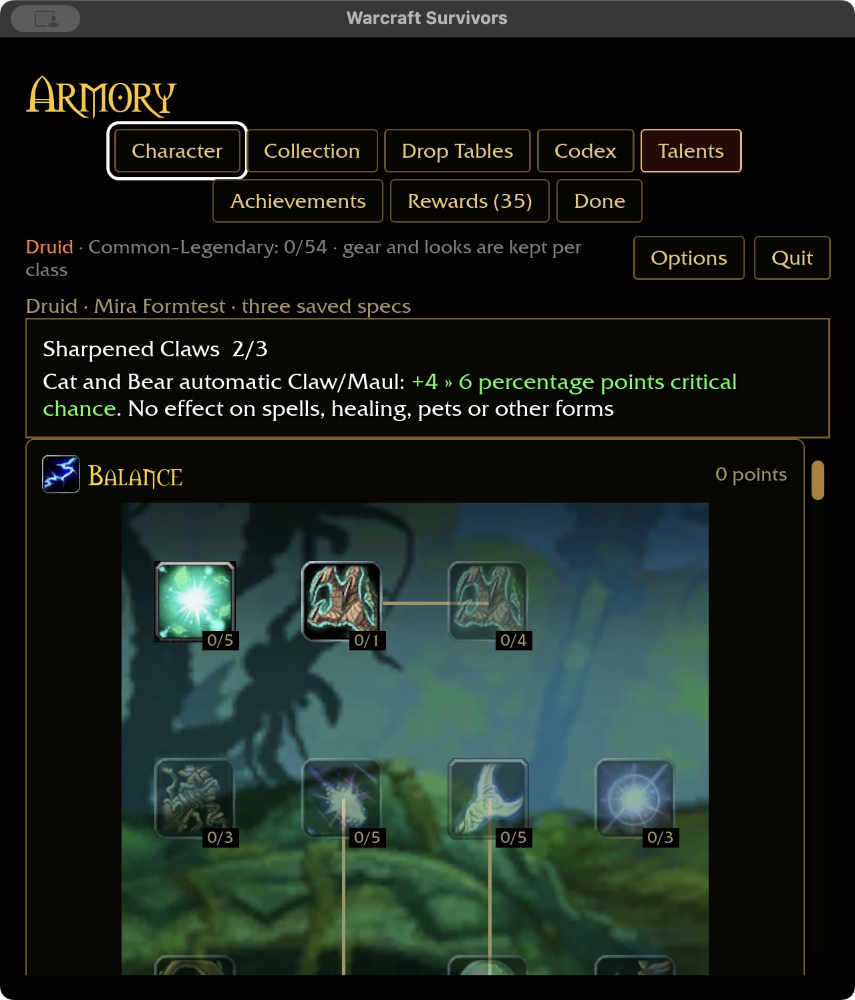

# Armory keyboard isolation — 2026-11-01

An initial Enter on Talents previously reached the global start-run shortcut
because it excluded only Run Options. The shortcut now requires the starter
page. Other Armory pages consume initial Enter to establish visible focus;
subsequent Enter activates the focused control through the existing handler.

Regression tests cover all ten nonstarter pages, both absent and present default
focus resources, initial focus versus activation, valid starter entry and missing
hero refusal. The ten-package scoped gate passes (31 optional addon-corpus skips),
plus native play build and WebGPU check. Existing native linker unwind and six
WebGPU warnings remain. Build output was 56.31 GiB before native review.

Native macOS production preview uses isolated fixture
`target/ui-fixtures/armory-enter-20261101`, with checkout-local game data. On
Talents, initial Enter highlights Character without leaving the page; second
Enter opens Character. Initial Enter also stays on Talents at 640×720 / 125%.
Wide capture uses 1280×720 / 100%. No combat was launched in this validation.
Windows, physical controller and attended gameplay acceptance remain open.

