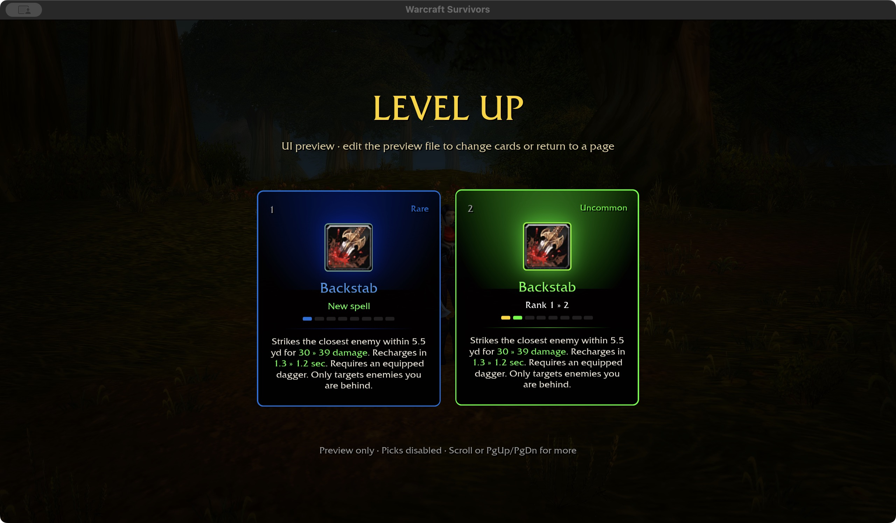
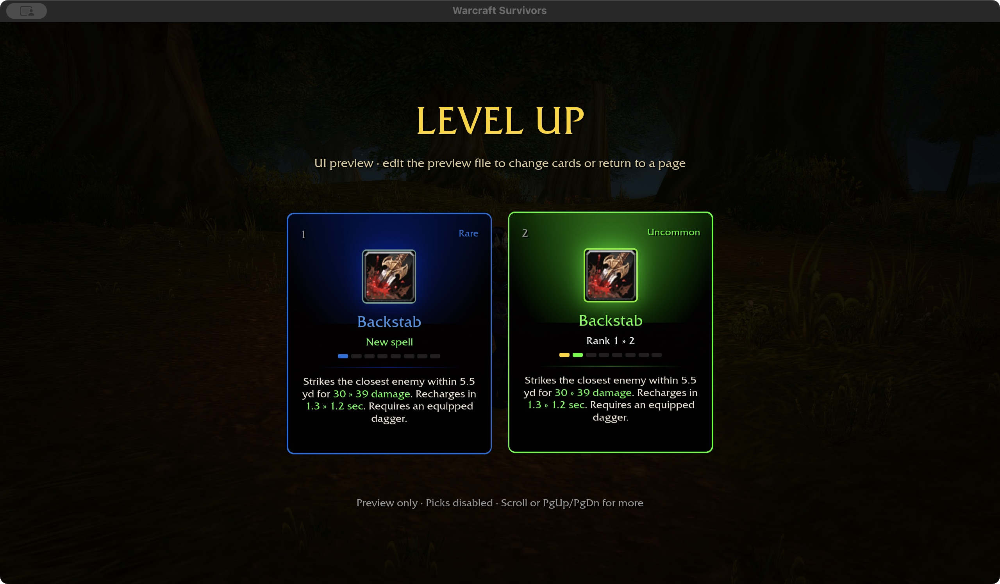
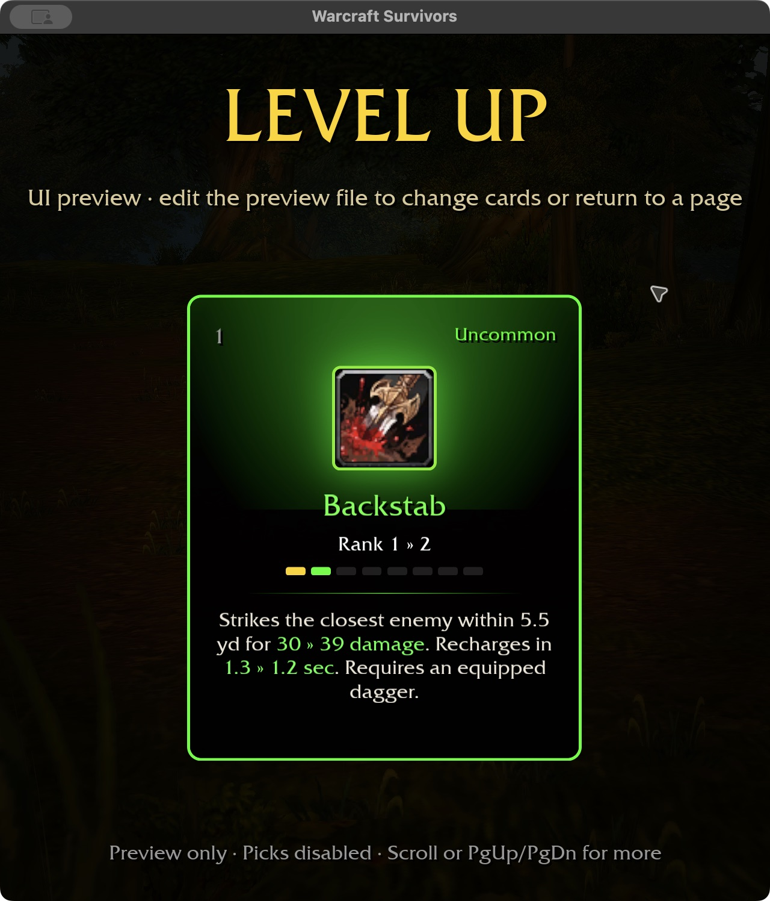
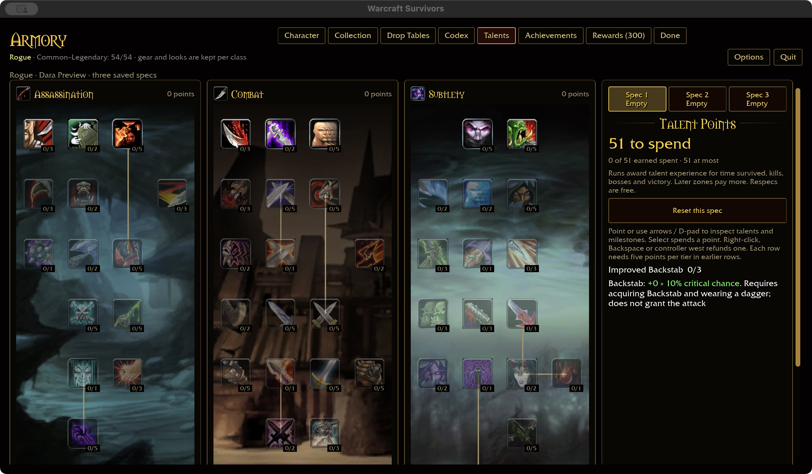
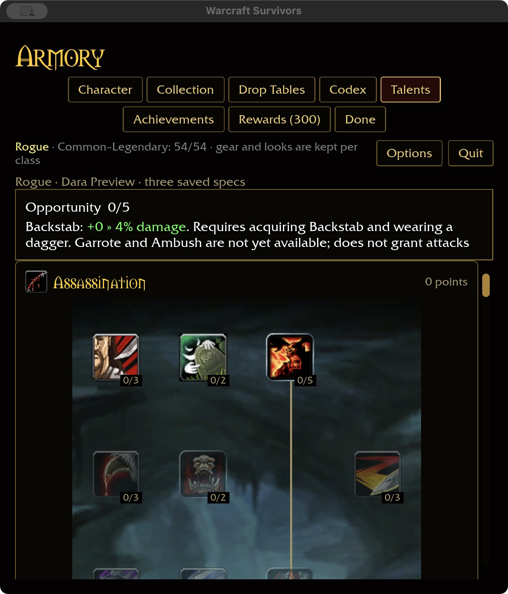

# Backstab without positional requirements — 2026-11-01

The approved [combat policy](../SURVIVORS-COMBAT-POLICY.md) removes positional
attack requirements. Backstab previously filtered every target to the rear half
of its facing and advertised that condition on acquisition/upgrade cards.

The shared ability definition no longer has a rear-position flag, and casting
uses the same nearest-in-range selection regardless of target facing. The worn
dagger requirement remains in drafting and casting; cosmetic daggers do not
qualify. Damage, recovery, talent modifiers and additional single targets retain
their existing tuning. Failed range checks use the ordinary 0.2-second retry and
do not consume critical charges. No new stealth or combo-point system is added.

The cast regression checks front, side, rear and rotated victims in one cast,
with an out-of-range victim excluded. Missing weapons and swords cannot cast;
failed casts preserve Cold Blood and Remorseless Attacks, while a successful cast
consumes them. Existing offer, weapon and talent tests retain their coverage.
Card tests require the dagger note and green inline growth without rear wording.

This checkpoint does not claim the entire combat-policy migration is complete.
In particular, generic ability targeting range still needs the approved area-stat
scaling; `Params::new` currently scales radius separately from targeting range.

## Visual comparison

The isolated native card preview uses Rogue hero 4 and Backstab acquisition plus
rank-one upgrade cards. Preview picks are disabled; these captures establish
wording/layout, not acquisition or attended combat acceptance.

Native captures verify cards at 1280×720 / 100% and 640×720 / 125%, Improved
Backstab wide, and Opportunity compact. No save format or purchase rules changed.
The ten-package formatting/Clippy/test gate passes, with 31 optional-addon skips.
Final talent wording additionally passes all 356 shared-rule tests and core Clippy;
formatting, native build (46.85 seconds) and WebGPU check (8.25 seconds) pass.
Existing native unwind-size and six WebGPU warnings remain. Windows, controller
and attended combat remain unverified. Definition coverage is unchanged.
