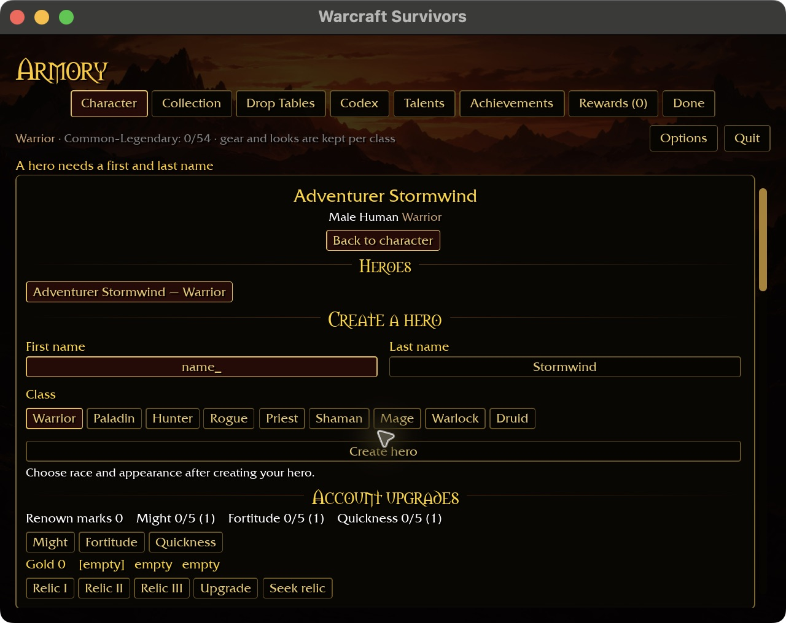
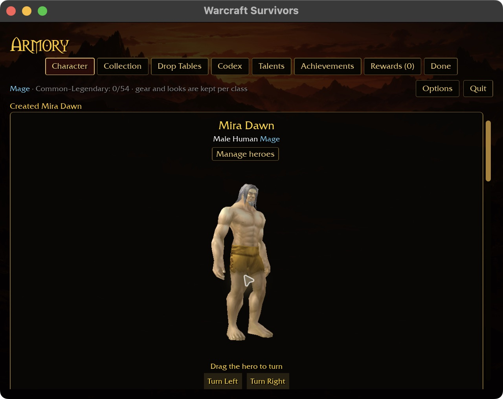
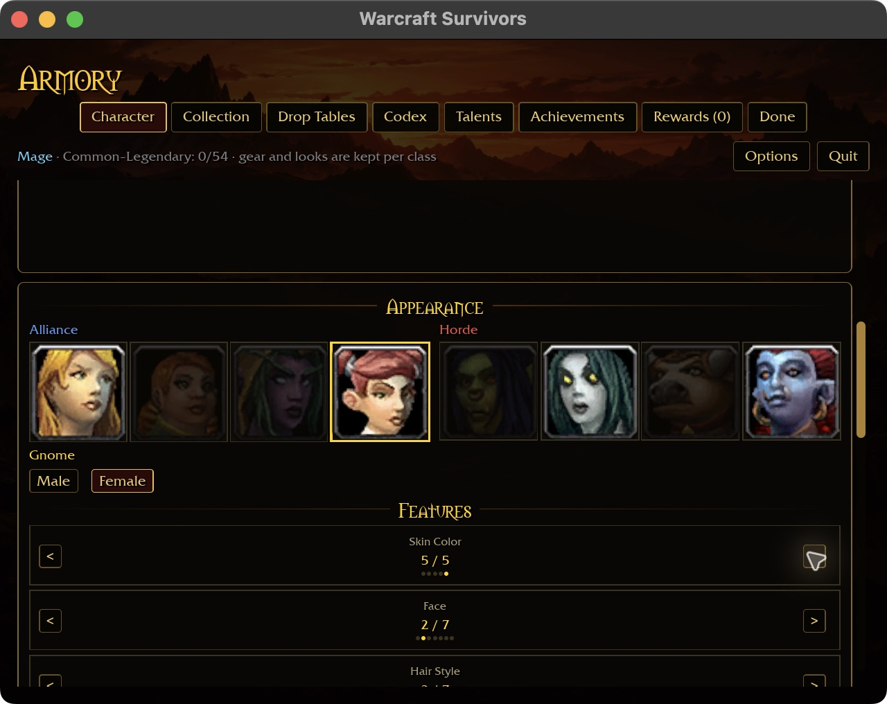
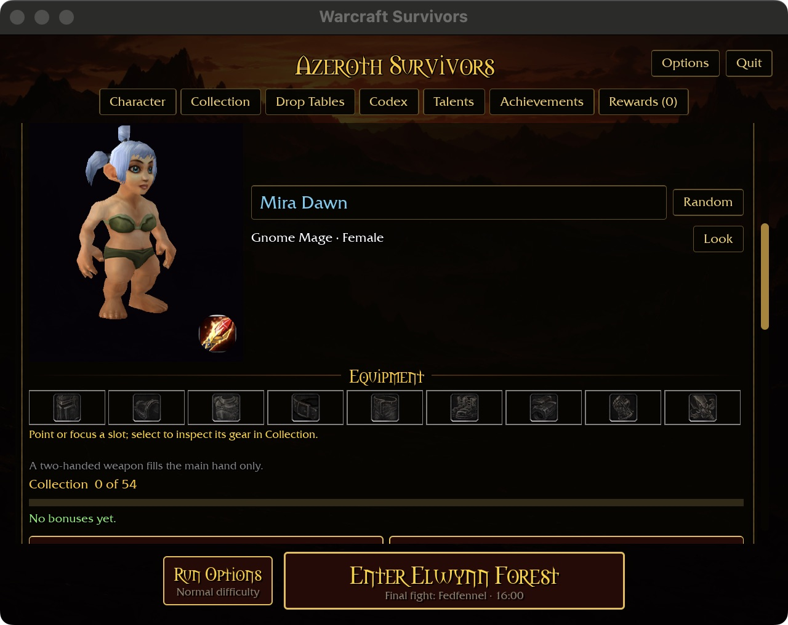
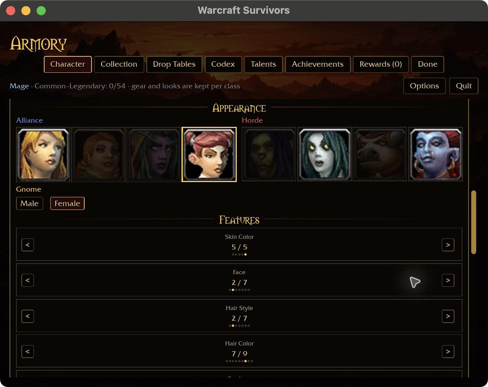

# Minimum-window character creation acceptance

Verified 2026-10-31 on native macOS, runtime built from `dd3304d`. No runtime
changes in this checkpoint. This closes one interaction/layout cell, not the
entire character or platform matrix.

## Setup and design reference

Used an isolated fresh account from `scripts/survivors-ui-fixture.py fresh`, with
`starter-fresh-640x480-125.txt`: 640×480 logical window, 125% requested UI scale
with automatic short-window fit. Retina screenshots include the window title bar.
Only this checkout's `wow-data/Data` supplied art. No combat session was started.

The [Character intention](../intentions/survivors_character_tab.png) remains the
reference for the hero model, race/body controls, feature selectors and gold
framing. At this minimum width, production UI stacks those sections in a
scrolling page instead of preserving the reference's three simultaneous columns.
This evidence establishes reachability and persistence, not exact art parity or
legibility on every display density.

## Observed flow

- Starter's create/choose action opens hero management with first/last name,
  all nine class choices and Create hero reachable.
- Clearing the first name using Backspace and clicking Create produces “A hero
  needs a first and last name” without creating another hero.
- Entering Mira, using Tab to reach the surname, replacing it with Dawn, choosing
  Mage and creating produces Mira Dawn with a rendered Human male model.
- Appearance controls allow Gnome and Female, then skin color 5/5 (from 4/5).
- Done returns to the starter with Mira Dawn, Gnome Mage · Female, nine empty
  equipment slots and Collection 0 of 54. The fixed run action stays reachable.
- Closing and reopening the app restores that selected hero and model. Returning
  to appearance shows Gnome, Female, skin 5/5, face 2/7, hairstyle 2/7 and hair
  color 7/9. Saved account rows independently confirm hero ID 2, its body and
  feature values; the selected-hero file also retains ID 2.

Later follow-up: [whole-name selection and replacement](NAME-SELECTION.md) now
passes native checks. The following describes the earlier `dd3304d` build.

The initial Command-A attempt did **not** select the name. The custom field
appended the character instead; the subsequent Backspace removed it, leaving the
default draft. Clicking Create then made Adventurer Stormwind (Warrior), before
Mira was created. That attempt is not counted as empty-name validation. Selection,
cursor editing and conventional Command-A/Ctrl-A behavior remain input polish
work; the validated editing path here is append/Backspace/Tab.

## Original captures

## Limits and next acceptance

Windows, controller navigation, every class/race/body combination and the remaining
resolution matrix are not covered. Rename, deletion, equipped appearances and
in-map behavior are outside this specific run. The native preview was stopped
and its temporary launcher restored. No new compiler or game-test run was needed
for this evidence-only checkpoint; local Markdown links and diff formatting are
checked separately.
