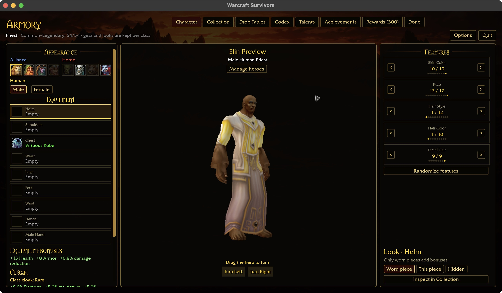
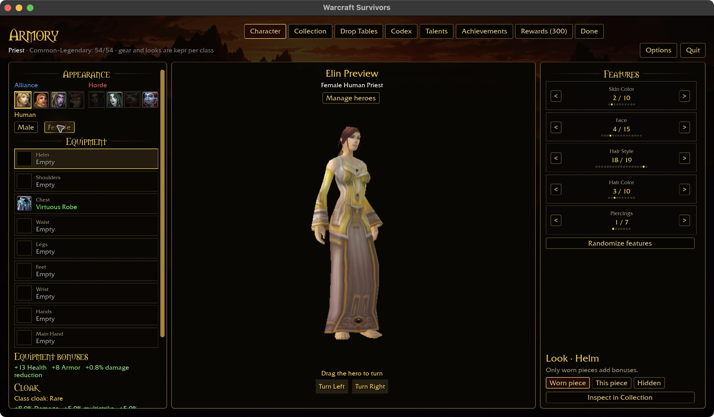
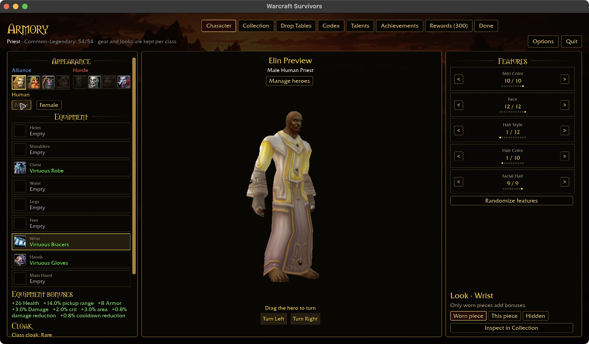
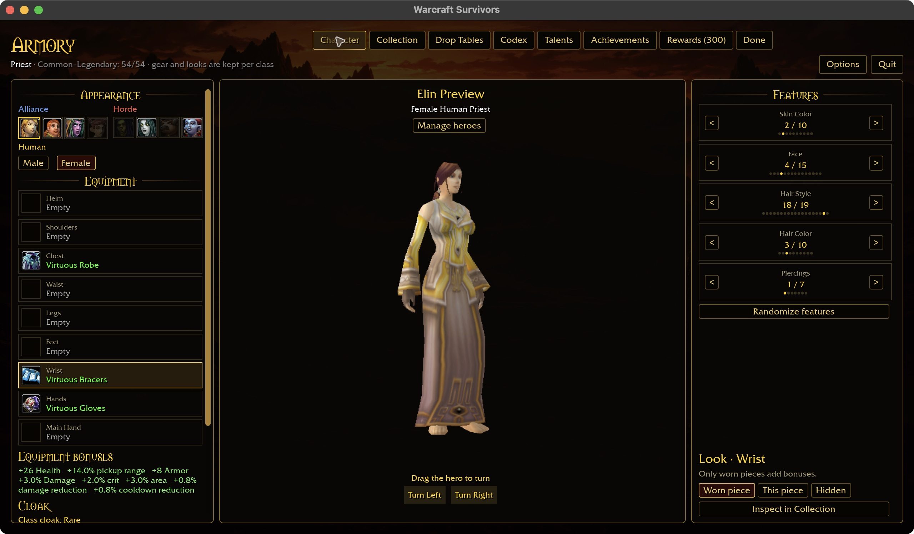
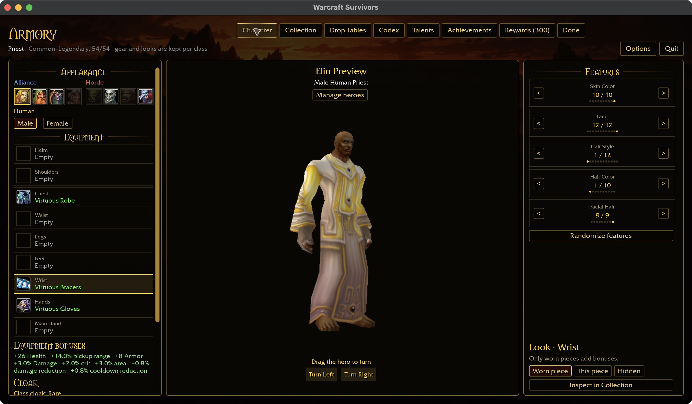

# Collection body-art acceptance — 2026-10-30

The Collection audit now checks the armor overlays selected by the same
`equip_blits` plan used by character rendering, for both male and female bodies.
It checks each piece alone so other equipped layers cannot conceal a missing
asset. Resolution follows the compositor: first decodable unisex texture, then
the corresponding sex-specific texture. Missing or corrupt candidates are
reported with item, display, inventory, sex and layer. The repair below is explicit.

```sh
cargo run -p survivors-audit -- wow-data/Data --collection
```

The initial raw-source audit supplied 746 distinct decoded body textures and
passed 645 of 646 unique display/inventory/sex checks. All nine classes retain their
54 named ordinary cells and 17 supplemental identities; Priest initially had one
body-art review gap: **Virtuous Robe**, item 22083, display 34633, inventory 20, male lower arm.
The referenced `Robe_DungeonPriest_A_02Gold_Sleeve_AL_U.blp` and `_M.blp` are absent
from `Item/TextureComponents/ArmLowerTexture/`. The `_F.blp` exists and decodes.
The chain also lists both male and female upper-arm sleeves, plus a unisex bracer
texture. The native comparison below establishes the chosen sleeve fallback.

The initial audit established a source-art asymmetry, **not yet proof of a rendering defect**.
The compositor already skips an unavailable layer, as it does for the original
source data. The native follow-up below checks this robe alone and with matching wrist/glove
pieces before applying a Survivors-specific repair.

The initial audit deliberately failed while this review gap remained. The code tests cover
candidate precedence, fallback after decode failure, total-failure diagnostics and
inventory-to-compositor slots. This does not validate head/shoulder/held meshes,
combined-layer ordering, body fit, attachment alignment or Windows rendering.
No new rendered screenshot is claimed for this asset-decoding checkpoint.

Initial audit checkpoint validation: the eight-package scoped formatting, Clippy and test gate passes
with 31 optional-addon skips (`/tmp/collection-body-check.log`). After the final
variant-count deduplication, audit-only all-target Clippy and all 16 tests pass
again; the final collection run retains precisely the one gap above. These are
source/asset checks, not native or Windows visual acceptance.

## Native comparison and scoped repair

The production Armory page at 1280×720 shows the male robe's flared lower cuffs
painted as skin when the robe is worn alone. The female version has fabric cuffs.
Equipping Virtuous Bracers and Gloves covers the male gap, which explains why
full outfits can conceal the missing sleeve asset.

Survivors now tries the robe's existing female lower-sleeve texture only after
its exact male candidate fails to read/decode. Existing unisex and male textures
retain priority. No other item path or female candidate is substituted. This is
an authored appearance repair, not a claim that the original client uses this
fallback. No MPQ data is modified or bundled. The shared native body-compositing
path uses it only with Survivors active and the Survivors UI feature enabled;
ordinary-client runs keep their original behavior. The repaired sleeve follows
the existing layer ordering over bracers; hands still use the selected gloves.

Before, male robe alone:



After, same male robe alone:


Female control before and after:




Matching pieces, before the repair (male and female):





Matching pieces after the repair:



The final collection command passes **646/646 body variants**, 746 decoded body
textures and 498 decoded icons. Its output explicitly identifies this single
Survivors fallback rather than claiming the missing male asset exists. Three
new pure-rule tests cover original priority, successful/failed fallback, disabled
mode and unrelated/female/unisex paths. The native play build took 41.34 seconds.
Native evidence is Human male/female on macOS, menu only, using an isolated fixture
and checkout data. Other races, Windows and attended gameplay remain unverified.

Reproduction uses the `collected` UI fixture with hero 5 (Human Priest), the
`heroes` preview page at 1280×720, and isolated account row
`equipment 4 002000000 000000000` for the robe alone. Change to
`equipment 4 002000220 000000000` for matching bracers and gloves, or equip them
through Collection. Use the page's Male/Female controls for the comparison.
Prepare a new fixture directory and edit its account only while the app is closed;
never replace a player account. The live preview request itself can be edited
while the app runs. The fixture selector's `look` page is the legacy world menu;
`heroes` selects the modern Armory character appearance page used here.

Final repair validation: all eight scoped packages pass formatting, Clippy and
tests, with 31 optional-addon skips (`/tmp/robe-fallback-check-repaired.log`).
The first attempt exhausted disk space; the next exposed incomplete test-object
linkage. Removing obsolete quarantined artifacts and rebuilding only the affected
`benilla-app` test incremental cache resolved both. Shared dependency caches and
the 41-second native play build were retained. No source changes were needed for
that environment repair.

## Attachment asset coverage — 2026-10-30

The same `--collection` command now also checks head, shoulder and held mesh
assets for every ordinary/supplemental collection identity and alternative weapon.
It mirrors `entities/equipment/mod.rs::ensure_item_model`: independent model and
skin basenames; both authored shoulder columns; Weapon/Shield folders; and the
16 helmet suffixes (`Hu`, `Or`, `Dw`, `Ni`, `Sc`, `Ta`, `Gn`, `Tr`, each M/F).
An absent model column is deliberately model-less, including one-sided shoulders.
Clothing remains covered by the separate body-overlay audit.

The checkout passes **1,055 display/inventory attachment variants**, **869 unique
parsed models with render triangles**, and **221 selected decoded textures**.
The model loader supplies embedded texture references; type-2 object batches
require their display-selected skin. Reusing one model never skips another
item's skin. Unused display skin names do not establish a rendered dependency.
Missing geometry, required skins, unreadable files or invalid textures fail the
collection command with item/display context. No game data is modified or copied.

Three regressions cover race/body suffixes, independent shoulder columns and
skin names, inventory directories, legitimate model-less/clothing cases, empty
geometry, missing required skins and different skins on a shared model. All 19
audit tests pass. The retained native build completes in 3.13 seconds.

This closes source-asset coverage for these attachments, **not** attachment
alignment, combined outfits, particles, animation, native race/body previews or
Windows acceptance. Runtime/UI rendering is unchanged; no new screenshot is
claimed. The native screenshots above remain evidence only for their shown cases.

Final verification: the eight-package formatting/Clippy/test gate passes with
31 optional-addon corpus skips. The collection audit has no reported gaps.
