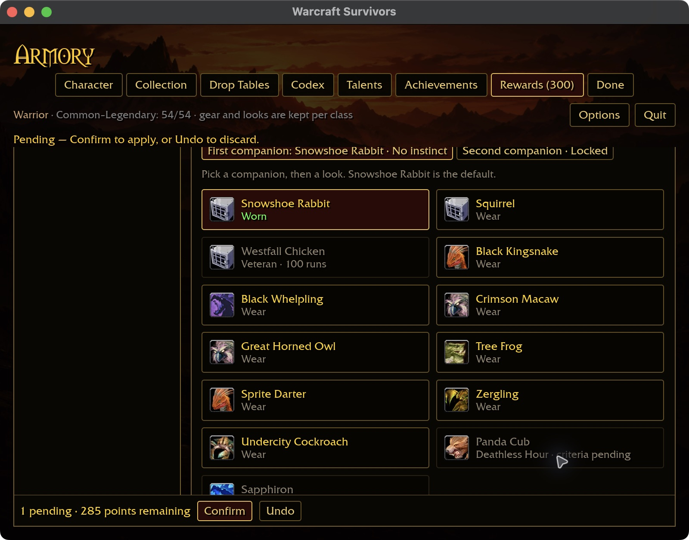
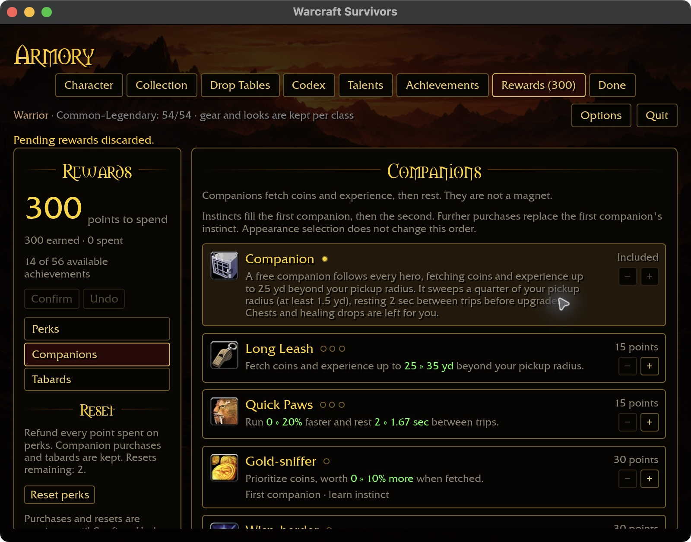
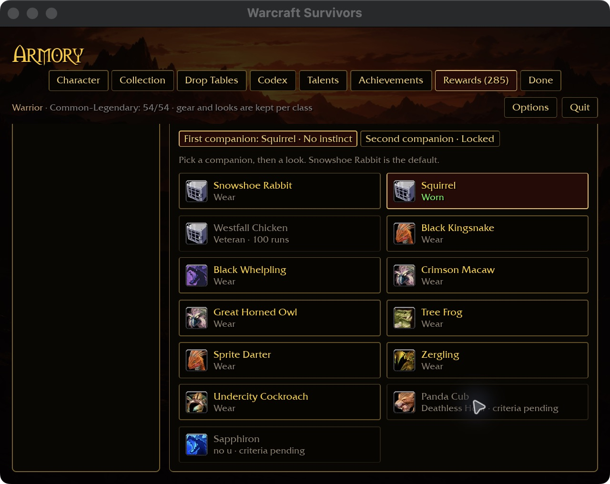
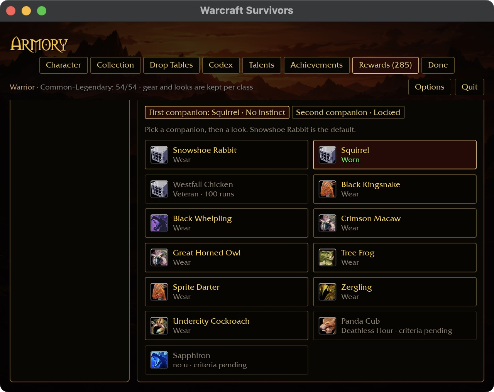
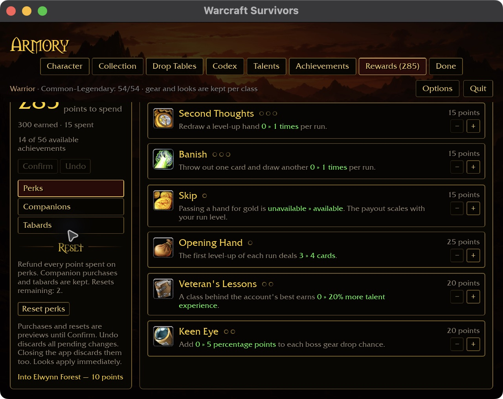

# Companion card readability — 2026-10-30

Reference: `docs/intentions/survivors_rewards_tab_companions.png`.
The reference has two aligned columns with room for each description, icon,
and purchase controls. Native reproduction at 800×600 with 125% requested UI
scale showed fixed two-column cards squeezing the included companion description
into a tall, narrow strip and stretching the adjacent Long Leash card.

The grid now selects one column below 648 logical content pixels: two 320-pixel
reading cards plus their gap. It measures the actual pane with the computed
inverse scale factor. Wider panes retain two equal fractional columns, including
one-column width for the final unpaired card. No purchase, save or fetch rule
changes.

Reusable presets live under `docs/ui-previews/rewards-companions-*.txt`.
The isolated `collected` fixture starts with 300 earned points and one included
companion. This is synthetic UI state, not evidence of earned progression.

## Native evidence and limits

- 800×600 / requested 125%: the included companion description fits across four
  lines instead of a tall strip; Long Leash and Quick Paws values stay inline.
- 640×480 / requested 125%, with existing short-window auto-fit: the same cards
  remain single-column and legible.
- 1280×720 / 100%: two equal columns return; Second Companion retains one card's
  width, with Looks below. All seven upgrade cards are visible.

The native build passed in 2m00s. Pointer automation repeatedly returned
`noWindowsAvailable` for the live, capturable window; keyboard attempts did not
produce a visible focus or scroll change. Rebinding and raising the live window
were insufficient. Thus this pass proves rendered layout and live preview
resizing only, not purchase, scrolling, restart or Windows acceptance. No combat
was started. The preview process stopped after app quit, and the temporary launcher was restored.

The eight-package scoped gate passed formatting, clippy and tests with 31
optional addon-corpus skips. Full landing and platform acceptance remain open.

## Native interaction follow-up — runtime 697c174

A fresh computer-use connection and app launch restored pointer delivery. This
supersedes the earlier pointer/scroll/restart limitation for the cases below;
keyboard End did not visibly move the page and is not counted as acceptance.
The same isolated collected fixture was used, without editing its purchases.

| Action | Observed result |
| --- | --- |
| Preview Long Leash at 800×600 | Rank 1, 285 points, one pending change. |
| Scroll to Looks | Confirm/Undo remain in the fixed bottom bar. |
| Undo from the bottom bar | Rank returns to 0 and currency returns to 300. |
| Repeat and Confirm from the bottom bar | Rewards confirmed; 285 points and rank 1 retained. |
| Select Squirrel | Worn label and first-companion label update immediately; currency stays 285. |
| Preview Quick Paws, then quit without confirming | Draft shows rank 1 and 270 points before quit. |
| Restart at 640×480 | Long Leash rank 1, Quick Paws rank 0, 285 points, no pending draft. |
| Scroll to Looks after restart | Squirrel remains worn; all appearances including Panda Cub and Sapphiron are reachable with pending criteria labels. |

Saved fixture row after restart: `pets 1 1 0 0 0 1 0 0` (one companion,
leash rank 1, paws rank 0, Squirrel in the first appearance slot).
Eight unedited screenshots are stored in
`docs/images/screenshots/2026-10-30-companion-interactions/`.

No runtime code changed; the source gate at 697c174 remains the applicable
validation (eight scoped packages, 31 optional-addon skips). No new gate run is
claimed. Windows, physical controllers, keyboard paging, all purchase combinations
and attended companion gameplay remain open. The app was quit and launcher restored.

## Rewards keyboard paging — 2026-10-30

The follow-up's inert End key was a missing runtime connection: the reading-key
handler accepted Achievements and Codex only. Rewards now selects its own scroll
surface for Page Up/Down (80% of the visible logical height) and Home/End. Positions
are bounded to content, and settings, typing and card-preview guards still apply.
This supersedes the earlier keyboard-paging limitation for the cases below.

The real navigation-system regression now includes Rewards alongside the two
existing reading pages. It checks all four keys, both boundaries, clamping of an
out-of-range starting offset, overlay guards, unrelated scroll preservation and
absence of button activation. The focused regression passed.

Native 640×480 / requested 125% (with existing short-window auto-fit): End reaches
the complete Companion appearance list; Page Up returns toward upgrades; Home
returns to the currency/first card; Page Down advances through the middle cards.
End also works on Perks and Tabards. Currency remained 285, Long Leash rank 1,
Squirrel worn, and no tabard worn. Six unedited captures are retained under
`docs/images/screenshots/2026-10-30-rewards-paging/`.

Native incremental build: 1m15s. The preview was quit and temporary launcher
restored. Windows, physical controllers and broad reward/gameplay acceptance
remain open.

The Rewards paging source passes the eight-package scoped formatting, clippy
and test gate with 31 optional addon-data skips. Full landing gates remain open.
