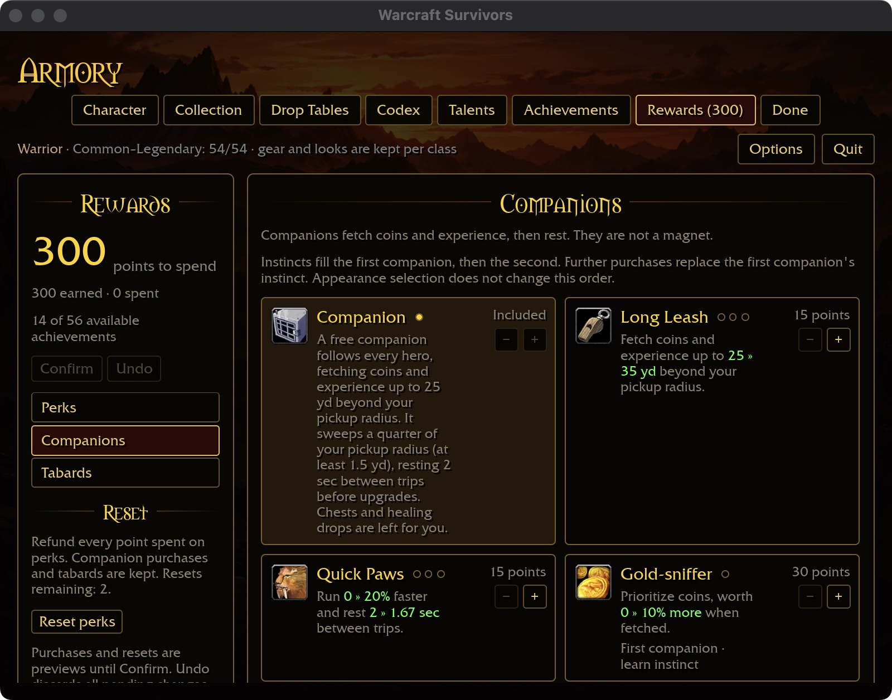
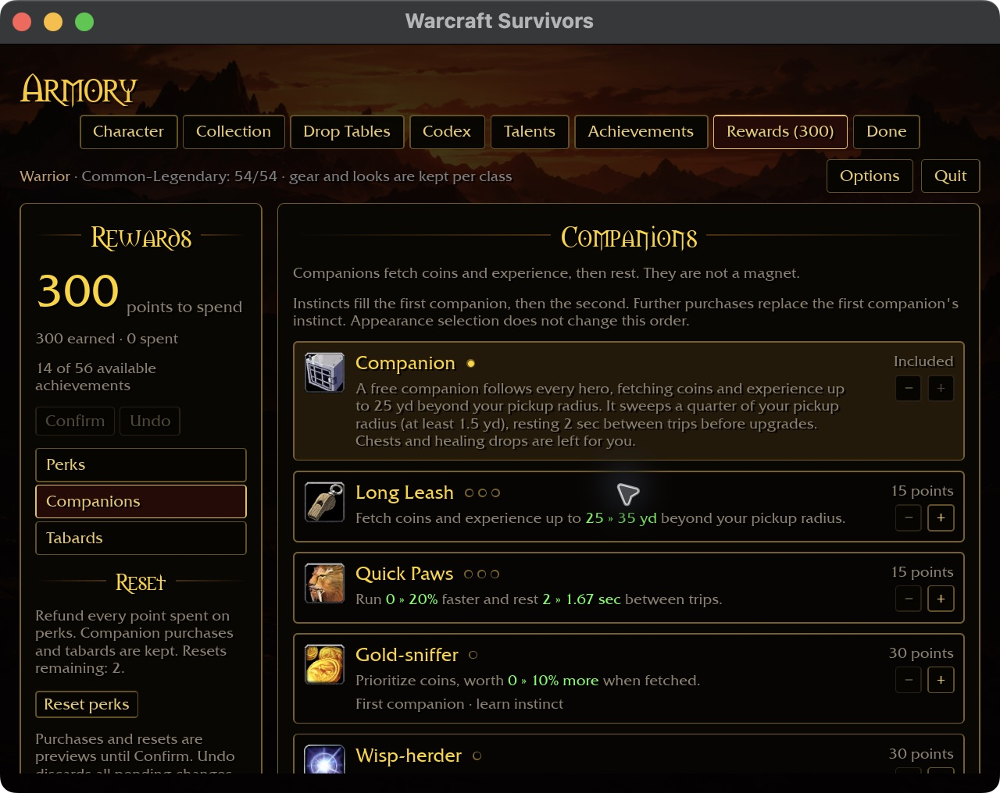
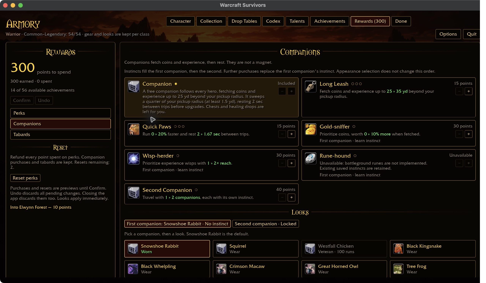

# Companion card readability — 2026-10-30

Reference: `docs/intentions/survivors_rewards_tab_companions.png`.
The reference has two aligned columns with room for each description, icon,
and purchase controls. Native reproduction at 800×600 with 125% requested UI
scale showed fixed two-column cards squeezing the included companion description
into a tall, narrow strip and stretching the adjacent Long Leash card.

The grid now selects one column below 648 logical content pixels: two 320-pixel
reading cards plus their gap. It measures the actual pane with the computed
inverse scale factor. Wider panes retain two equal fractional columns, including
one-column width for the final unpaired card. No purchase, save or fetch rule
changes.

Reusable presets live under `docs/ui-previews/rewards-companions-*.txt`.
The isolated `collected` fixture starts with 300 earned points and one included
companion. This is synthetic UI state, not evidence of earned progression.

## Native evidence and limits

- 800×600 / requested 125%: the included companion description fits across four
  lines instead of a tall strip; Long Leash and Quick Paws values stay inline.
- 640×480 / requested 125%, with existing short-window auto-fit: the same cards
  remain single-column and legible.
- 1280×720 / 100%: two equal columns return; Second Companion retains one card's
  width, with Looks below. All seven upgrade cards are visible.

The native build passed in 2m00s. Pointer automation repeatedly returned
`noWindowsAvailable` for the live, capturable window; keyboard attempts did not
produce a visible focus or scroll change. Rebinding and raising the live window
were insufficient. Thus this pass proves rendered layout and live preview
resizing only, not purchase, scrolling, restart or Windows acceptance. No combat
was started. The preview process stopped after app quit, and the temporary launcher was restored.

The eight-package scoped gate passed formatting, clippy and tests with 31
optional addon-corpus skips. Full landing and platform acceptance remain open.
