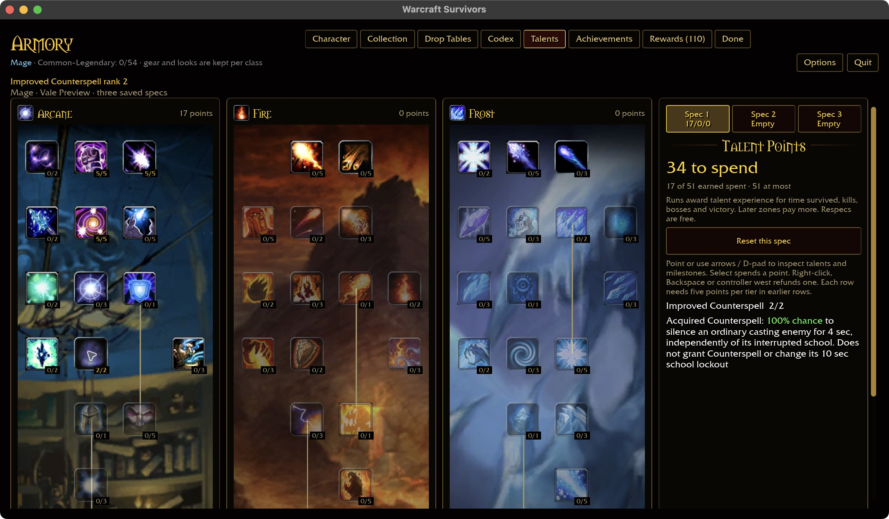
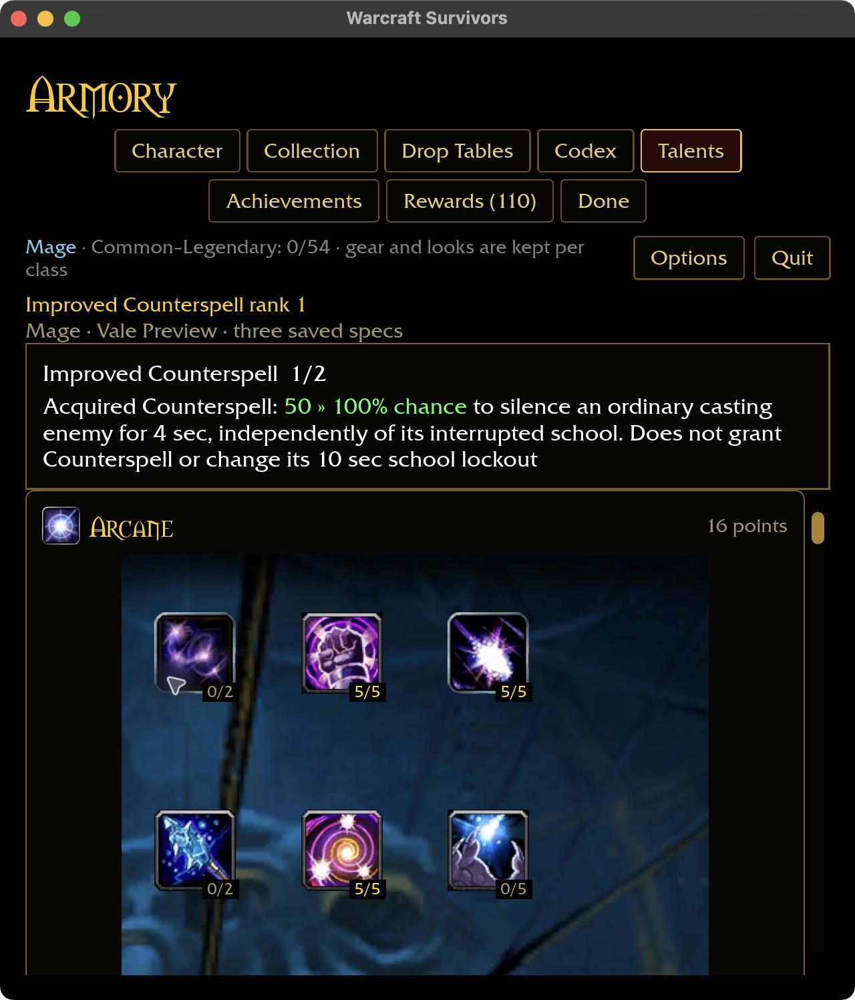
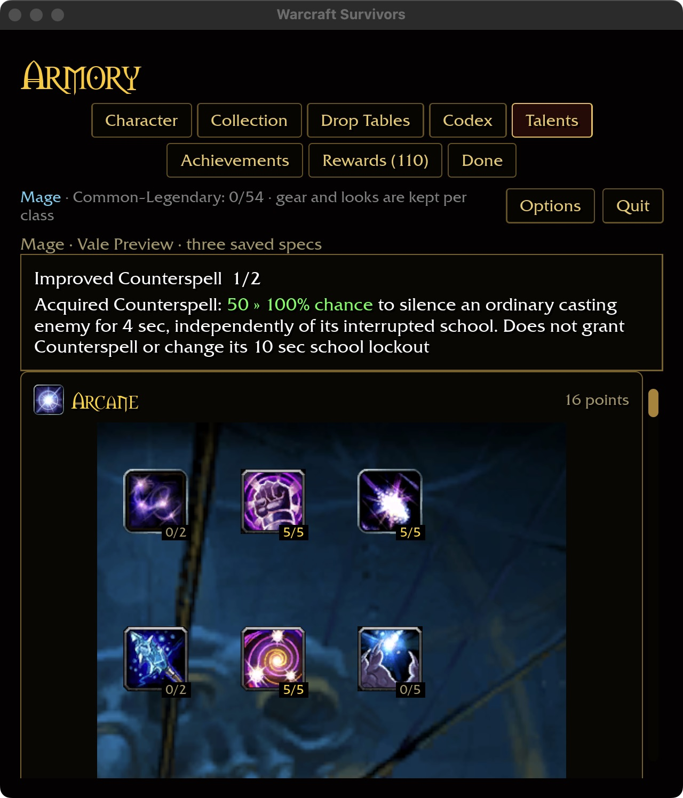
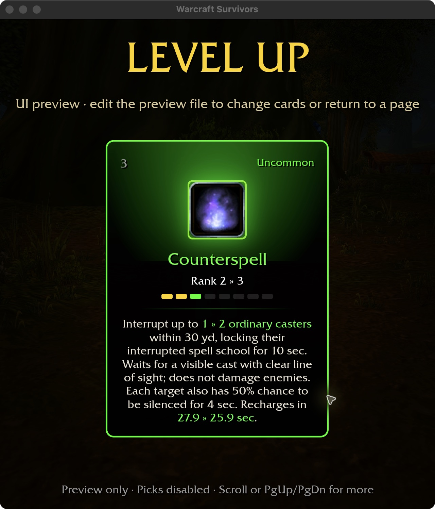

# Counterspell and Improved Counterspell

## Implementation — 2026-10-30

Installed evidence recorded in the [Mage dependency audit](MAGE-TALENT-DEPENDENCIES.md)
identifies Counterspell 2139: 30-yard range, 30-second recovery and a 10-second
interrupted-school lockout. Talent node 88 supplies a separate 50/100% chance
of four-second silence (18469). The [enemy casting lifecycle](ENEMY-CASTING.md)
now provides the actual consumer, initially on Darkeye Bonecaster.

Counterspell joins the Mage level-up pool and occupies an ordinary ability slot.
Training Improved Counterspell does not grant the spell. The automatic cast waits
for a live, visible ordinary enemy with an unfinished cast, within range and clear
line of sight. No eligible target leaves the ability ready. Bosses are excluded
by this initial Survivors policy. Targets follow the existing nearest-enemy order.

A successful interrupt cancels only the current cast and locks its school for
10 seconds. The talent rolls silence independently: it can cancel an
interrupt-immune cast without granting a school lockout. A failed silence roll
on that eligible target still spends the cooldown. Silence blocks all magic
schools for four seconds. Counterspell deals no damage, cannot crit, and creates
no damage-proc hits. Cancellation and spell visuals use the installed identities.

Ability ranks use the existing recovery reduction and target growth at ranks
3/5/7; single-target bonus stats also add targets. Neither rank nor damage/critical
talents lengthen the fixed lockout or silence. This is an explicit Survivors
adaptation rather than a claim of vanilla multi-target Counterspell.

## Validation

- All 347 shared-rule tests pass. Actual runtime tests cover ranks 0–2 and
  deterministic proc seeds, cancellation before enemy damage, school/silence
  independence, interrupt immunity, invalid targets, obstruction, concealment,
  boss exclusion, deadline ties, and non-damaging rank parameters.
- Catalog-backed account regression includes legal purchase, rank cap,
  independent specs, reload and refund for node 88. Inline text regression checks
  shared units, green changed spans and absence of redundant rank prose.
- Native macOS preview: purchase 0→1→2, refund to 1, inspect at 1280×720 and
  640×720 / 125%, close/restart and retain rank 1. The isolated save records
  `0:88:1`, with 16 spent points and the other two specs empty.
- Production card preview shows new acquisition and ranks 1→2 / 2→3, including
  the saved 50% silence chance. Compact cards scroll to the third choice.
  Captures are original native JPEGs; previews do not run combat or grant cards.
- The six-package scoped formatting/Clippy/test gate passes, with 31 optional
  addon-corpus skips.
- Native play build passed in 1m15s. Existing `block` compatibility and macOS
  large-unwind-table linker warnings remain. Attended combat visuals, Windows,
  physical-controller interaction and broader caster rosters remain unverified.

Fresh source-data coverage: 39/49 Mage, 312/432 overall, all 81 milestone
descriptions. The remaining 120 definitions and the full acceptance contract
remain open. Definition counts alone do not prove playable completion.

