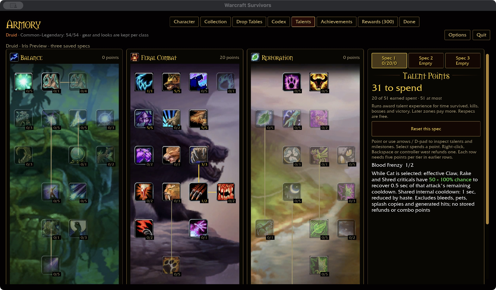
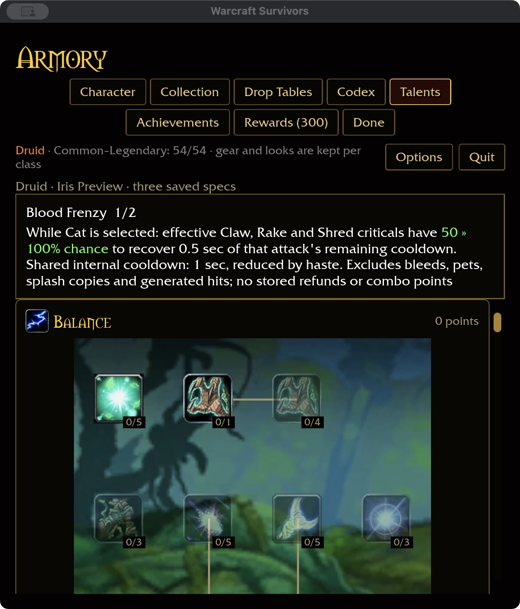

# Blood Frenzy — 2026-11-04

Checkout talent 800 has two ranks (16952/16954), requires Sharpened Claws 3,
and gives Cat combo builders a 50/100% chance to generate an additional combo
point through spell 16953. Reproduce the checkout-only reference with
`cargo run -p survivors-audit -- wow-data/Data --talent-evidence 800`. The approved combat policy removes combo points.

## Survivors conversion

With permanent Cat selected, effective original Claw, Rake and Shred criticals
have a 50/100% chance to remove 0.5 seconds from the triggering attack's remaining
recovery. Claw uses the automatic attack timer; Rake and Shred use their own
slotted timers. This grants no ability and changes neither starting nor maximum
slot limits.

The attacks share a one-second internal cooldown reduced by haste. Refunds clamp
at ready and cannot be stored. Ready attacks do not spend the proc. Noncritical
or zero-damage hits, pets, reflection, generated hits, splash copies and periodic
damage do not qualify. Pounce has no direct damage and is excluded. Other forms
cannot use Blood Frenzy. The common feral recovery clock also retains Primal
Fury's Bear rules; the permanent forms remain mutually exclusive.

## Validation status

380 core tests pass, including Cat form/source/rank scope, failed rolls, shared
haste timing, no banked refunds and green inline chance previews. Added runtime
regressions pass for Claw/Rake/Shred timer ownership, rejected hit origins and
ready/clamped recovery. The ten-package scoped format/Clippy/test gate passes with 31 optional addon-corpus skips. Build storage is 63.13 GiB, within budget.

Native and WebGPU builds pass (the existing native unwind-table warning and six
WebGPU warnings remain). Five native screenshots verify rank 1→2 purchase,
2→1 refund, an empty independent Spec 2, and saved Spec 1 restart at 640×720 /
125% scale; the wide layout is 1280×720 / 100%. Only an isolated fixture was used.
The installed-data audit reports Druid 43/47, overall 337/432 and 81/81 milestone
descriptions. Definition counts do not prove full combat acceptance.

Attended combat, balance, Windows/controller and full landing acceptance remain open.
