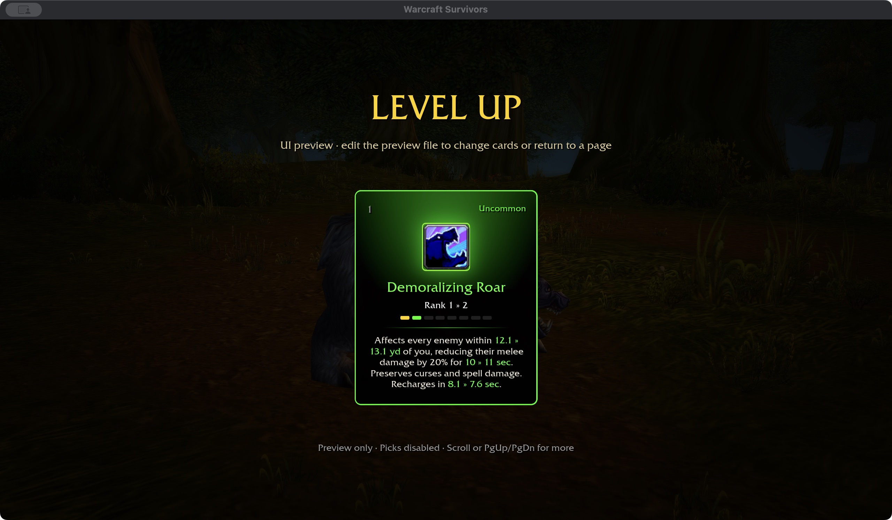
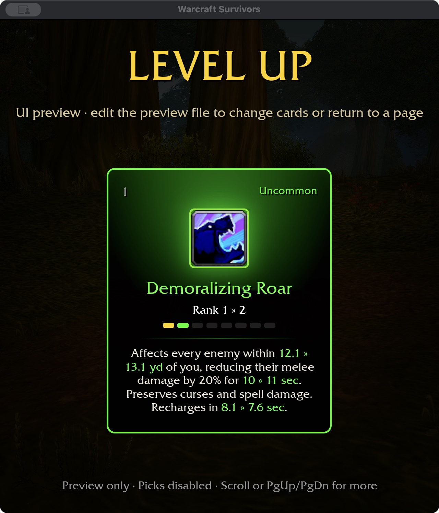

# Demoralizing Roar — 2026-11-04

Checkout spell 99 is Bear/Dire Bear-only, with a ten-yard radius and a 30-second
melee attack-power reduction. Talent 795 has five ranks: +8% Roar strength and
+3% Ferocious Bite damage per rank. Reproduce using checkout `wow-data/Data`:
`survivors-audit --spell-evidence 99` and `--talent-evidence 795`.

## Survivors behavior

Permanent Bear can acquire Roar through normal level-up cards: 20% melee-contact
reduction for ten seconds, a ten-yard radius and twelve-second base recovery.
These are authored tuning values. It grants no starting slot, deals no damage,
and cannot trigger damaging-hit procs. It continues while moving and leaves
other attack timers independent. Area expands one player-centered radius;
extra targets never duplicate it. It waits for a visible target with clear line
of sight before spending full recovery; empty/blocked casts use the shared
0.2-second retry delay. Bosses can be affected.

Each enemy owns an independent Roar component. Stronger applications replace;
equal strength refreshes without shortening; weaker applications cannot replace
or prolong a stronger effect. Expired effects accept new weaker applications,
and stale delayed applications cannot revive old reductions.

The reduction applies only to physical contacts, including attacks redirected
to a combat pet or totem. Flat Curse of Weakness and general weakening apply
before Roar; target mitigation applies afterward. Roar does not replace a curse
or reduce Frostbolt damage. It deliberately does not use the existing general
weakening effect, which also affects magic damage.

Ferocity, Feral Instinct, Furor and Natural Shapeshifter affect recovery. Rank
upgrades increase radius/duration and shorten recovery; cards show these changes
inline in green without a zero-damage sentence.

## Validation

384 core tests and the final ten-package format/Clippy/test gate pass, with 31
optional addon-corpus skips. Runtime tests verify Bear-only casting, zero damage,
boss eligibility, hero/pet/totem contacts, curse preservation, unchanged Frostbolt,
area scaling, wall obstruction and the shared 0.2-second empty-target retry.
Test-only initializer and retry-delay assertions were corrected during validation.
Build storage is 64.01 GiB, within budget.

Native and WebGPU builds pass (existing native unwind-table warning and six
WebGPU warnings). Selected Bear-build cards fit 1280×720 / 100% and 640×720 /
125%. Captures use an isolated saved fixture and do not establish attended
random-card acquisition. Normal player saves were not changed.

Attended acquisition/combat/balance, Windows/controller and full landing acceptance
remain open. No additional talent definition is counted by this ability addition.

## Next: Feral Aggression

Node 795 remains provisional until both scoped effects are implemented and
verified. Roar strength increases are relative: at 20% base reduction, five
ranks should yield 28%, not 60%. Bite damage increases by 3% per rank, multiplying
existing physical modifiers. Neither effect grants an ability. Both changing
values need green inline previews, all-rank and refund tests, actual consumers,
and native purchase/refund/spec/restart captures.
