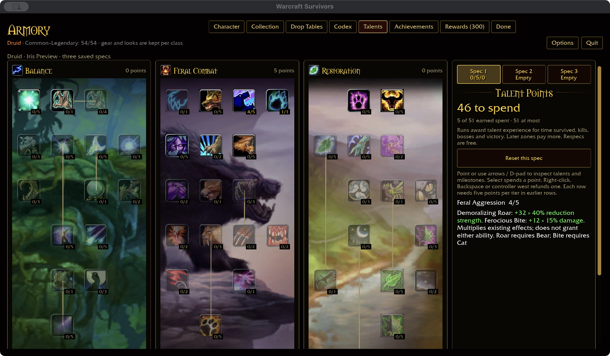
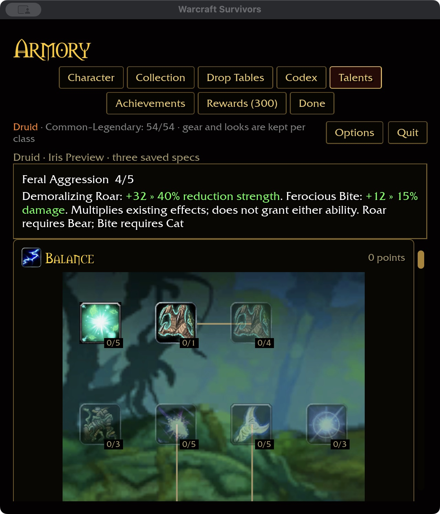

# Feral Aggression — 2026-11-04

Checkout talent 795, spells 16858–16862, specifies five ranks of +8% Demoralizing
Roar strength and +3% Ferocious Bite damage. Read-only source evidence:
`survivors-audit wow-data/Data --talent-evidence 795`.

## Behavior

Roar's melee-contact reduction scales relatively: 20% becomes 21.6/23.2/24.8/
26.4/28%. Duration, radius, recovery, curses and magic damage are unchanged.
Bite damage gains 3/6/9/12/15%, multiplying Natural Weapons and other damage
bonuses. Other attacks, healing and pets receive neither bonus.

The talent grants neither ability: Roar remains acquired and Bear-only; Bite
remains acquired and Cat-only. Starting kits and automatic attacks are unchanged.
Both numbers use green inline current-to-next previews, with one unit per value.

## Validation

386 core tests and the ten-package format/Clippy/test gate pass (31 optional
addon-corpus skips). Runtime coverage verifies every rank reaches actual Bite
hits and Roar settlement. Core checks cover imported rank clamping, class and
ability scope, refunds, multiplicative damage, unchanged unlocks/starters, and
both preview spans.

Native and WebGPU builds pass with existing warnings. An isolated native fixture
verifies purchase to rank five, refund to four, independent spec two, return to
spec one and persistence after restart. Wide 1280×720 / 100% and compact 640×720 /
125% previews fit and show both green inline values. Normal player saves were
not changed. The initial preview request incorrectly included a cards-only
profile field; removing it restored the intended talent view.

Definition coverage is Druid 44/47, overall 338/432, with all 81 milestone
descriptions. The legacy `--talents` catalog check reports the three authored
forms absent from vanilla; the current `--talent-coverage` audit accounts for
these intentionally separate forms. Build storage is 64.23 GiB.

Attended combat/balance, Windows/controller and full landing acceptance remain
open. Druid's remaining provisional nodes are Feral Charge (804), Faerie Fire
(Feral) (1162), and Improved Enrage (826). Charge's manual-mobility versus
automatic-ability choice remains unresolved.
