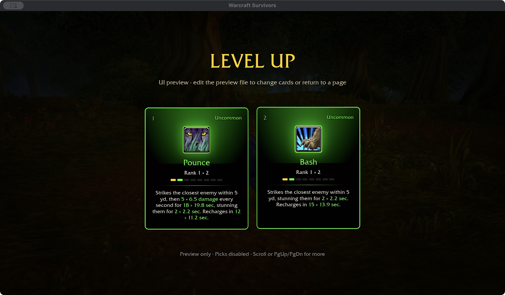
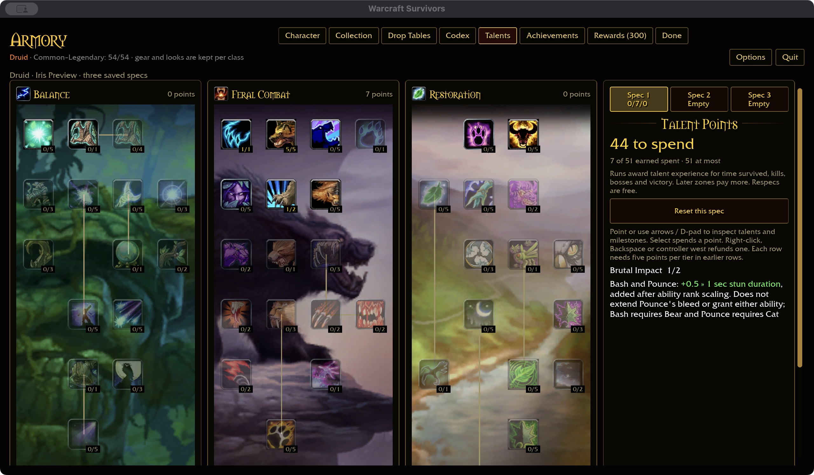
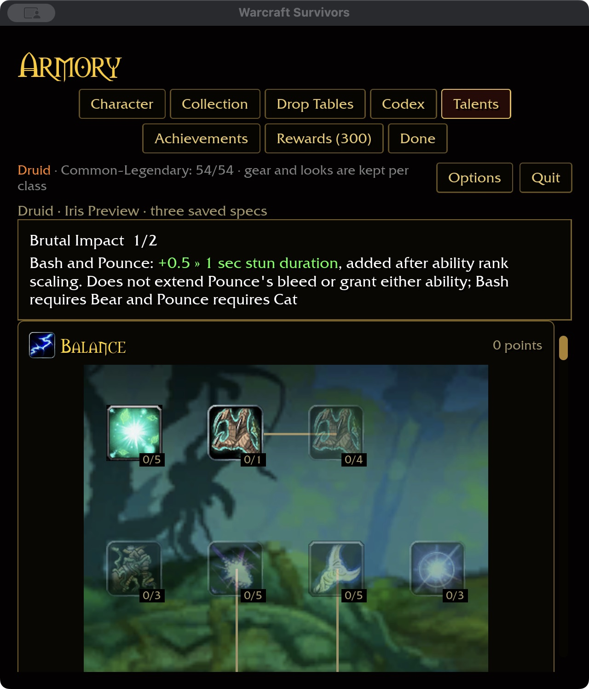

# Bash, Pounce and Brutal Impact — 2026-11-04

Checkout `wow-data/Data` evidence: Bash 5211 has a two-second Bear stun,
five-yard range and 60-second category recovery. Pounce 9005 has a two-second
Cat stun and triggers bleed 9007 (18 seconds, 15 damage per three-second tick).
Brutal Impact 797 (16940/16941) adds 0.5/1 second to both stuns.
These raw data facts are distinct from the authored Survivors tuning below.

## Authored behavior

Bash is acquired only in permanent Bear; Pounce only in permanent Cat. Both use
normal level-up cards and a normal ability slot, without adding starting abilities.
They have five-yard base reach, scaled by area, and ordinary extra-target support.
Bash recovers in 15 seconds; Pounce in 12 seconds. Both stun for two seconds and
deal no initial damage. Pounce adds five physical damage per second for 18 seconds.
Ability ranks scale recovery, bleed damage/duration and stun time through existing
rules. No stealth, positional, combo-point or resource gate applies.

Brutal Impact adds 0.5 seconds per rank (two ranks) after ability-rank stun scaling.
It does not grant abilities or extend the bleed. Existing boss control reduction
applies to the final stun: 30% of ordinary duration. Feral Instinct, Furor and
Natural Shapeshifter reduce recovery; Natural Weapons scales Pounce's bleed.
Ferocity/Savage Fury retain their original four-attack scope. Neither zero-damage
impact nor bleed can trigger Omen; bleeds do not critically strike.

## Verification

Core coverage checks form eligibility, acquisition versus starter slots, rank
clamping, unrelated controls, bleed duration isolation and green inline upgrades.
Runtime coverage exercises actual casts and hit settlement across every permanent
form, ordinary enemies and bosses, with separate Pounce bleed state and no initial
health loss. The existing enemy control path prevents movement/attacks and cancels
casting while stunned; this checkpoint does not claim attended combat validation.

The production UI preview shows both cards together for comparison; mutually
exclusive forms prevent that combined hand in ordinary acquisition. The cards use
baseline stats, while the talent fixture has Cat, Ferocity 5 and Brutal Impact 1.

377 core tests pass. Native macOS and WebGPU builds pass; native linking reports
an oversized unwind-table warning, and WebGPU retains six existing warnings.
Cards fit at 1280×720 / 100% and 640×720 / 125%. Talent purchase 1→2,
refund 2→1 and saved compact restart pass. Six milestone screenshots are retained.
Build output is 62.36 GiB, within budget. Fresh installed-data coverage is Druid
41/47 and overall 335/432, with all 81 milestone descriptions.

The first runtime check caught two test-fixture assumptions: Bash needed Bear in
the recovery matrix, and settlement already advances the new bleed by one 0.1-second
frame. Both expectations were corrected. The final ten-package format/Clippy/test gate
passes with 31 optional addon-corpus skips. Rustdoc link validation passes
(150 benign unresolved-link warnings).
Attended combat/acquisition/balance, Windows/controller and full landing
acceptance remain open.
