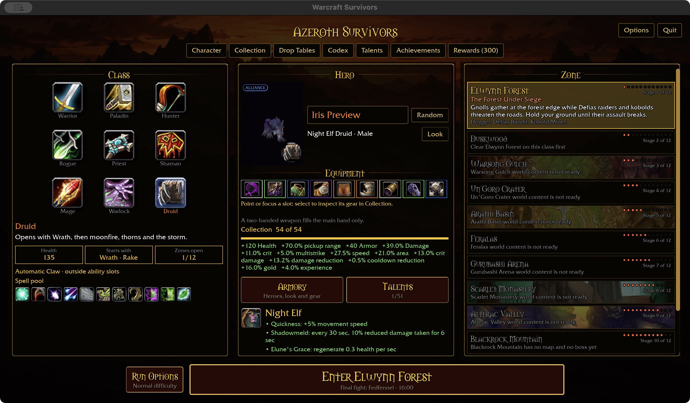
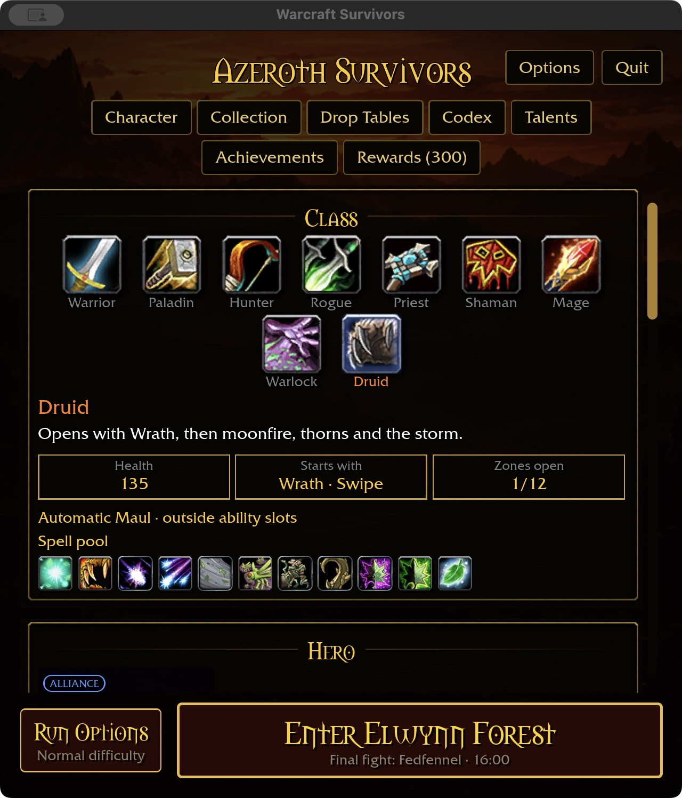
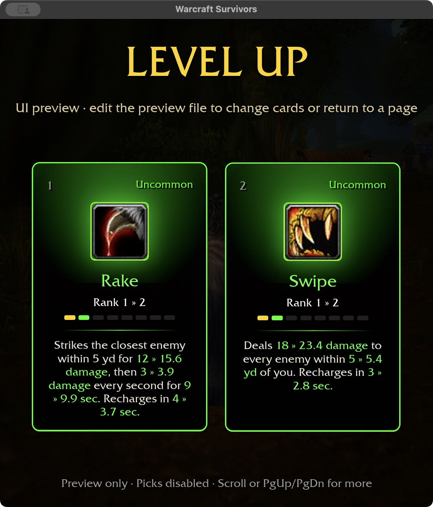

# Permanent feral starting kits — 2026-11-02

Cat now starts with Wrath + Rake; Bear starts with Wrath + Swipe. Automatic
Claw/Maul remain outside the six ability slots. Each build uses two starting
slots, retains the ordinary Druid spell pool, and grants only its compatible
feral attack. Refunding the form removes that grant from future runs.

Rake deals 12 normalized physical damage plus 3 damage per second for 9 seconds,
with 5-yard reach and 4-second recovery. Swipe deals 18 physical damage to every
enemy in one player-centered 5-yard radius, with 3-second recovery. These are
initial balance values. Existing rank, damage, area and recovery scaling applies;
extra targets never duplicate Swipe's area. Neither requires resources, stealth,
combo points or positional attacks. Green inline upgrades show changed values.

Starter pools, draft/chest upgrades, pick validation and casting respect form
eligibility. Existing talent-gated spells also stay hidden from the starter pool
until learned. Saves retain their existing form/spec encoding.

## Visual acceptance

Native isolated-fixture checks covered Cat purchase, refund, repurchase, switching
to saved Bear spec, and Bear persistence after restarting at 640×720 with 125%
requested UI scale. Wide views use 1280×720 at 100%. The simultaneous Rake/Swipe
card display is an explicit UI preview, not a legal dual-form build.

## Validation and limits

Core tests cover class/form eligibility, conflicting selections, refunds, retained
spell pools and starting counts. ECS tests exercise actual casts, direct damage,
Rake bleed provenance, area scaling and extra-target behavior. Offer tests reject
incompatible acquisitions and upgrades. Validation passes: 365 core tests; the ten-package scoped format/Clippy/test gate
(31 optional addon-corpus tests skipped); native play build (30.24 seconds) and
WebGPU check (8 seconds, six existing warnings). A radius regression initially
retained the empty-target retry cooldown; resetting it isolates radius behavior.
The final scoped run passed with local mock-network socket access. This is not
a full landing-gate run. Storage: 60.83 GiB generated, 1228.81 GiB free.
Markdown links and whitespace checks pass.

This adds ability consumers, not named talent definitions. Ferocity, Savage Fury,
Shred/Bash and broader feral talent integration remain unfinished. Existing
explicitly automatic-only talent effects are unchanged. Attended combat, Windows,
controller and collision acceptance remain open; this checkpoint does not claim
new line-of-sight or navigation behavior.
