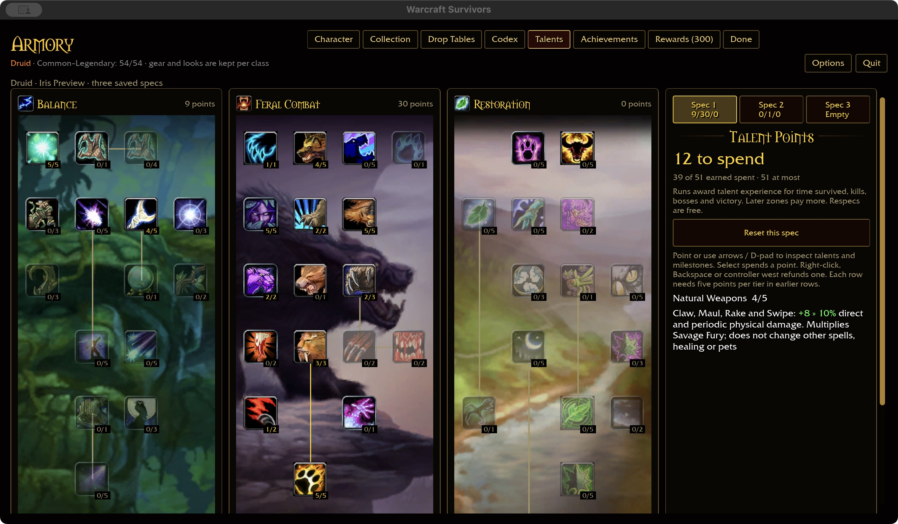
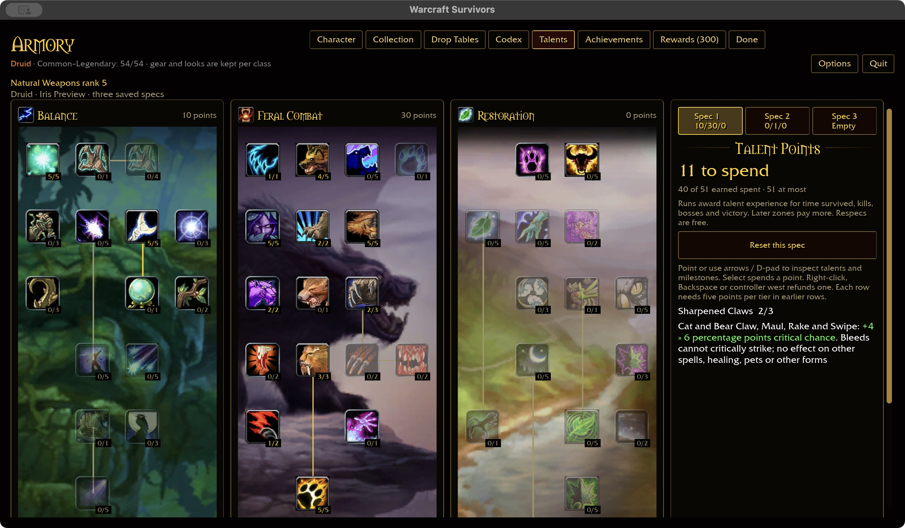
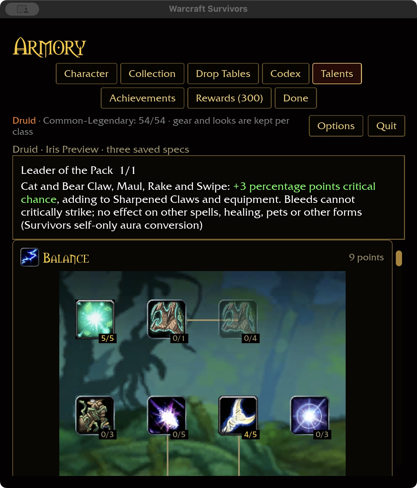

# Feral physical talent integration — 2026-11-02

Natural Weapons now applies its 2% per rank to Claw, Maul, Rake and Swipe,
including Rake's bleed. It multiplies Savage Fury: maximum ranks produce
1.10 × 1.20 = 1.32 damage before other bonuses.

Sharpened Claws adds 2 percentage points of direct critical chance per rank;
Leader of the Pack adds 3 points. Both now include Rake and Swipe alongside
Claw/Maul, require a permanent Cat/Bear form, and add to equipment. Rake's bleed
remains noncritical. Other spells, healing, pets and caster forms are unchanged.
Leader retains the existing self-only conversion; party sharing is not claimed.
Predatory Strikes remains explicitly automatic-only and needs separate review.

The checkout's installed talent rows 791/798/809 were rechecked: physical damage,
feral critical chance, and melee/ranged party critical aura respectively. This
checkpoint extends existing Survivors consumers rather than adding definitions.
Saved IDs, ranks, slot limits and independent attack timers are unchanged.

## Acceptance

367 core tests pass. Core coverage includes every class/catalog ability, rank
clamping, refunds, form restrictions and inline values. Runtime tests exercise
Rake/Swipe with deterministic rolls around each individual and combined critical
threshold, actual damage settlement, multiplicative damage stacking and a
separately stored noncritical bleed. Existing automatic-attack tests also pass.
The ten-package scoped format/Clippy/test gate passes (31 optional addon-corpus
skips); native build takes 14.94 seconds and WebGPU check 7.19 seconds (six existing
warnings). This is not the full landing gate or attended combat acceptance.

Native macOS validation purchased all three talents, refunded all three, restored
Leader, switched to an independent Bear spec, and restarted the trained Cat spec
at 640×720 / 125% requested scale. Saved ranks: Natural Weapons 4, Sharpened Claws 2,
Leader 1. Wide captures use 1280×720 / 100%. Earlier-row fixture points were seeded
in an isolated account; player saves were not modified. Windows/controller and
attended combat remain open. Definition coverage stays Druid 33/47, total 327/432.

