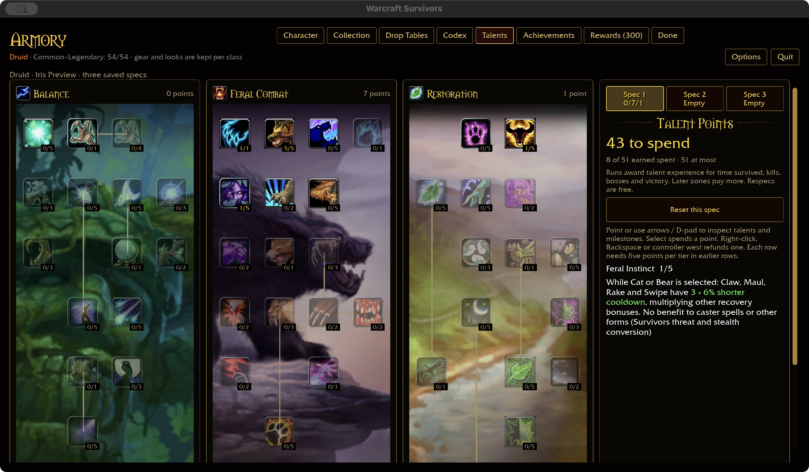
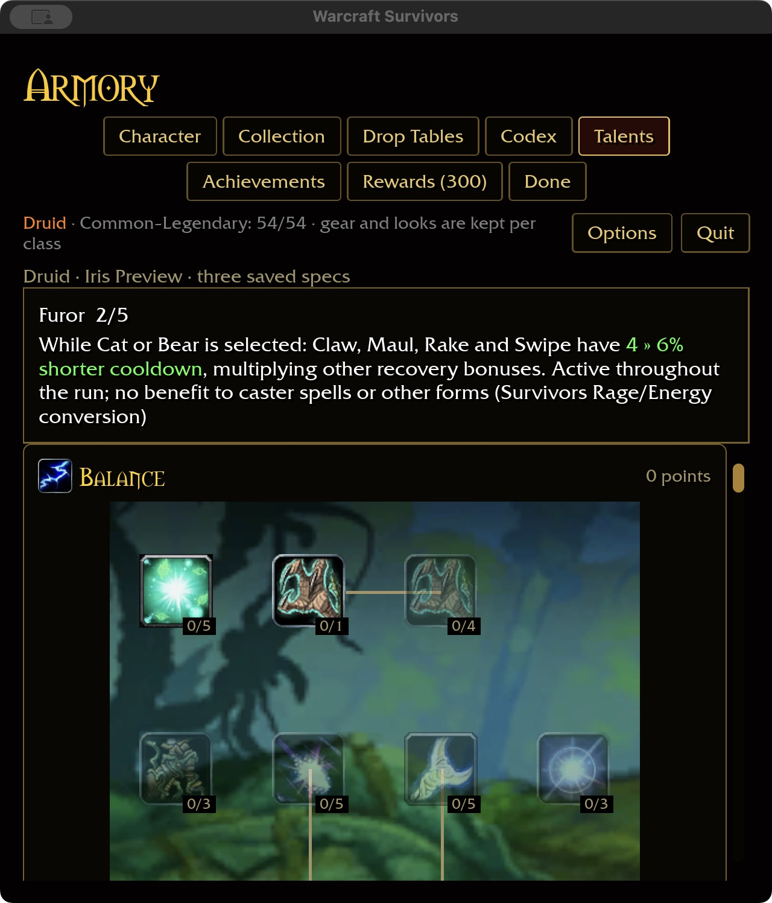

# Permanent feral recovery — 2026-11-03

Only this checkout's `wow-data/Data` supplied reference evidence:
`survivors-audit --talent-evidence 799` and `--talent-evidence 822`.
Feral Instinct has five ranks of Bear threat plus Prowl concealment. Furor has
five ranks of a form-entry chance to grant Rage/Energy. Those resource/stealth
mechanics conflict with the approved permanent-form, resource-free policy.

## Authored Survivors rules

- Feral Instinct (799): 3% shorter Claw/Maul/Rake/Swipe cooldown per rank, five ranks.
- Furor (822): 2% shorter cooldown for those attacks per rank, five ranks.
- Both require permanent Cat or Bear. No form, Moonkin, Tree of Life, other
  classes, caster/healing spells and pets receive no benefit.
- The two bonuses multiply one another, Ferocity, Natural Shapeshifter and haste.
  They change neither damage nor bleed duration. Existing ability eligibility
  continues to enforce Rake/Cat and Swipe/Bear.
- Furor remains active throughout the run instead of supplying an entry-only
  resource. Neither talent grants an ability or occupies a slot. Refunds use the
  same saved node IDs; removing the form disables the bonuses.

These are authored conversions and tuning, not reproductions of the original
resource percentages. No stealth, threat, Rage or Energy system is added.

## Acceptance

374 shared-core tests pass. Added matrix coverage checks every class/catalog key,
all forms, absent forms, rank clamping, refunds, unchanged non-recovery effects
and stacking. Runtime coverage uses real spell and automatic-attack timers with
Renown/equipment recovery. Native macOS verifies Feral Instinct purchase 1→2 and refund 2→1, Furor purchase
1→2, separate empty Spec 2, and saved rank 2 after restart at 640×720 / 125%.
Wide captures use 1280×720 / 100%. An isolated fixture seeds prerequisites and
Cat; normal player saves are untouched.

Native play build passes in 19.54 seconds; WebGPU passes with six existing
warnings. Fresh installed-data coverage is Druid 38/47, total 332/432, with all
81 milestone descriptions. These are definitions, not full gameplay acceptance.
Windows/controller, attended combat/balance and the full landing gate remain open.

Final ten-package scoped formatting/Clippy/test gate passes, with 31 optional
addon-corpus skips. Build storage is 61.41 GiB, within budget.
