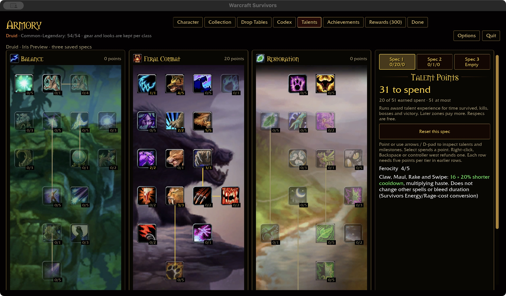
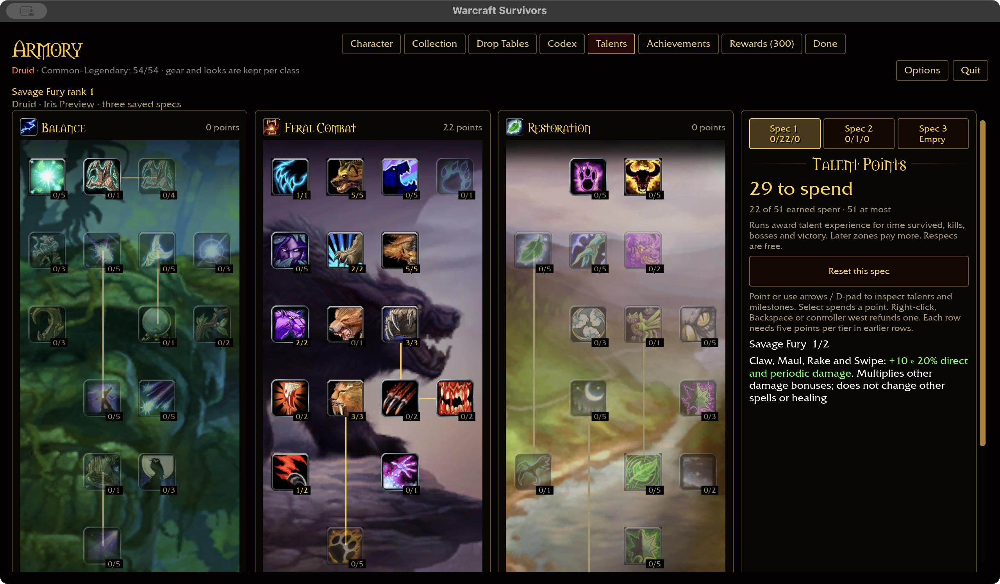
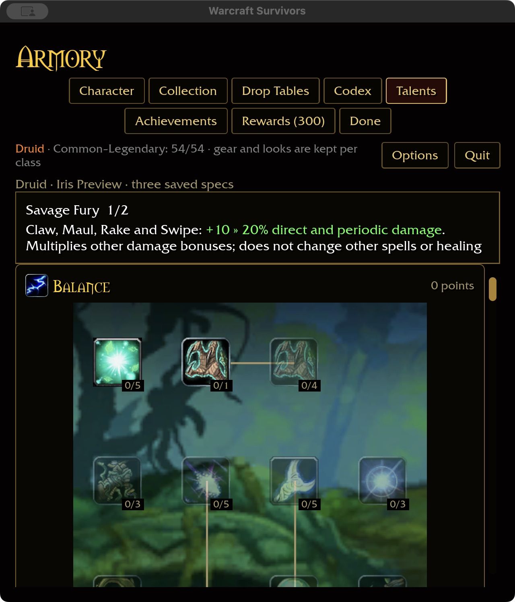

# Ferocity and Savage Fury — 2026-11-02

Ferocity (796, five ranks) now reduces Claw, Maul, Rake and Swipe recovery by
4% per rank, up to 20%. This is authored Survivors tuning for the approved
Energy/Rage-to-recovery conversion. It multiplies haste and each attack's other
existing recovery factors; it does not shorten Rake's bleed duration.

Savage Fury (805, two ranks) increases those four attacks' direct and periodic
damage by 10/20%, multiplying existing bonuses. Rake's bleed stays independently
noncritical. Automatic attacks remain outside slots; no resources or attacks are
added. Other abilities, healing and pets are unaffected. The independent Feral
10-point Thorns milestone retains its 15% cooldown benefit with a corrected label.

Installed evidence was rechecked using the checkout's data and `survivors-audit
--talent-evidence 796` / `805`: five resource-cost ranks and two 10/20% damage
ranks, both scoped to these four attacks. Raw resource costs are reference inputs,
not Survivors recovery values. Named definitions replace the old generic
provisional bonuses; existing saved IDs/ranks remain valid.

## Acceptance evidence

Core tests cover every class and catalog ability, rank clamping, refunds and
inline green values. ECS tests run real casts and damage settlement for Cat/Bear,
automatic/slotted attacks, haste, and ranks 0/1/2/5/255. They verify direct damage,
Rake's separately stored bleed, and actual recovery timers. Automatic attacks now
consume the cast effect's recovery multiplier, which was previously unused.

Native macOS checks purchased Ferocity 4→5 and Savage Fury 0→1→2, refunded them
to 4/1, switched to an independent Bear spec with neither trained, then restored
the Cat spec and restarted at 640×720 / 125% requested scale. The saved ranks
persisted; green inline values were readable. Wide captures use 1280×720 / 100%.
The isolated fixture seeds earlier-row points only; it does not modify player saves.

Fresh audit coverage: Druid 33/47, overall 327/432, 81/81 milestone descriptions.
This is definition coverage, not full class acceptance. Windows/controller and
attended combat remain open. Natural Weapons, Sharpened Claws, Leader of the Pack
and Predatory Strikes retain their explicitly automatic-only scope; other feral
attacks and their redesigned dependencies remain unfinished.

Validation: 366 core rules pass, native build passes (24.60 seconds, then 14.26
seconds after the milestone-label correction), and final WebGPU check passes
(8.50 seconds, six existing warnings). Native screenshots preceded only that
unrelated label correction; all pictured talent behavior is unchanged. Storage
is 60.68 GiB generated with 1228.59 GiB free. Markdown links and whitespace pass.
The initial runtime test fixture used a nonexistent haste field; it was corrected
to exercise the existing Renown haste stat before runtime validation.

Final ten-package scoped formatting/Clippy/tests pass with local mock-network
access; 31 optional addon-corpus tests are skipped. The full landing gate has
not been rerun for this checkpoint.
