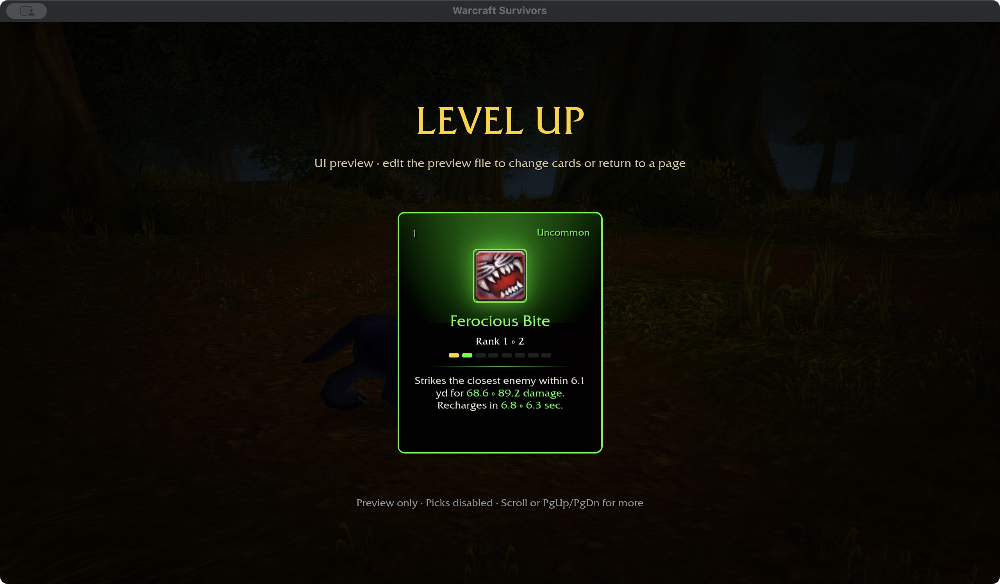
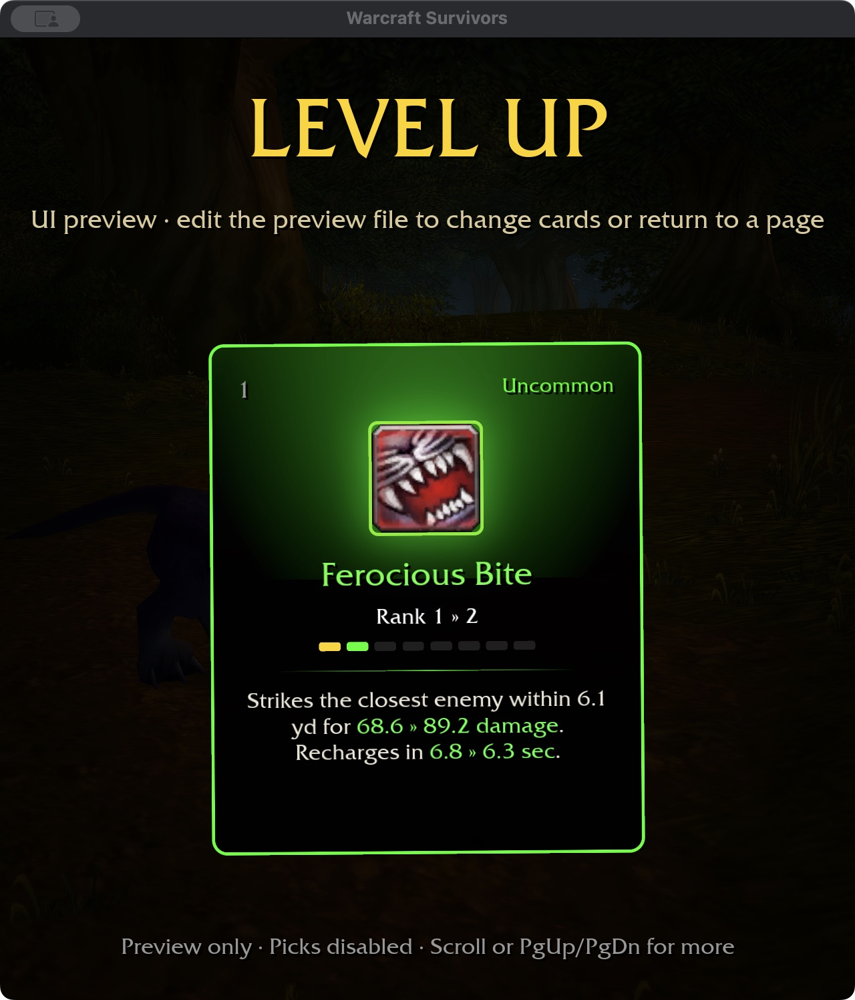

# Ferocious Bite — 2026-11-04

Checkout spell 22568 is a Cat-only, five-yard physical attack whose original
formula consumes combo points and extra Energy. Reproduce the evidence with
`cargo run -p survivors-audit -- wow-data/Data --spell-evidence 22568`.
The approved combat policy removes both requirements and normalizes melee damage.

## Survivors design

Bite deals 48 normalized physical damage at rank one, with eight-second recovery
and five-yard reach. These are authored tuning values, not an imported weapon or
combo formula. Permanent Cat can acquire it through normal level-up cards within
the six-slot limit. It does not add a starting ability: Cat retains Wrath + Rake
and automatic Claw outside slots. It fires while moving, independently of other
attacks, without a facing, stealth, resource or preceding-hit requirement.
Area increases melee reach; extra targets use single-target attack selection.

Natural Weapons, Sharpened Claws, Leader of the Pack, Feral Instinct, Furor,
Natural Shapeshifter and Omen include Bite. Ferocity, Savage Fury and Improved
Shred keep their named scopes. Predatory Strikes stays automatic-only. Blood
Frenzy remains restricted to Claw/Rake/Shred builders; Bite does not trigger it.
There is no bleed. Feral Aggression remains provisional until both Bite and
[Demoralizing Roar](DRUID-DEMORALIZING-ROAR.md), and the talent's scoped consumers, are implemented and verified.

## Acceptance

381 core tests and runtime regressions pass, covering form eligibility, starter exclusion, normalized
physical damage/critical training, recovery scope, either-side targeting and
area-scaled reach. Native and WebGPU builds pass (existing native unwind-table and six WebGPU
warnings remain). Native selected-build cards fit 1280×720 / 100% and 640×720 /
125%, using saved Cat talents and equipment. Inline green damage and recovery
upgrades and the checkout spell icon are visible. These preview cards do not
prove attended random-card acquisition. The final ten-package format/Clippy/test gate passes with 31 optional addon-corpus skips.
The new independence test accounts for normal frame ticking; the earlier zero-time
fixture skipped casting and was corrected. Build storage is 63.29 GiB.

No additional talent definition is counted complete by adding this ability.
Attended acquisition/combat/balance and Windows/controller acceptance remain open.
