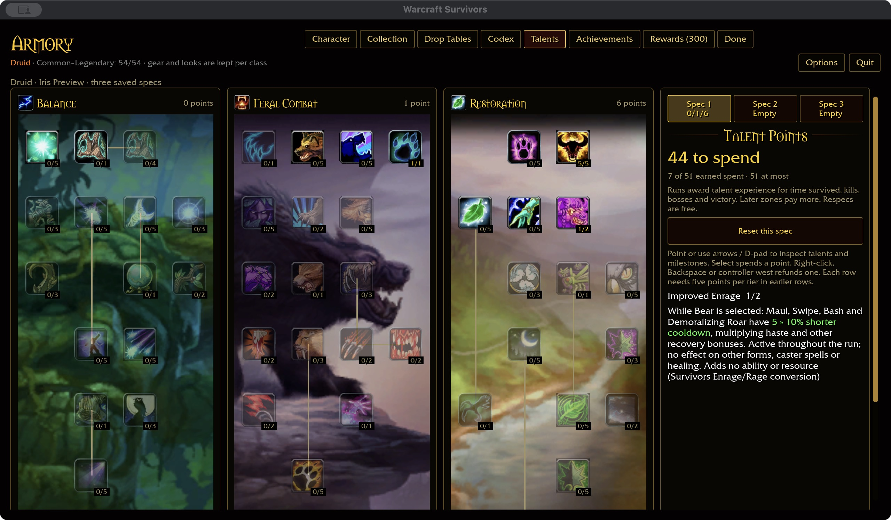
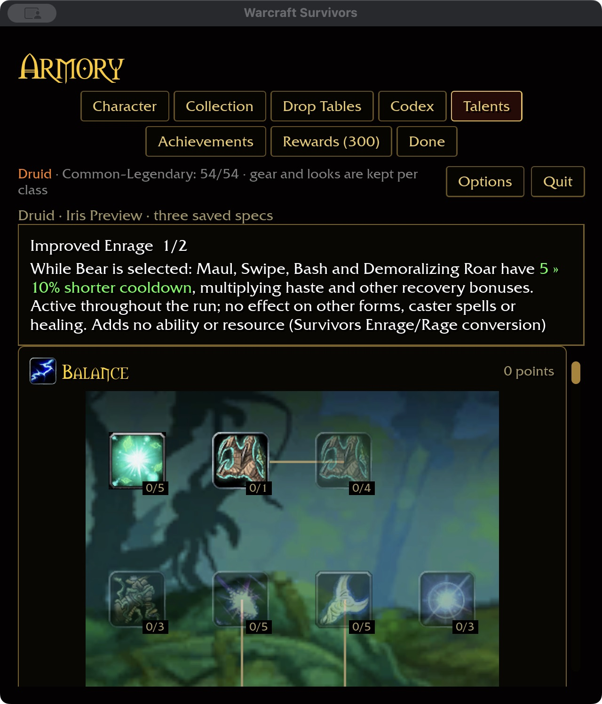

# Improved Enrage — 2026-11-04

Checkout node 826 (spells 17079/17082) triggers 17080/17081 for 5/10 immediate
Rage from Enrage. The approved combat policy replaces Rage with recovery and
permanent forms replace temporary form cycling.

## Survivors conversion

Two ranks give 5/10% shorter Maul, Swipe, Bash and Demoralizing Roar recovery
while permanent Bear is selected. This authored tuning multiplies haste and
existing recovery bonuses. It does not affect Cat, Moonkin, Tree, caster spells,
healing, damage, control duration or the number of starting/slotted abilities.
There is no Enrage activation, armor penalty, resource meter or form-entry refund.

This is a passive progression conversion, not an implementation of the reference
Enrage lifecycle. It remains in Restoration's original tree position, allowing
Bear builds to invest there. Refunding or switching to an untrained spec removes
its effect. The preview shows the current-to-next recovery reduction inline.

## Validation

387 core tests pass. The conversion is checked across every class, permanent
form, capped rank and ability, including refunds and unchanged starter/unlock
rules. Runtime tests cover each affected cast and automatic Maul under stacked
recovery and haste. The ten-package format/Clippy/test gate passes, with 31 optional addon-corpus
skips. Native and WebGPU builds pass with existing warnings. Build storage is
64.35 GiB.

An isolated native save verifies purchase to rank two, refund to one, independent
spec two, return to spec one and restart persistence. Wide 1280×720 / 100% and
compact 640×720 / 125% captures retain readable green inline recovery values.
Normal player saves were not changed.

Definition coverage is Druid 45/47, overall 339/432, with all 81 milestone
descriptions. Attended combat/balance, Windows/controller and full landing
acceptance remain open. Faerie Fire and Feral Charge are the remaining provisional
Druid nodes; Charge's movement choice remains pending.
