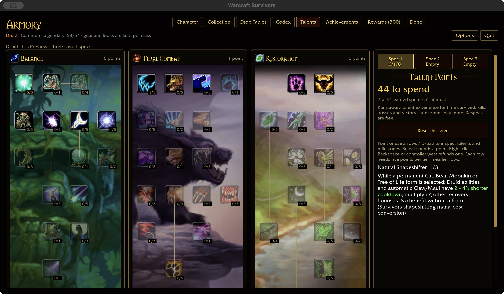
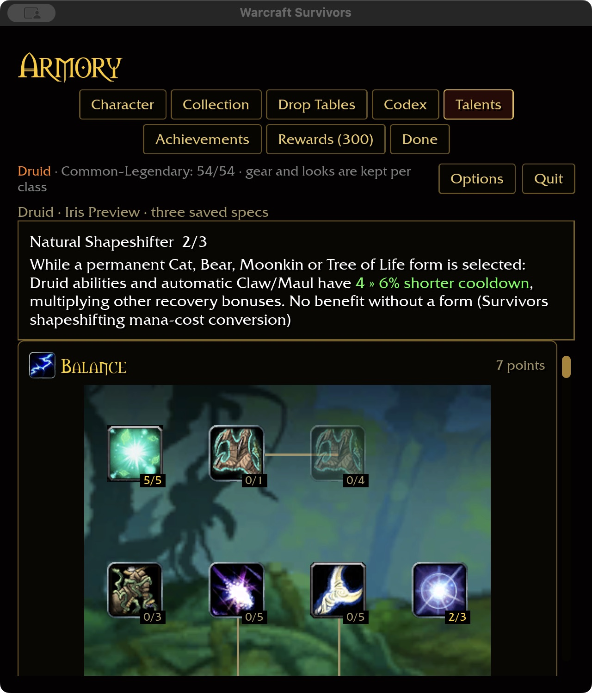

# Natural Shapeshifter — 2026-11-03

Installed node 781 (spells 16833–16835) reduces shapeshifting mana costs by
10/20/30%. Survivors uses permanent forms and no mana. Under the approved
cost-to-recovery policy, this node now grants 2% shorter Druid ability and
automatic Claw/Maul cooldowns per rank, capped at 6%, while any permanent form
is selected. This is authored tuning, not the installed percentage.

The shared core checks the actual form snapshot and Druid ability catalog.
No form, conflicting forms, other classes, unrelated spells and pets gain no
benefit. This multiplies haste and other recovery talents. Refunds preserve
saved talent identity; refunding the form disables the benefit without removing
the ranks. Existing run snapshots remain independent of menu edits.

## Acceptance

369 core tests pass, including every class/catalog key, all four forms, no form,
rank clamping, refunds and composition with Reflection/Ferocity. Runtime tests
exercise actual spell and automatic-attack timers with equipment and Renown
recovery, including no-form and non-feral cases. The ten-package scoped
format/Clippy/test gate passes with 31 optional addon-corpus skips. Native build
passes in 18.23 seconds; WebGPU check passes with six existing warnings.

Native macOS checks purchase ranks two/three, refund to two, refund and restore
Cat, switch to an independent empty spec, then restart at 640×720 / 125% scale.
Saved ranks are Natural Shapeshifter two, Cat one. Wide captures use
1280×720 / 100%. Prerequisite ranks were seeded in an isolated fixture; normal
player saves are untouched. Screenshots began November 2 and completed November 3.
Definition coverage reaches Druid 35/47 and total 329/432, with 81 milestone
descriptions. Windows/controller, attended combat and full landing-gate acceptance
remain open. Build output is 61.31 GiB, within the storage budget.

