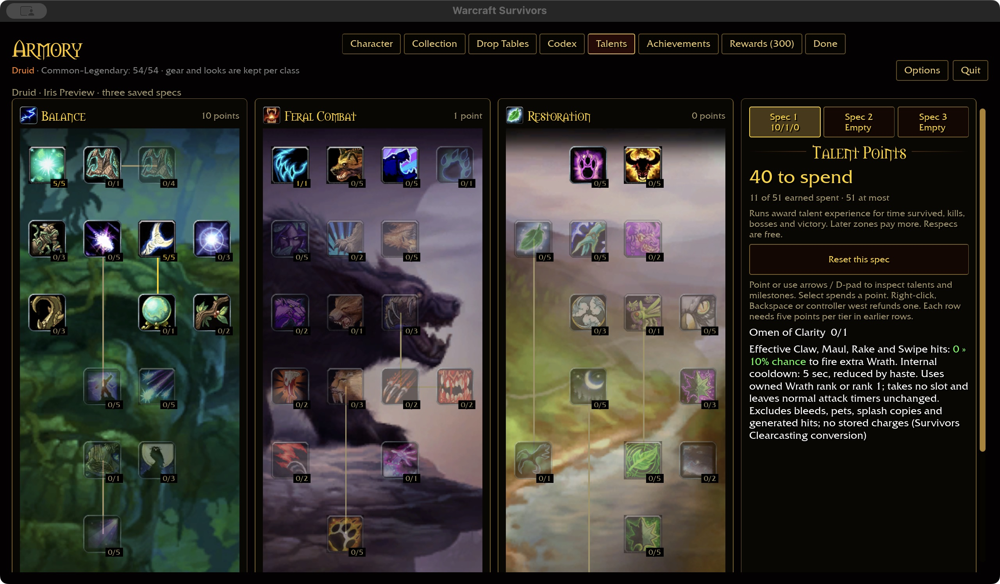
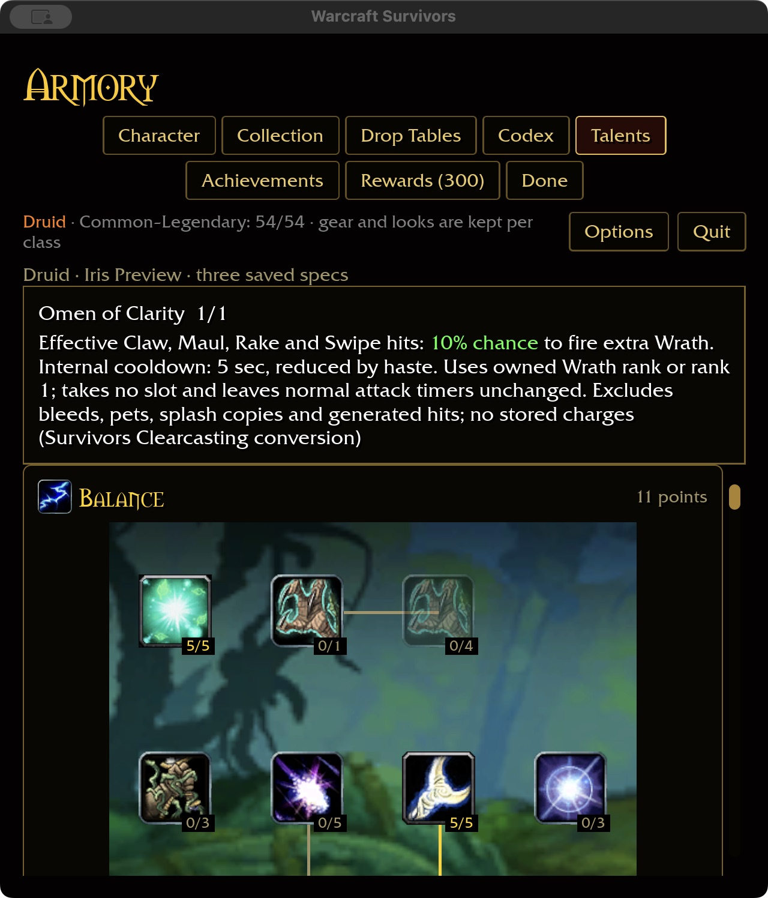

# Omen of Clarity — 2026-11-03

Installed node 788 (spell 16864) requires Natural Weapons 5 and supplies a
melee-triggered Clearcasting resource discount. The outer DBC proc chance is
not evidence of an effective per-hit percentage. Survivors has no resource cost
and the approved Clearcasting direction calls for a visible extra ability.
Reference: checkout-only `survivors-audit wow-data/Data --talent-evidence 788`.

## Authored conversion

Effective original Claw, Maul, Rake and Swipe hits have a 10% chance to queue one
extra Wrath. Its independent five-second internal cooldown scales with haste.
The extra cast uses owned Wrath rank, or rank one if absent, and normal damage,
critical, range and target-count scaling. It occupies no slot and does not reset
ordinary attack timers. Wrath is the Druid's Nature-themed replacement; the
percentage and cooldown are authored tuning, not vanilla values.

Damage must actually remove health. Bleeds, splash copies, pets, reflections,
foreign spells and generated hits cannot trigger Omen. Generated Wrath is
explicitly attributed as triggered hero damage. A pending cast dispatches once
on the next active cast update, selecting living in-range visible targets;
missing targets consume it rather than storing charges. Paused casts wait.
The run owns the clock, so resetting the run resets its cooldown and queue.

## Acceptance

375 core tests pass, including class/source filtering, rank clamping, haste,
refund, pending-charge exclusion and invalid input handling. Native macOS verifies purchase, refund, repurchase, independent empty Spec 2,
and saved 1/1 after restart at 640×720 / 125%. Wide captures use 1280×720 / 100%.
Prerequisites were seeded in an isolated fixture; normal saves remain untouched.

Attended proc/projectile appearance, combat balance, Windows/controller and the
full landing gate remain open. Definition coverage is not full talent acceptance.

Runtime checks pass for actual hit → extra cast → damage settlement, generated-hit
recursion exclusion, owned-rank scaling with all six slots occupied, unchanged
normal cooldowns, pet/reflection/zero-damage rejection, pause and target loss.
The shared dispatch retains Mage Clearcasting regression coverage.
Native build passes in 1m52s; WebGPU passes with six existing warnings. Fresh
installed-data coverage is Druid 39/47, total 333/432, with 81 milestone descriptions.

Final ten-package scoped format/Clippy/test gate passes with 31 optional
addon-corpus skips. Storage is 61.77 GiB, within budget.
