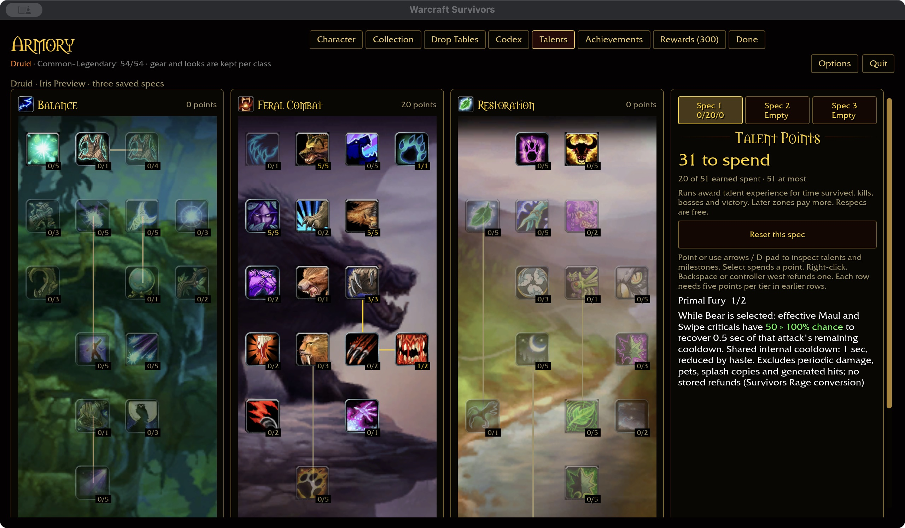
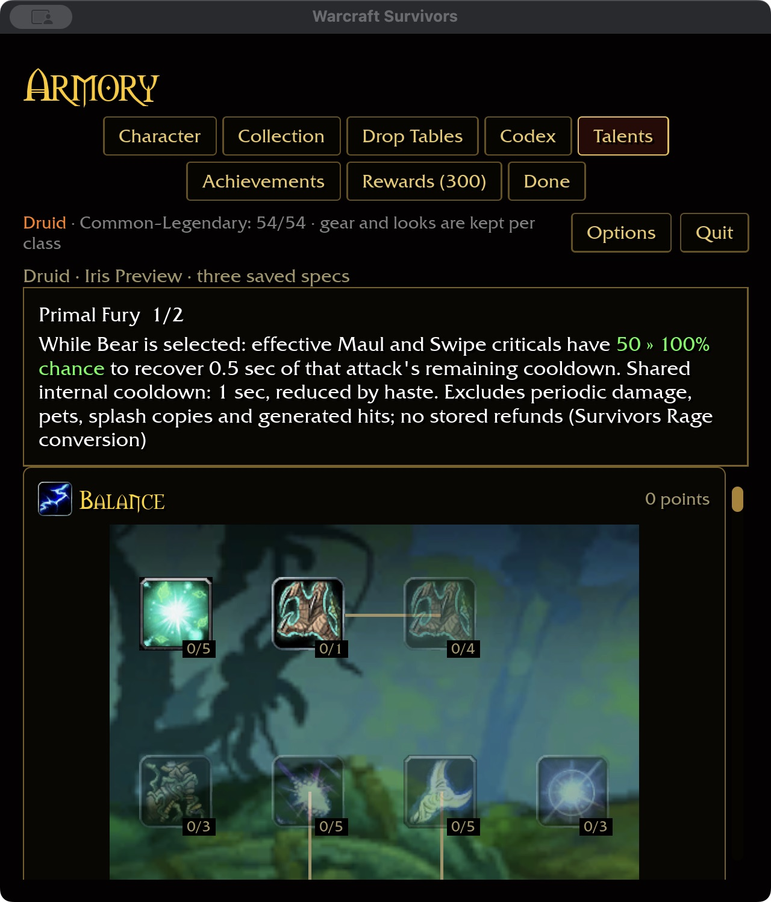

# Primal Fury — 2026-11-04

Checkout talent 801 has two ranks (16958/16961), requires Sharpened Claws 3,
and gives Bear/Dire Bear criticals a 50/100% chance to trigger five Rage through
16959. Evidence comes from `survivors-audit --talent-evidence 801` and
`--spell-evidence 16959`, using only checkout `wow-data/Data`.

## Survivors conversion

While permanent Bear is selected, effective original Maul and Swipe critical hits
have a 50/100% chance to remove 0.5 seconds from that attack's remaining recovery.
Maul reduces its automatic-attack timer; Swipe reduces only its slotted timer.
There is no Rage pool, new ability grant or change to the starter-slot limit.

A shared one-second internal cooldown is reduced by haste, independently of
ordinary attack recovery. It prevents one Swipe through a crowd from producing
many refunds at once. Refunds clamp at ready, never queue a cast, and never bank
unused time. An already-ready source does not consume the proc. Other abilities
continue on their existing timers. Failed rolls do not consume the cooldown.

Only actual health removed by an original hero critical qualifies. Noncritical
hits, periodic damage, pets, reflection, splash copies and generated hits are
excluded. Bash has no direct damage and cannot trigger it. Other permanent
forms and classes cannot use the effect. Refund/spec changes apply through the
normal immutable run talent snapshot; each run starts with a fresh proc clock.

## Acceptance

Core tests cover forms, sources, rank caps, refund removal, foreign classes,
invalid values, failed rolls, shared haste timing and absence of stored charges.
Runtime tests cover effective settlement, Maul versus Swipe timer ownership,
other attack timers, noncritical/zero/nonhero events and ready/clamped recovery.
379 core tests pass. Native and WebGPU builds pass, with a native unwind-table
linker warning and six existing WebGPU warnings. The native talent page fits
1280×720 / 100% and 640×720 / 125%. Purchase 1→2, refund 2→1, switching to
an empty Spec 2 and back, and saved compact restart pass. Five screenshots are
retained. The isolated fixture seeds Bear and required earlier-tree points;
normal player saves are untouched. Fresh installed-data coverage is Druid 42/47,
overall 336/432, with 81 milestone descriptions.

The final ten-package format/Clippy/test gate passes with 31 optional addon-corpus
skips. Build output is 62.96 GiB, within budget. Attended combat, balance,
Windows/controller and full landing acceptance remain open.
