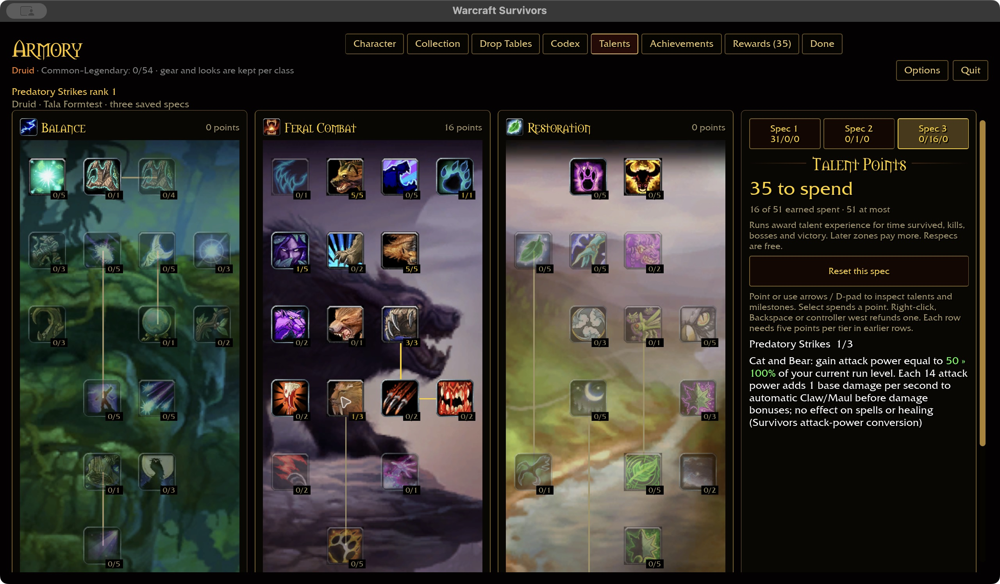
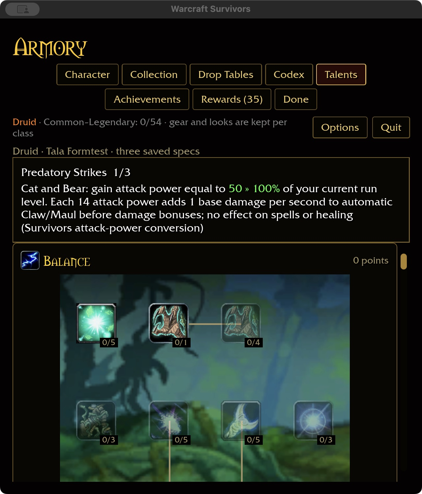
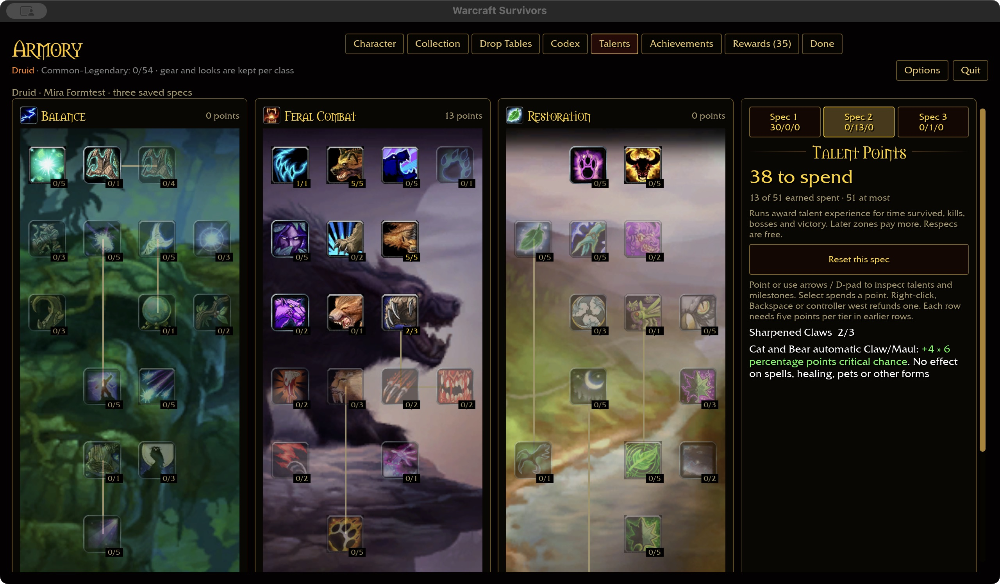
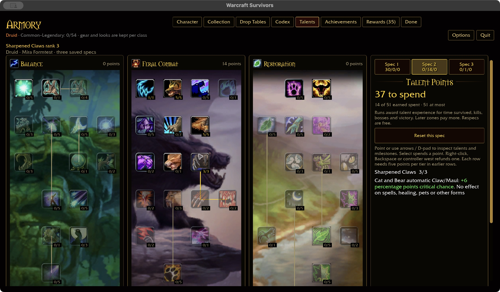
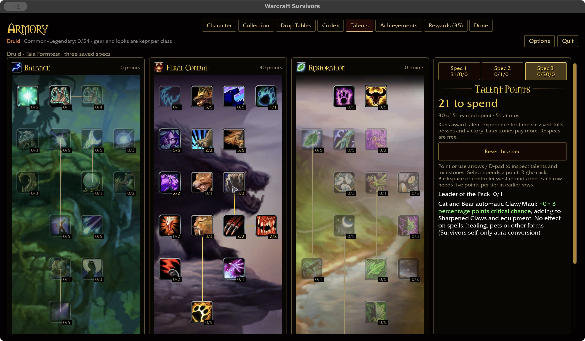
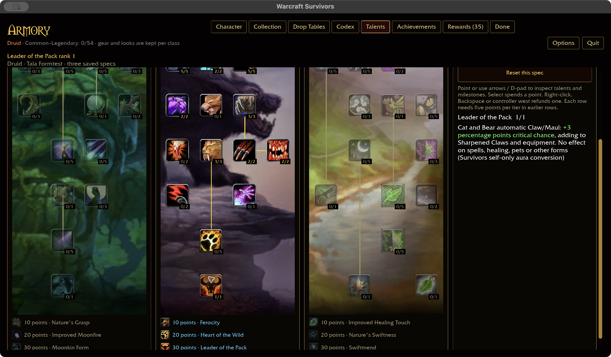
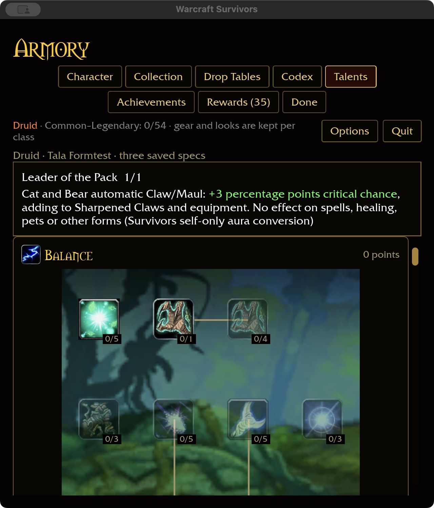
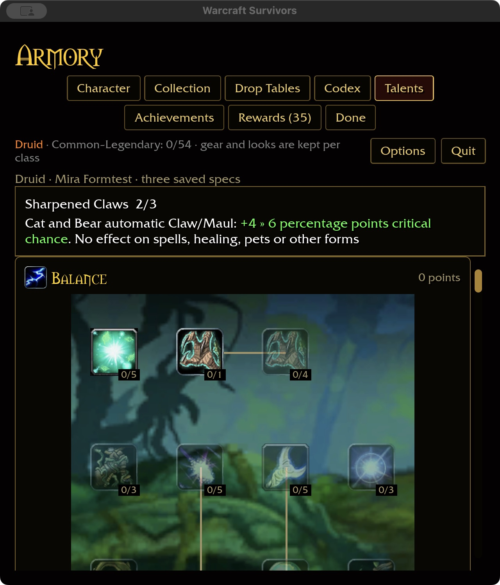

# Permanent Druid progression forms

## Rules

The user-approved lifecycle is a permanent progression upgrade that lasts the
entire run. Cat/Bear belong to Feral, Moonkin to Balance, Tree of Life to Restoration.
Only one form may be trained in a spec. Existing three-spec saves hold independent
choices; the existing talent-rank encoding stores the choice without a new file.
Refund/reset removes it for future runs. An active run keeps its start snapshot.
Imported conflicting choices retain their ranks for repair and grant no talent
bonuses until repaired; no arbitrary first-choice resolution is allowed.

## Authored progression and initial tuning

These are Survivors choices, not inferred vanilla values:

| Form | Talent | Placement / cost | Initial benefit |
| --- | ---: | --- | --- |
| Cat | 1000001 | Feral first row, leftmost empty cell; one point | +20% movement speed |
| Bear | 1000002 | Feral first row, rightmost empty cell; one point | +25% maximum health |
| Moonkin | 793 | Existing Balance capstone; one point | +5 percentage points Wrath/Moonfire/Starfire critical chance |
| Tree of Life | 1000003 | Restoration seventh row, rightmost empty cell; one point | +20% Rejuvenation/Regrowth/Healing Touch healing |

Normal earlier-row gates apply. Cat/Bear may be refunded before committing to a
later-tree form. Existing conversions and milestone bonuses remain independent;
Moonkin explicitly adds to the earlier Balance-30 conversion. Feral attacks and
form-specific migration of legacy conversions remain separate implementation work.
The three authored nodes are reported separately from vanilla definition coverage.
Tree of Life temporarily uses Healing Touch's verified icon, with its own name and
description; its model is the verified Ent display 864.

## Presentation

The menu resolves the selected saved spec. Playing, pause, level-up and game-over
use the run snapshot. The stock live-display replacement path receives the form
model; visible equipment is cleared while equipment power is retained. Removing
the form restores the normal body and saved appearances. Native display remains
the humanoid body, preserving existing collision-height behavior. Tauren use
Tauren form skins; other supported races use Night Elf skins. Tree uses the shared
Ent model. Full player animation/camera/collision acceptance is still required.

## Validation

Two focused shared-rule tests and three account/catalog tests pass. Native macOS
production previews confirmed Cat purchase and conflicting Bear rejection,
independent Bear selection in spec 2, refund restoring the humanoid body, and
Tree purchase in spec 3 retained after restart. The fixture uses disposable
progression under `target/ui-fixtures/druid-progression-20261101`; it does not
change a real account. Compact preview revealed cropped Tree artwork; the
Survivors pane now fits creature-form bounds independently of gameplay scale.
The six-package scoped gate passes (31 optional-addon skips). Final native
framing was verified at 640×720 / 125% and 1280×720 / 100%, including a switch back
to saved Cat. Mesh bounds are cached for skinned previews; the fit reserves 30%
extra room for idle-pose excursions. Native incremental rebuilds took 71 seconds
and 15 seconds for the final margin adjustment. All four focused portrait tests and the final WebGPU recheck pass. Definition coverage is 317/432 (Druid 29/47), plus
three authored nodes outside the vanilla denominator.

Moonkin purchase/body, Tauren skins, in-map animations, movement/collision,
combat and Windows remain acceptance work; no full form/combat acceptance claim.

## Automatic feral attacks and faction preview follow-up — 2026-11-01

The user approved automatic Cat/Bear attacks outside the six slots while keeping
the spell pool. Shared-core attack descriptors now feed the existing physical
auto-attack pipeline. Claw (12 damage / 1 sec) and Maul (30 / 2.5 sec) use authored
initial tuning at equal base DPS; Natural Weapons adds 2% damage per rank.
The starter names the automatic attack separately from the starting spell and pool.
Six slots, pause, invalid targets, geometry, physical vulnerability and damage
settlement are covered by integration regressions. All three new feral integration
tests and the existing Paladin attack regressions pass. All 356 shared-rule tests
pass. The six-package scoped gate is green, with 31 optional-addon skips. The
native build finished in 1m33s and the WebGPU check passes (existing warnings).
Fresh coverage is 318/432, including Druid 30/47, plus the three authored form
nodes. Build output is 46.65 GiB with 1243 GiB free; no caches were deleted.

Before that implementation, the production UI on `a7b4e45` verified Moonkin purchase
for Night Elf and Tauren, Night Elf refund restoring the humanoid body, and Tauren
Cat/Bear saved-spec body replacement. Fixture prerequisites were seeded; Moonkin
purchases and refund used UI input. Captures use 1280×720 / 100% and the disposable
`target/ui-fixtures/druid-form-matrix-20261101` account. Combat was not started.

The new native build also verifies Natural Weapons purchase with green inline
2 » 4% scaling, and the separate automatic Maul label beside the unchanged Wrath
starter. The label remains visible at 640×720 with 125% scaling. These are
production menu previews, not evidence of attended combat or earned progression.

## Predatory Strikes follow-up — 2026-11-01

Installed node 803 (spells 16972/16974/16975) grants attack power equal to
50/100/150% of level in Cat/Bear forms. Survivors uses current **run level**,
recalculates every automatic attack, and converts 14 attack power to one base
DPS. The added hit damage uses the attack's un-hasted base recovery; ordinary
power, Natural Weapons, criticals and haste then apply. This is explicit
Survivors tuning, not imported vanilla weapon damage. No effect reaches spells,
healing, pets, caster forms or a hero without a feral form.

At rank three and run level 14, either form gains 21 attack power / 1.5 base DPS:
Claw becomes 13.5 damage per second; Maul becomes 33.75 every 2.5 seconds before
bonuses. Changing the saved talent rank does not alter an active run snapshot.

The isolated production-menu fixture seeds Bear and 15 earlier-row Feral points.
Native purchases move rank 0 → 1 → 2, and refund returns rank 2 → 1 and its point.
This verifies purchases, not earned prerequisite progression. Attended combat,
Windows and full feral ability coverage remain open.

Rank one survives a clean native restart at 640×720 / 125%; its full description
and green inline upgrade remain readable. The shared-rule suite has 357 passing
tests, including all form/rank/level combinations, no-form exclusions, refund
removal and unchanged spells. Native build: 23 seconds. The scoped gate passes
with 31 optional-addon skips; WebGPU check passes with existing warnings. Fresh
coverage is 319/432 definitions (Druid 31/47), plus three authored form nodes.
The final focused core/runtime rerun also passes after strengthening the haste
fixture. Build output is 46.56 GiB; warm caches retained.

## Feral critical-chance scope — 2026-11-01

Sharpened Claws (798) now gives automatic Cat/Bear Claw/Maul +2/4/6 percentage
points critical chance. Leader of the Pack (809) adds 3 points to the same attacks.
They add to equipment/global critical chance when rolling the swing, without
modifying the global spell/healing stat. Humanoid, Moonkin and Tree of Life do
not receive either bonus. Leader remains an explicit self-only Survivors aura
conversion; party sharing and future feral abilities are not claimed implemented.

This replaces the earlier temporary no-form/global-critical conversions. Saved
node IDs and ranks are unchanged: existing specs retain their point investment,
but now need Cat/Bear to gain these bonuses. Normal free refunds remain available.
Active runs retain their starting milestone snapshot. The separate authored
30-point Thorns-healing milestone is unchanged. Feline Swiftness, Heart of the
Wild and other legacy form conversions remain separate work.

Evidence comes from checkout `--talent-evidence 798`, `--talent-evidence 809` and
`--spell-evidence 24932`: installed Claws ranks are 2/4/6 points and the Leader
aura is 3 points with Cat/Bear form mask `0x91`. The scoped automatic-attack
application is Survivors' current physical-attack mapping, not a general vanilla
party aura implementation.

Shared tests cover all four forms/no form, ranks/caps, stacking, refunds, wrong
classes and spell isolation. A real ECS attack test fixes RNG samples around the
critical thresholds for both attacks, each talent separately and together, then
checks actual damage settlement. The account regression covers purchase, save,
spec isolation, refund, form removal and immutable run snapshots.

Native macOS pointer checks verify Claws 2→3→2, Leader 0→1→0→1 and both saved
ranks after restart at 640×720 / 125%. Wide captures use 1280×720 / 100% and
`target/ui-fixtures/feral-critical-20261101`; prerequisites were seeded only
before launch. Six captures preserve the green inline changes and scope text.

During the keyboard check, Enter unexpectedly started a run from the talent
preview. It was immediately stopped; this is not gameplay acceptance. The
`hud::keys` menu Enter path guards run options but not every Armory page when
keyboard focus is inactive. Fix this routing before further native keyboard
acceptance. Attended combat, Windows and the other form conversions remain open.

Final verification: all 357 shared-rule tests and the ten-package scoped
formatting/Clippy/test gate pass (31 optional-addon corpus skips). The native
build takes 23.13 seconds; WebGPU check passes with existing warnings. The native
linker again reports unwind-table size. Build output is 56.10 GiB. The normal
launcher is restored. Definition coverage remains 319/432 plus three authored
forms; this corrects two existing consumers rather than completing new nodes.
