# Permanent Druid progression forms

## Rules

The user-approved lifecycle is a permanent progression upgrade that lasts the
entire run. Cat/Bear belong to Feral, Moonkin to Balance, Tree of Life to Restoration.
Only one form may be trained in a spec. Existing three-spec saves hold independent
choices; the existing talent-rank encoding stores the choice without a new file.
Refund/reset removes it for future runs. An active run keeps its start snapshot.
Imported conflicting choices retain their ranks for repair and grant no talent
bonuses until repaired; no arbitrary first-choice resolution is allowed.

## Authored progression and initial tuning

These are Survivors choices, not inferred vanilla values:

| Form | Talent | Placement / cost | Initial benefit |
| --- | ---: | --- | --- |
| Cat | 1000001 | Feral first row, leftmost empty cell; one point | +20% movement speed |
| Bear | 1000002 | Feral first row, rightmost empty cell; one point | +25% maximum health |
| Moonkin | 793 | Existing Balance capstone; one point | +5 percentage points Wrath/Moonfire/Starfire critical chance |
| Tree of Life | 1000003 | Restoration seventh row, rightmost empty cell; one point | +20% Rejuvenation/Regrowth/Healing Touch healing |

Normal earlier-row gates apply. Cat/Bear may be refunded before committing to a
later-tree form. Existing conversions and milestone bonuses remain independent;
Moonkin explicitly adds to the earlier Balance-30 conversion. Feral attacks and
form-specific migration of legacy conversions remain separate implementation work.
The three authored nodes are reported separately from vanilla definition coverage.
Tree of Life temporarily uses Healing Touch's verified icon, with its own name and
description; its model is the verified Ent display 864.

## Presentation

The menu resolves the selected saved spec. Playing, pause, level-up and game-over
use the run snapshot. The stock live-display replacement path receives the form
model; visible equipment is cleared while equipment power is retained. Removing
the form restores the normal body and saved appearances. Native display remains
the humanoid body, preserving existing collision-height behavior. Tauren use
Tauren form skins; other supported races use Night Elf skins. Tree uses the shared
Ent model. Full player animation/camera/collision acceptance is still required.

## Validation

Two focused shared-rule tests and three account/catalog tests pass. Native macOS
production previews confirmed Cat purchase and conflicting Bear rejection,
independent Bear selection in spec 2, refund restoring the humanoid body, and
Tree purchase in spec 3 retained after restart. The fixture uses disposable
progression under `target/ui-fixtures/druid-progression-20261101`; it does not
change a real account. Compact preview revealed cropped Tree artwork; the
Survivors pane now fits creature-form bounds independently of gameplay scale.
The six-package scoped gate passes (31 optional-addon skips). Final native
framing was verified at 640×720 / 125% and 1280×720 / 100%, including a switch back
to saved Cat. Mesh bounds are cached for skinned previews; the fit reserves 30%
extra room for idle-pose excursions. Native incremental rebuilds took 71 seconds
and 15 seconds for the final margin adjustment. All four focused portrait tests and the final WebGPU recheck pass. Definition coverage is 317/432 (Druid 29/47), plus
three authored nodes outside the vanilla denominator.

Moonkin purchase/body, Tauren skins, in-map animations, movement/collision,
combat and Windows remain acceptance work; no full form/combat acceptance claim.

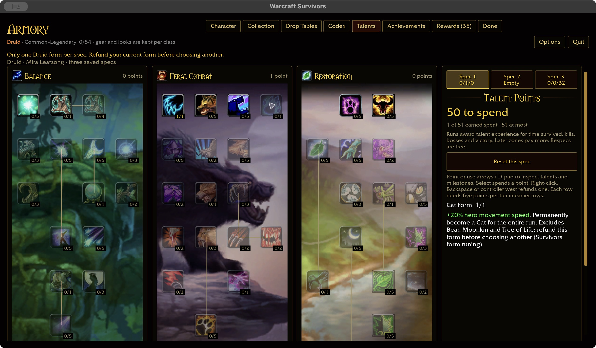

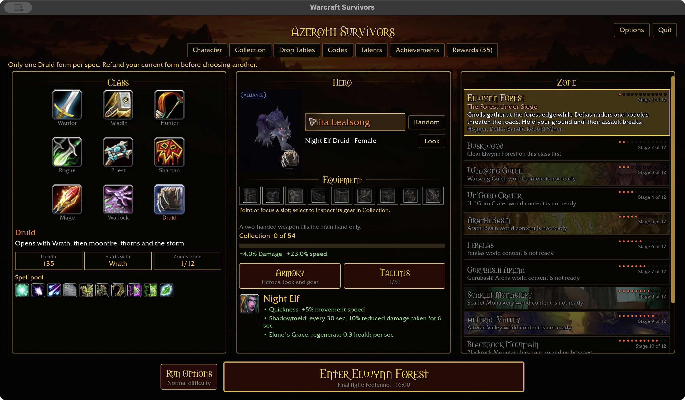

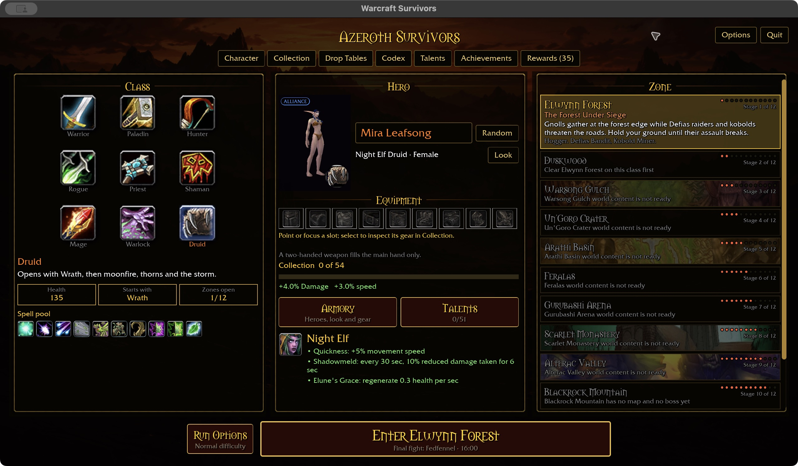

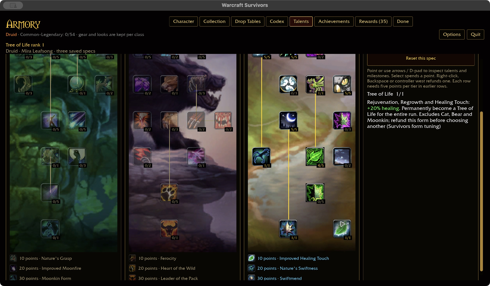

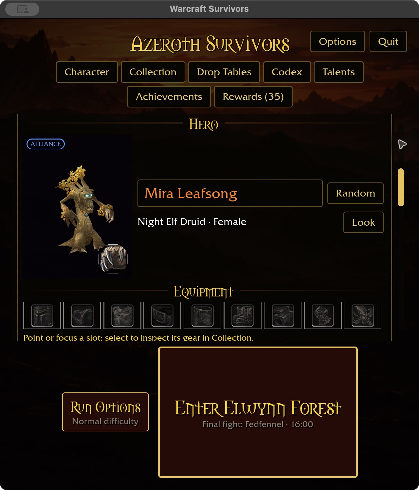

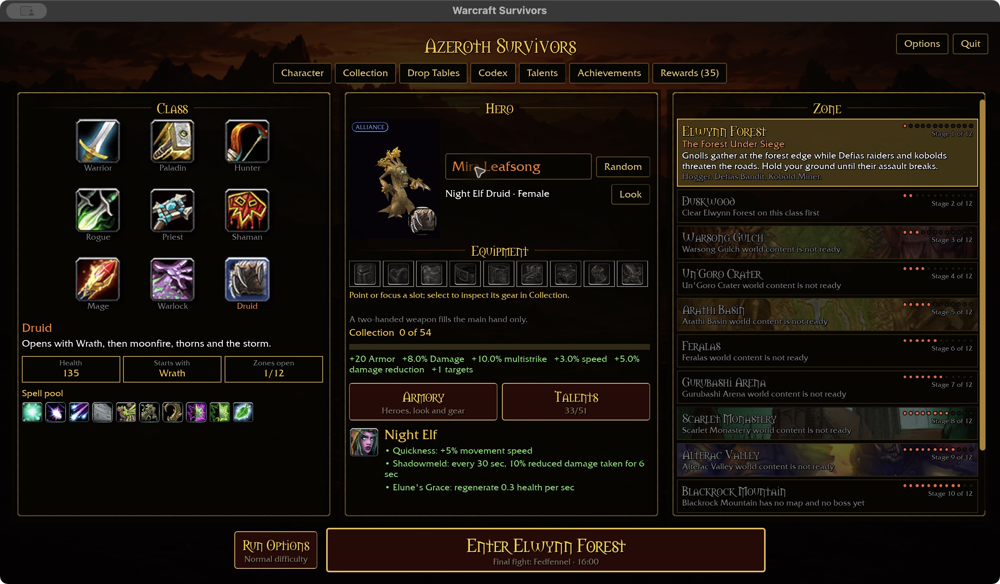

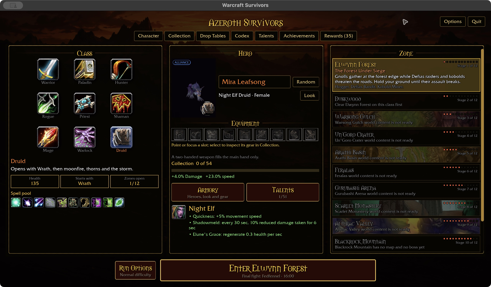

## Automatic feral attacks and faction preview follow-up — 2026-11-01

The user approved automatic Cat/Bear attacks outside the six slots while keeping
the spell pool. Shared-core attack descriptors now feed the existing physical
auto-attack pipeline. Claw (12 damage / 1 sec) and Maul (30 / 2.5 sec) use authored
initial tuning at equal base DPS; Natural Weapons adds 2% damage per rank.
The starter names the automatic attack separately from the starting spell and pool.
Six slots, pause, invalid targets, geometry, physical vulnerability and damage
settlement are covered by integration regressions. All three new feral integration
tests and the existing Paladin attack regressions pass. All 356 shared-rule tests
pass. The six-package scoped gate is green, with 31 optional-addon skips. The
native build finished in 1m33s and the WebGPU check passes (existing warnings).
Fresh coverage is 318/432, including Druid 30/47, plus the three authored form
nodes. Build output is 46.65 GiB with 1243 GiB free; no caches were deleted.

Before that implementation, the production UI on `a7b4e45` verified Moonkin purchase
for Night Elf and Tauren, Night Elf refund restoring the humanoid body, and Tauren
Cat/Bear saved-spec body replacement. Fixture prerequisites were seeded; Moonkin
purchases and refund used UI input. Captures use 1280×720 / 100% and the disposable
`target/ui-fixtures/druid-form-matrix-20261101` account. Combat was not started.

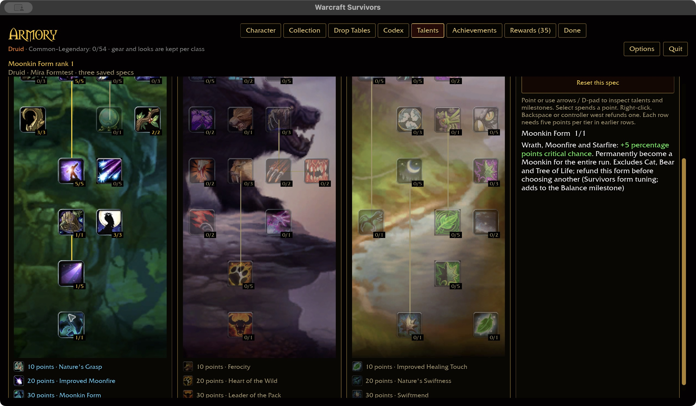

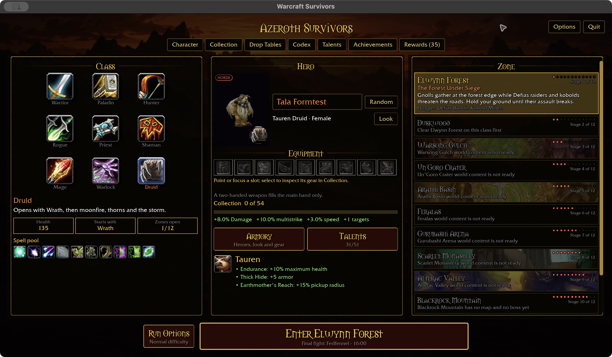

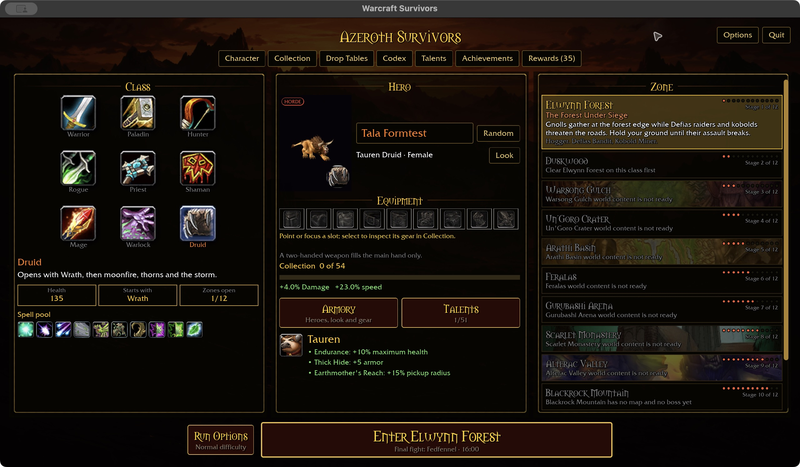

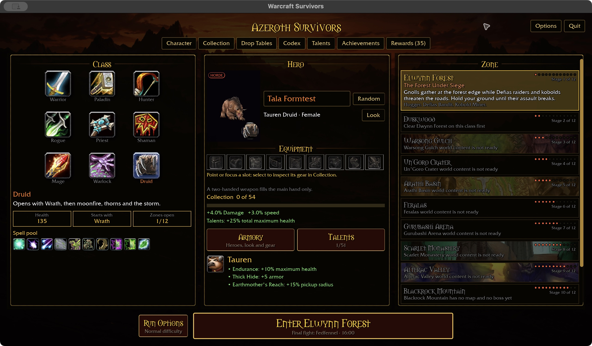

The new native build also verifies Natural Weapons purchase with green inline
2 » 4% scaling, and the separate automatic Maul label beside the unchanged Wrath
starter. The label remains visible at 640×720 with 125% scaling. These are
production menu previews, not evidence of attended combat or earned progression.

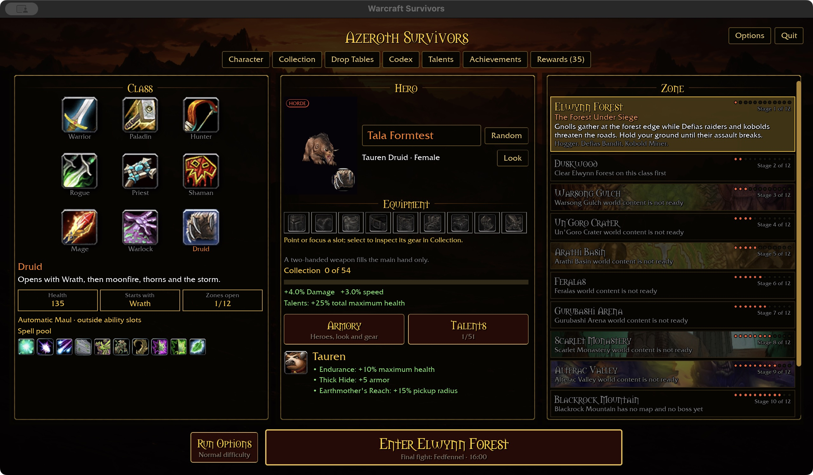

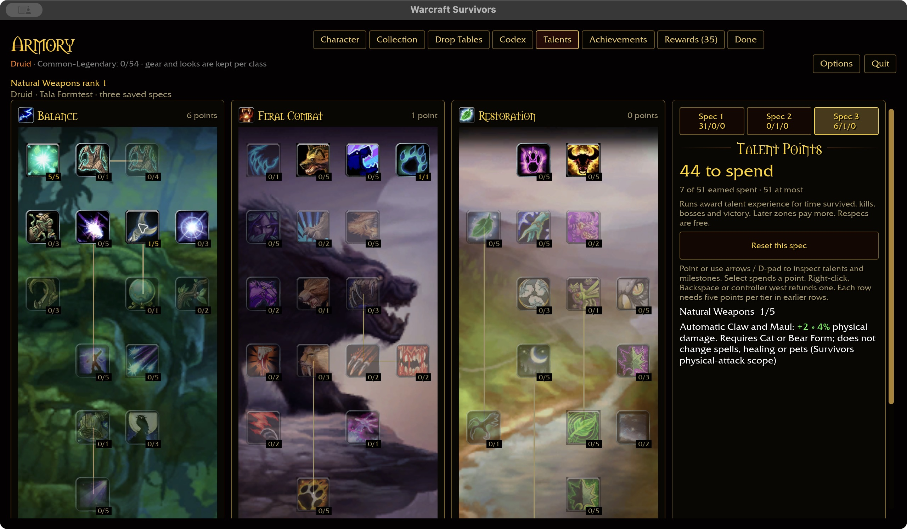

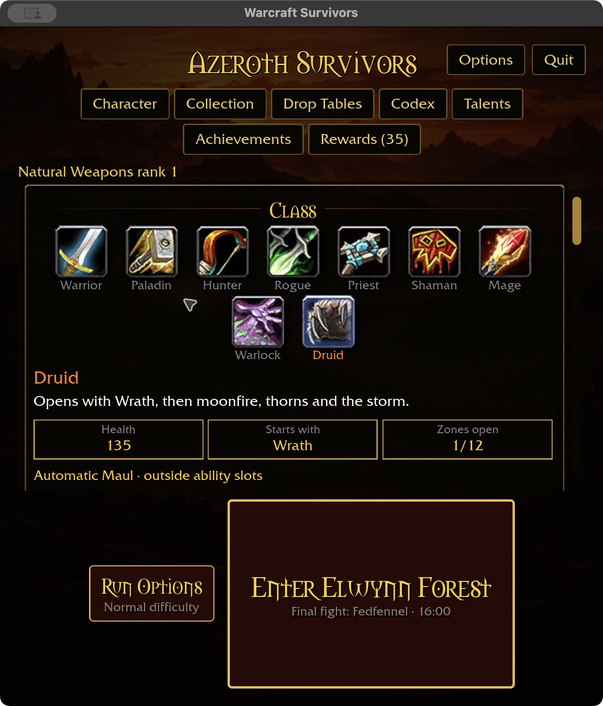
