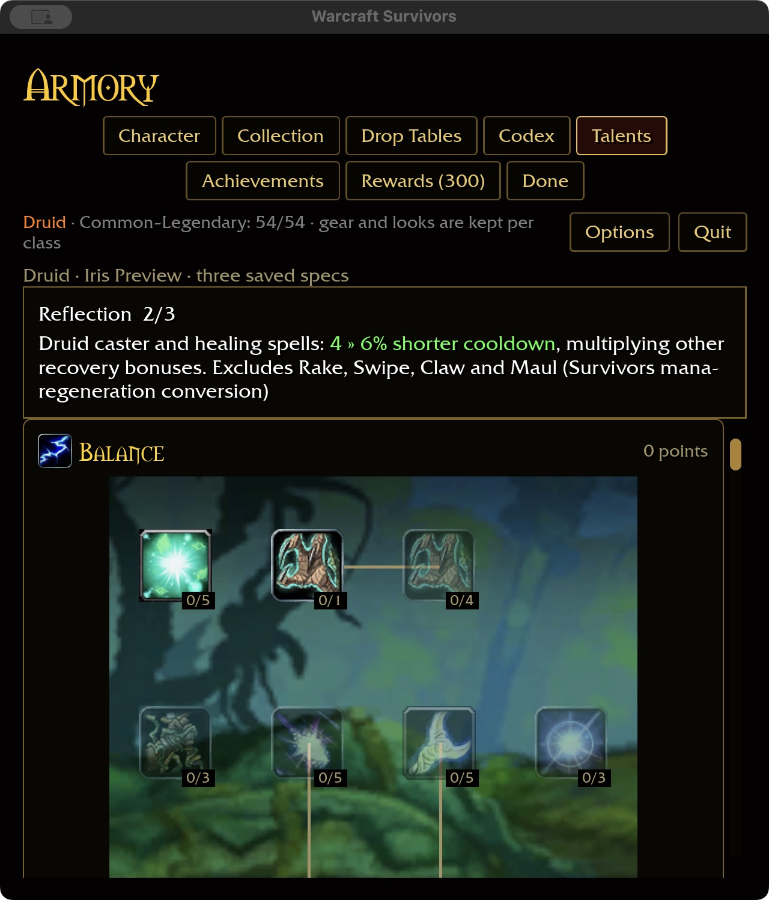

# Druid recovery conversions — 2026-11-02

Subtlety now reduces Rejuvenation, Regrowth and Healing Touch cooldowns by
2% per rank (10% maximum), replacing its provisional incoming-damage reduction.
Reflection reduces the ten Druid caster/healing spell cooldowns by 2% per rank
(6% maximum). Neither affects Rake, Swipe or automatic Claw/Maul.

These convert the installed healing-threat and casting mana-regeneration talents
(841 and 829) under the approved resource-free combat policy. Percentages are
Survivors tuning, not vanilla values. Bonuses multiply other recovery effects;
maximum Subtlety and Reflection together give healing a 0.90 × 0.94 multiplier.
Saved IDs/ranks and starting ability limits are unchanged.

## Acceptance

368 core tests pass, covering class/ability scopes, rank caps, refunds, inline
values, absence of the old defense bonus, and composition with existing recovery
talents. Runtime tests check actual cast timers across Druid spells and feral
attacks with equipment and Renown recovery. Native and WebGPU builds pass;
WebGPU retains six existing warnings. The ten-package scoped format/Clippy/test gate passes (31 optional addon-corpus
skips).

Native macOS checks purchase Subtlety to five and Reflection to three, refund
each, switch to an empty independent spec, and restart at 640×720 / 125% scale.
Saved ranks remain Subtlety four and Reflection two. Wide captures use
1280×720 / 100%. The isolated account seeds prerequisite points; player saves
are untouched. Windows/controller and attended combat remain open.
Definition coverage is Druid 34/47 and total 328/432, with 81 milestone descriptions.
This is not full gameplay or landing-gate acceptance.

