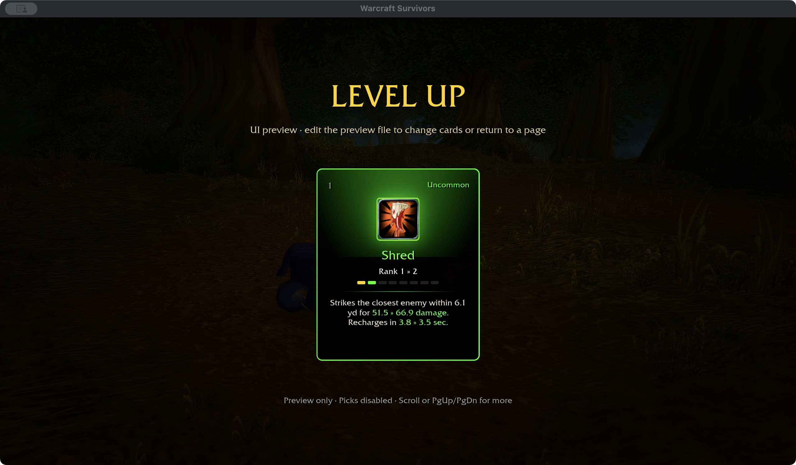
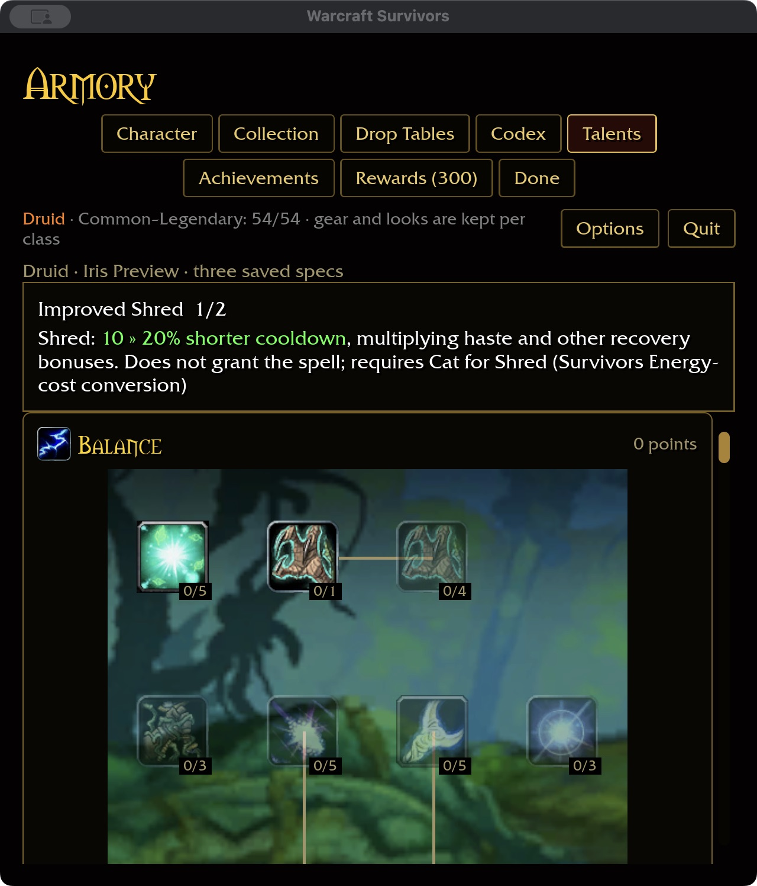

# Shred — 2026-11-04

Installed Shred (5221) is Cat-only and combines weapon-relative damage with
position/combo mechanics; Improved Shred (802, spells 16966/16968) reduces Energy
cost by 6/12. Reference evidence comes only from checkout `wow-data/Data` via
`survivors-audit --spell-evidence 5221` and `--talent-evidence 802`.

## Authored Survivors behavior

Shred deals 36 normalized physical damage at rank one, with five-yard range and
five-second recovery. It requires permanent Cat, uses normal level-up acquisition
and one of the six ability slots, and has no positional, stealth, combo or resource
requirement. It does not add another starting ability: Cat still starts with
Wrath + Rake and automatic Claw outside slots. Extra targets apply as ordinary
single-target melee targeting; area increases reach.

Improved Shred reduces its recovery by 10% per rank, two ranks, multiplying
haste and other recovery. It modifies the acquired spell without granting it.
Natural Weapons, Sharpened Claws, Leader of the Pack, Feral Instinct, Furor,
Natural Shapeshifter and Omen now include Shred. Ferocity and Savage Fury retain
their original named four-attack scope; Predatory Strikes stays automatic-only.
Descriptions name the expanded scope. Shred has no bleed.

## Acceptance

376 core tests pass, including Cat eligibility, acquisition versus starter slots,
scoped recovery, and existing physical/recovery matrix coverage. Runtime tests verify Cat-only actual casts, physical damage/critical settlement,
no bleed, targets on either side, area-scaled range and scoped recovery.
Native macOS selected-build upgrade cards fit at 1280×720 / 100% and
640×720 / 125%. Talent purchase 1→2, refund 2→1 and saved compact restart pass.
An isolated fixture seeds Cat and prerequisite points; normal saves are untouched.
These preview cards do not establish attended random-card acquisition.

Native and WebGPU builds pass (six existing WebGPU warnings). Fresh installed-data
coverage is Druid 40/47, overall 334/432, with 81 milestone descriptions.
Attended combat/acquisition/balance, Windows/controller and full landing
acceptance remain open.

Final ten-package scoped format/Clippy/tests pass with 31 optional addon-corpus
skips. Build storage is 61.68 GiB, within budget.
