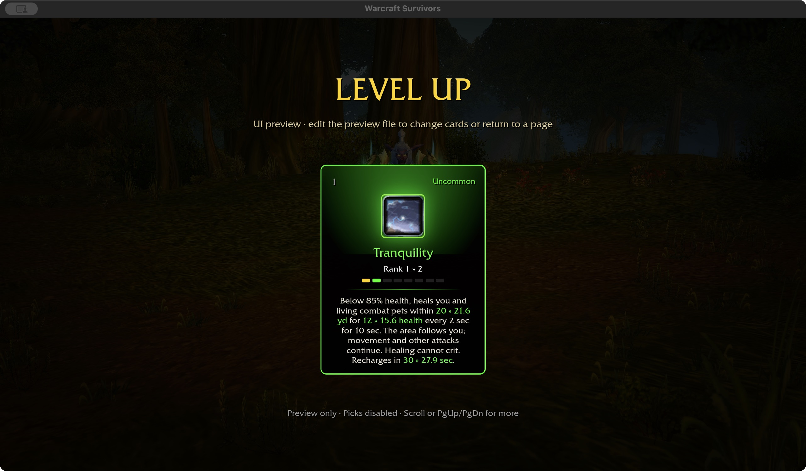
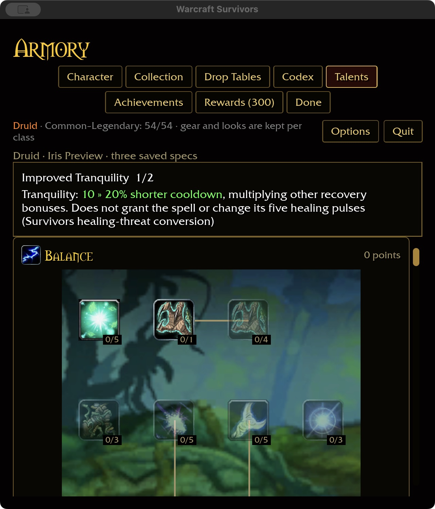

# Tranquility integration — 2026-11-03

## Installed evidence

Read only from this checkout's `wow-data/Data`:

```sh
target/debug/survivors-audit wow-data/Data --spell-evidence 740
target/debug/survivors-audit wow-data/Data --talent-evidence 842
```

Rank-one Tranquility (740) has a ten-second duration, two-second periodic healing
amplitude, twenty-yard radius, and a five-minute category recovery. Its tooltip
targets nearby group members and requires channeling. Raw healing includes a die
range and level term; the base-points field is not the final heal amount.
Improved Tranquility (842; spells 17123/17124) reduces its healing threat by
50/100%. Survivors must convert that to recovery under the approved combat policy.
Movement and other attacks must continue throughout its independent channel.

## Healing clock prerequisite implemented

`HealingOverTime::refresh_pulsed` schedules a fixed number of equal pulses. The
first payment occurs after one interval. Continuous heals coexist independently;
recasting replaces only the matching source and resets that source's clock.
Long frames settle every due pulse, cap payment to the unpaid total, then expire.
Invalid schedules and zero/invalid elapsed time preserve existing effects.
A double-precision elapsed clock avoids losing final pulses through repeated
single-precision frame subtraction. The caller remains responsible for active
simulation time, health caps and life eligibility.

The ten-package scoped format/Clippy/test gate passes (31 optional addon-corpus
skips), as does the WebGPU check with six existing warnings. Build storage is
59.97 GiB, within budget. This is not the full landing gate.

372 core tests pass. Added tests check pulse boundaries, concurrent continuous
heals, long frames, 60 Hz/subsecond partitions, refresh, invalid values and no
post-expiry payment. The existing runtime uses this shared clock in regeneration;
this checkpoint does not schedule Tranquility from gameplay yet. No interface or
asset changes are made, so no new visual capture is claimed.

## Gameplay integration implemented

Authored rank-one values: 60 total healing, five pulses of 12 at 2/4/6/8/10
seconds, twenty-yard radius and thirty-second base recovery. Ability rank and
healing bonuses scale the total; area scales the radius. Recovery uses haste,
rank and scoped cooldown bonuses, with a ten-second floor. An active channel
cannot be replaced by an early recast. Acquisition uses a normal ability slot;
Improved Tranquility modifies the spell without granting it.

Below 85% hero health, the automatic cast starts its independent schedule.
At each payment, the area follows the caster and checks current distance,
line of sight and life state. The single-player runtime heals its hero and
combat pets (currently the Hunter wolf health component); cosmetic companions
have no health and are excluded. Long-frame payments use current positions,
not reconstructed historical positions. Defeat or a missing caster ends the
channel; elapsed run time freezes during menu/pause. Periodic healing cannot
crit, resurrect, or bank overhealing. Extra targets do not multiply this area.

Improved Tranquility converts threat reduction to 10% shorter cooldown per rank,
two ranks. Tranquil Spirit, Nature's Focus, Gift of Nature, Tree of Life,
Reflection and Subtlety now include Tranquility. Moonglow and Improved Healing
Touch remain explicitly scoped to their existing spells. Natural Shapeshifter
includes the new catalog ability only when a permanent form is selected.

Native preview verifies green inline card upgrades at wide and 640×720/125%
layouts, talent purchase to 2/2, refund to 1/2, an empty second spec, and saved
1/2 after compact restart. Screenshots use disposable checkout fixtures.





373 core tests pass. Runtime regression exercises actual casting, concurrent
Wrath, moving recipient eligibility, unchanged-time pause behavior, early recast
rejection, overhealing, dead-pet exclusion and caster defeat. Native play build
and WebGPU check pass (six existing WebGPU warnings).

Remaining acceptance: attended in-world particle appearance and real-world
obstruction cases, Windows/controller behavior and balance. This is the
single-player recipient implementation, not multiplayer party healing. Acquisition
uses the normal Druid pool; screenshots verify an upgrade card, not a played
new-spell acquisition. Full landing validation and the overall talent phase remain
open.

Fresh installed-data definition audit: Druid 36/47, total 330/432, with 81/81
milestone descriptions. This measures definitions, not complete gameplay acceptance.

Final integration gate: ten-package scoped format/Clippy/tests pass, with 31
optional addon-corpus tests skipped. Build storage is 61.15 GiB, within budget.
The full landing gate remains separate.

## Obstruction and teardown acceptance — 2026-11-03

Two additional runtime regressions use the production pulse system and world
collision queries. A solid wall excludes one living pet while an unobstructed pet
and the caster heal. Removing the wall with unchanged simulation time pays
nothing; the next pulse heals only its ordinary amount, without banking blocked
pulses. Restoring the wall blocks later payments, and the channel still expires.
A separate test removes the caster before settlement, then exercises the actual
menu run-reset system: pending pulses disappear and cannot heal a subsequent run.

These are deterministic collision/lifecycle checks, not attended world visuals.
No interface or rendering change is made; the existing milestone captures above
remain the visual evidence. Druid definition coverage is unchanged.

Follow-up gate: scoped formatting, Clippy and tests pass with the same 31 optional
addon-corpus skips. Storage is 61.27 GiB. Production code and UI are unchanged,
so the preceding native/WebGPU builds and captures remain applicable.
