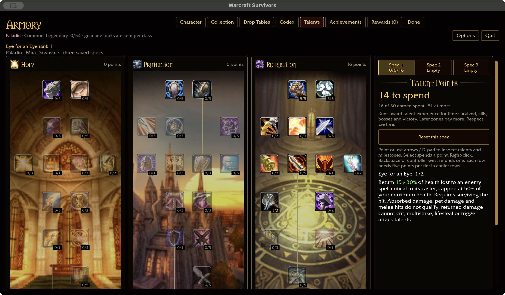
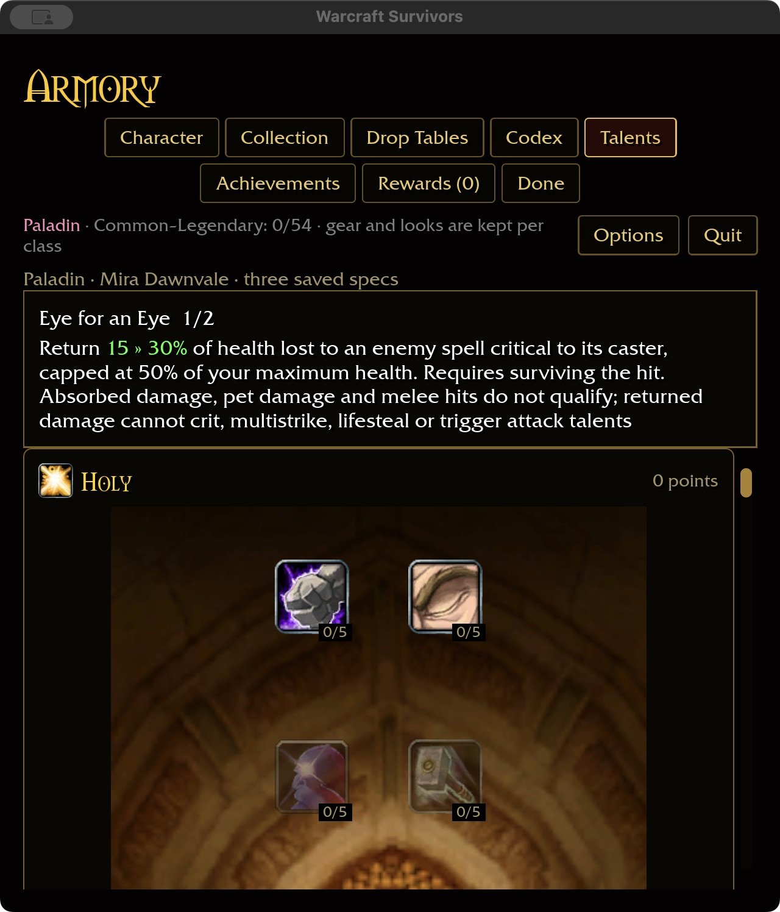

# Eye for an Eye and incoming spell criticals

## Installed reference

This checkout's `survivors-audit wow-data/Data --talent-evidence 1632` identifies
Paladin Retribution row three / column zero, two ranks without a named prerequisite.
Spells 9799/25988 return 15/30% of spell-critical damage taken to its caster,
capped at 50% of the Paladin's total health. The raw aura has base points 14/29
plus one die; the talent proc chance is 100%.

## Survivors behavior

The existing roster-backed Frostbolt caster (template 1522, spell 13322) now rolls
5% critical chance once per completed spell, with 1.5× damage. This is authored
Survivors tuning, not inferred from DBC damage or claimed as vanilla balancing.
Hero, combat-pet and totem recipients receive the same critical roll. Interrupted
or cancelled casts never roll or deal damage. Other enemies keep their current
attack rules; this does not introduce a general enemy spell roster.

A surviving Paladin returns 15/30% of actual health lost from an enemy spell
critical to that caster, limited to half maximum health. Shields, immunity,
noncriticals, pet/totem damage and melee contact cannot trigger it. Lethal hits
and delayed retaliation after hero death produce no return: this preserves the
existing Survivors no-post-death-response rule and is an explicit adaptation.

Retaliation has separate hit provenance. It settles once without offensive
multipliers, critical rolls, multistrike, lifesteal, splash or attack-talent procs;
it still wakes incapacitated targets, records damage and awards normal kills.
It never re-enters incoming spell settlement, preventing reflection loops.
Talent refunds and independent saved specs remove/restore the response normally.
No new ability slot or acquisition card is involved.

The existing intention-based talent page shows the changing return percentage
green and inline, with the fixed 50% cap unmodified.

## Validation

Two shared-rule tests pass for all classes/ranks, invalid inputs, critical-only
eligibility, cap, removal and inline highlight ranges. All 20 enemy-casting tests
pass, including real cast settlement through reflection application with partial/
full shields, immunity, lethal hits and offensive bonuses that must not leak in.
The six-package scoped gate passes (31 optional-addon tests skipped); native play
build passes in 1m26s and WebGPU check in 8.35s with six existing warnings. Fresh
coverage is 316/432 definitions, including Paladin 31/44.

Native macOS production-page preview verified purchases 0→1→2, right-click refund
2→1, and saved rank 1 after restart at 640×720 / 125%. Wide captures are 1280×720 /
100%. The intention talent screenshot remains the layout reference; narrow mode
stacks the trees with the inspected description above. This used an isolated
synthetic account, no combat session. Attended combat, balance, Windows and
physical-controller acceptance remain separate requirements.

