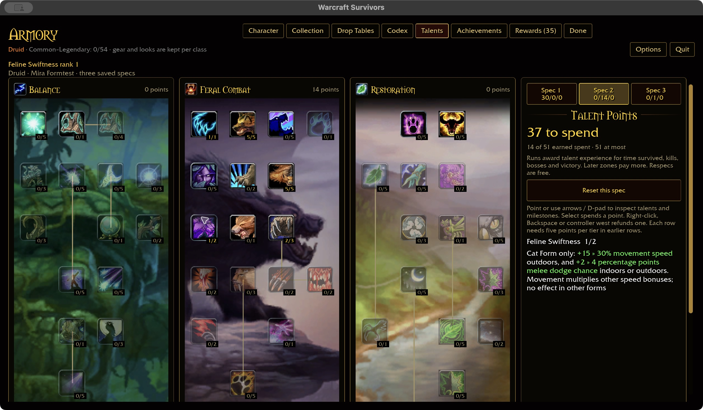
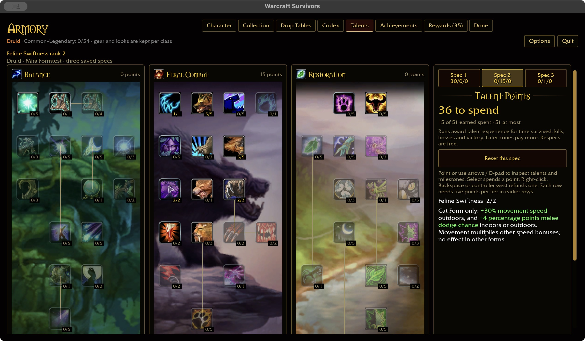
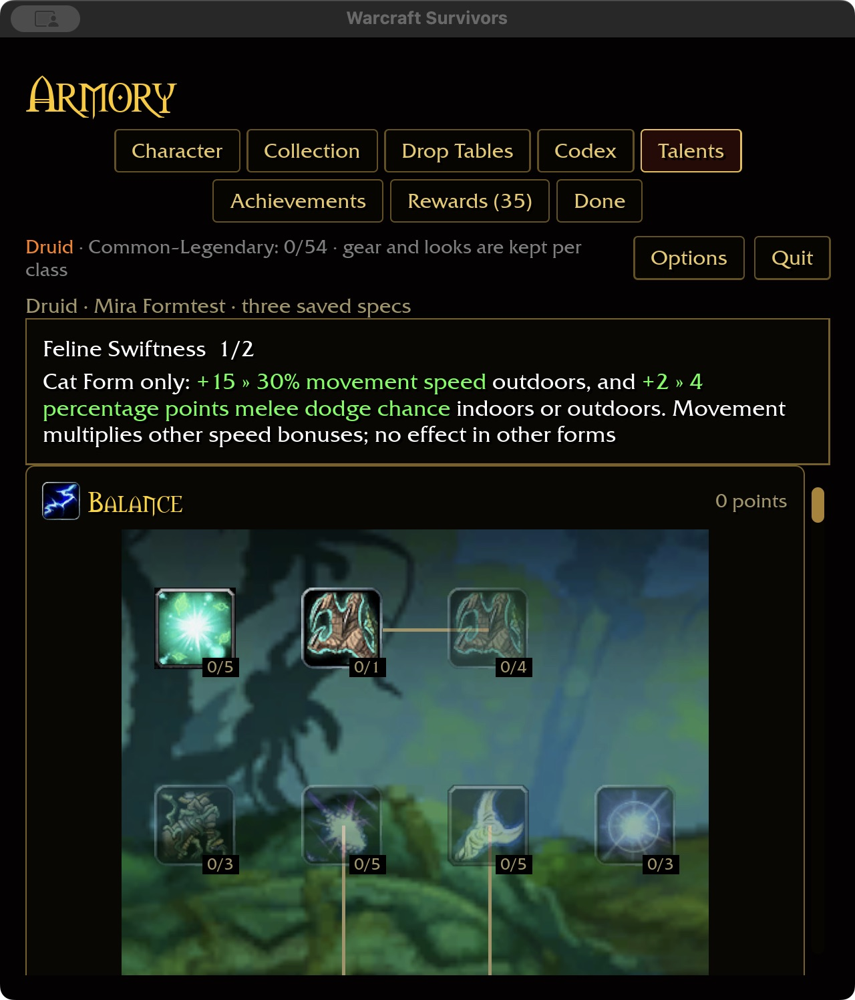

# Feline Swiftness — 2026-11-01

The former unconditional +5/10% movement conversion is replaced by Cat-only
+15/30% outdoor movement and +2/4 percentage points melee dodge. The movement
factor multiplies existing speed, haste and slow factors; Cat's base +20% remains.
Dodge works indoors too. Other forms, no form and conflicting imported forms
receive neither effect. Saved node 807/ranks remain compatible; refunds are free.
This corrects an existing definition, so coverage remains 319/432 (Druid 31/47),
plus three authored form nodes. Heart of the Wild and other legacy conversions
remain separate work.

## Evidence and integration

Checkout-local `survivors-audit --talent-evidence 807` reads spell 17002/24866:
15/30% speed, outdoors in Cat Form. The description references dodge spells
24867/24864, whose aura 49 values are 2/4 points. The first has Cat mask 0x1;
the parent description explicitly scopes both ranks to Cat. These raw rows
supply values and scope, not a claim that Survivors reproduces every server rule.
Multiplication with Survivors equipment/base-form speed is an explicit authored
stacking rule.

`hero::drive_hero` queries `WorldPoint::indoors_at` at the moving body's position,
using the existing WMO/terrain down-ray rather than camera position or zone type.
Untrained/non-Cat movement avoids that extra query. Streaming geometry retains
the engine's existing classification behavior. `defense::contact` consumes the
Cat dodge bonus before shields or health damage through the existing attack table.

Shared tests cover all classes/forms, indoor/outdoor context, rank caps, refund,
conflicting forms, no unconditional stat leakage, and both green inline ranges.
Contact tests sample both sides of the dodge thresholds and verify shield
preservation and form-removal behavior. The account regression covers purchase,
cap, serialization, spec isolation, partial refund, form removal and immutable
run snapshots.

Native macOS production UI checks use isolated fixture
`target/ui-fixtures/feline-swiftness-20261101`: purchases 0→1→2, refund 2→1,
then restart retaining rank one. Wide 1280×720 / 100% and compact 640×720 / 125%
show both inline changes with units once. No gameplay was launched. Attended
indoor/outdoor traversal, live combat and Windows remain unverified.

Validation: 359 shared-rule tests and the final ten-package scoped
formatting/Clippy/test gate pass (31 optional-addon corpus skips). Native play
build and WebGPU check pass with the existing linker unwind warning and six
WebGPU warnings. Final generated build storage: 56.67 GiB; caches preserved.
