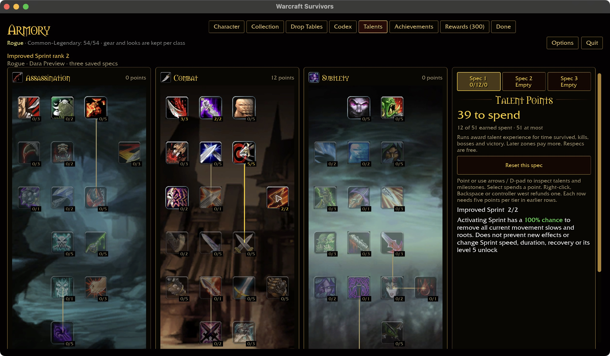
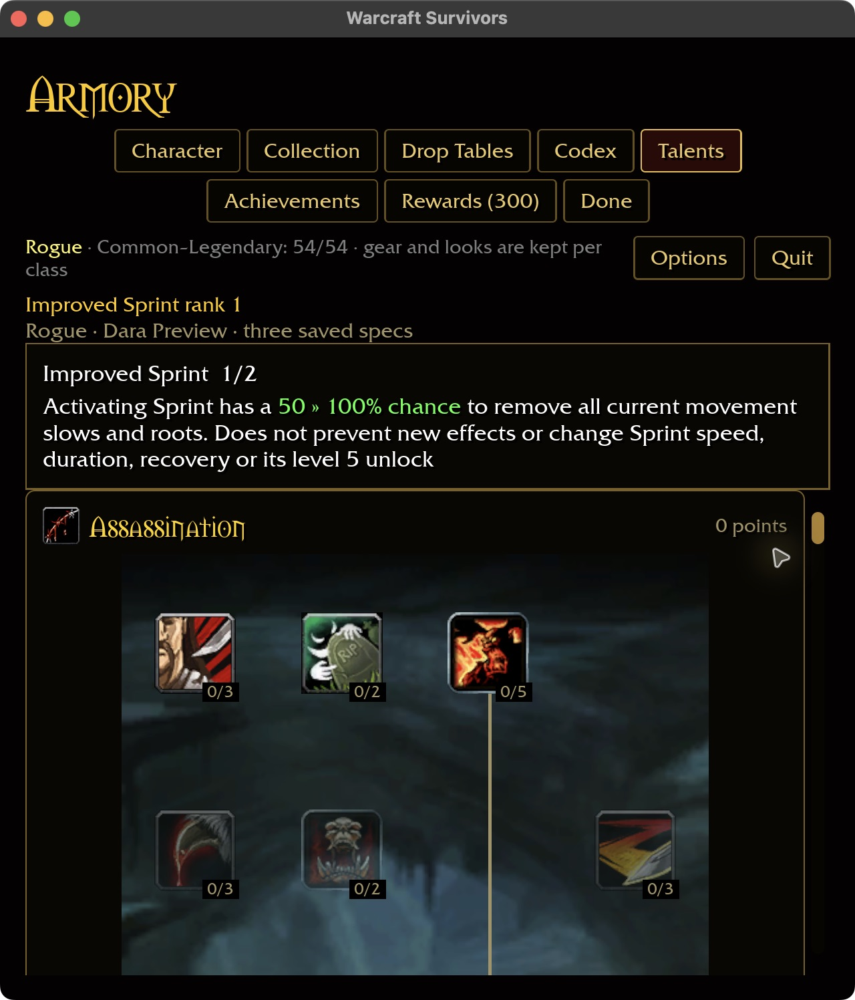
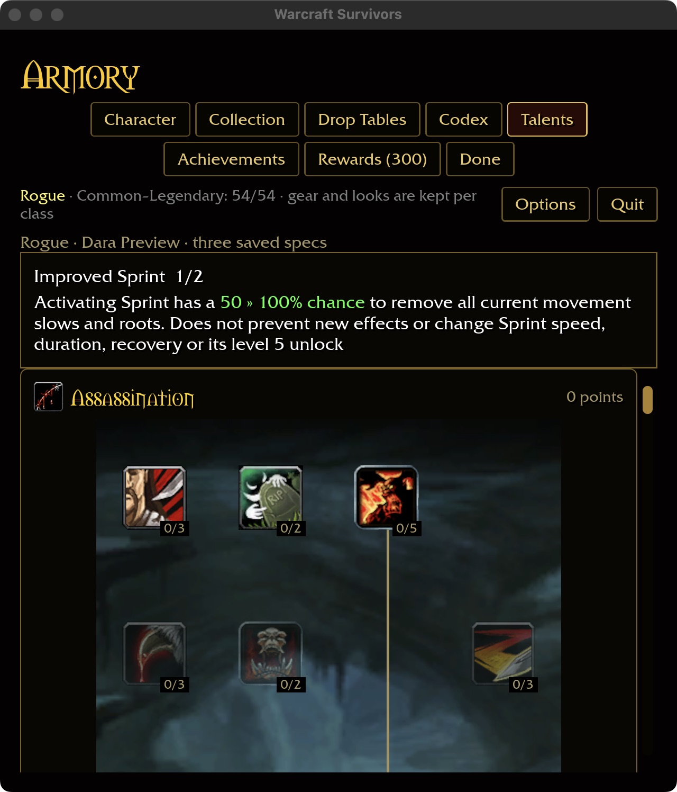

# Improved Sprint

## Installed evidence — 2026-10-31

`survivors-audit wow-data/Data --talent-evidence 222` identifies Rogue Combat
node 222, row two / column three, two ranks, no named prerequisite. Spells
13743/13875 specify 50/100% chance to remove movement impairments on Sprint
activation. Trigger 30918 describes removing snares and roots and has raw
one-second mechanic-immunity aura rows (77, mechanics 11 and 7). Survivors
implements the talent as removal of current effects only; omitting any forward
immunity is an authored adaptation, not inferred from those raw duration fields.

## Runtime contract

The existing manual Sprint remains learned at level five, outside the acquired
ability slots. A successful activation rolls Improved Sprint once. Success
cleanses every current incoming slow, including a zero-speed root, without
changing haste, duration or recovery. Endurance still modifies recovery separately.
A failed roll still activates Sprint normally. Loading, pause, death, unlearned
Sprint, missing input, a missing hero or an active cooldown cannot cleanse.
Another class's mobility never consumes this Rogue training.

The shared slow state retains a cleanse timestamp. Delayed applications from
before that timestamp cannot restore removed effects, including previously unseen
sources. Effects applied after the cleanse, including later processing at the
same timestamp, work normally. This is removal, not a timed immunity. The current
enemy roster supplies Frostbolt slows; zero-speed roots are covered synthetically
and do not claim a new enemy root spell. Active-run time preserves pause behavior.

The existing intention-based talent page shows green inline 50 » 100% chance.
Training uses installed row rules and independent saved specs. No new level-up
card is introduced for this existing manual mobility.

## Validation

Shared rules pass 351 tests, including overlapping slow/root removal, stale hit
rejection, future effects and capped/class-scoped/refundable training. Both new
actual mobility-system regressions pass; the four-test Sprint filter also includes
the existing Endurance timing and persistence regressions. Native build passes in
1m22s with the existing linker warning. Fresh definition coverage is 315/432,
Rogue 40/51; this is not a gameplay-completeness claim. The six-package scoped
formatting/Clippy/test gate passes, including the installed prerequisite, purchase,
cap, independent-spec, save/reload and refund matrix (31 optional-addon skips).
Rustdoc links pass (150 benign). Attended combat, Windows and physical-controller
acceptance remain open.

## Native page evidence

An isolated Rogue profile with ten legal Combat points purchases both ranks,
refunds rank two to one, and retains rank one after restart. Wide captures use
1280×720 / 100%; compact captures use 640×720 / 125%. The existing three-tree
wide layout follows `docs/intentions/survivors_talent_tab.png`; the compact layout
stacks trees and pins the description above them. No player save was modified.

