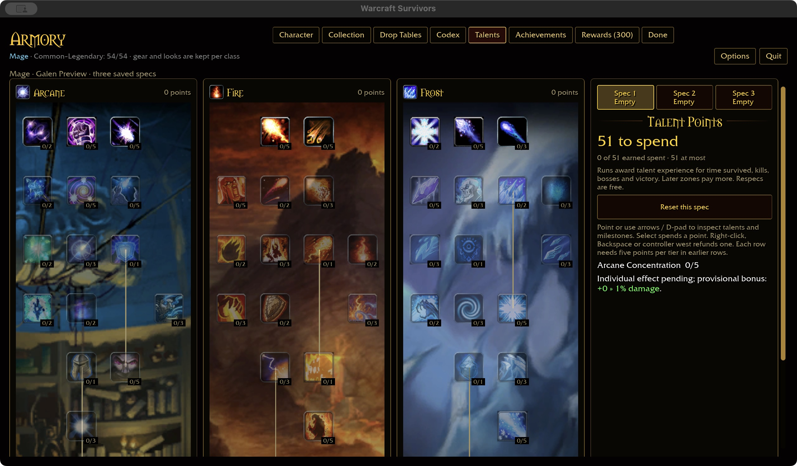
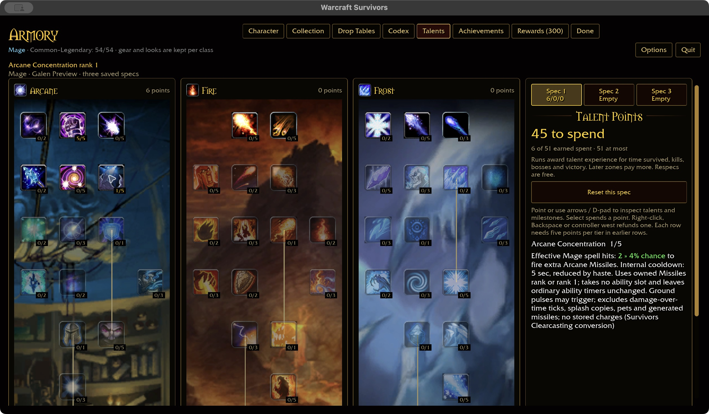
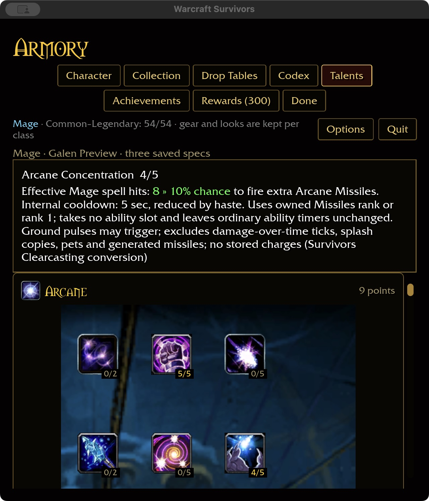

# Mage Clearcasting — implementation and acceptance

Arcane Concentration (node 75) replaces its provisional damage bonus with the
approved extra Arcane Missiles proc. Rank chances are 2/4/6/8/10%; the authored
internal cooldown is five active-run seconds divided by `max(0.1, 1 + haste)`.
This is a Survivors conversion, not vanilla mana conservation.

## Runtime contract

- An original hero-owned Mage spell hit must actually remove health. Ground
  pulses qualify; damage-over-time ticks, splash copies, pets, reflection and
  generated missiles do not. Multistrike damage settles as one proc opportunity.
- A successful roll queues one extra cast for the next active cast update. The
  cooldown starts at the triggering hit's settlement. No charges accumulate;
  if no visible, in-range, unobstructed living target remains, the cast is lost.
- Missiles use the owned ability's rank, or rank one if unowned, and its ordinary
  damage, critical, target-count and range scaling. They consume no slot, leave
  all six ordinary timers alone, and can fire while the player moves.
- Generated hits retain hero talent damage scaling and Arcane Missiles meter
  attribution, but carry distinct provenance to prevent recursive Clearcasting.
  Extra casts do not consume or activate other successful-cast procs/milestones.
- Active Arcane Power scales the extra missiles. No mana, next-spell refund,
  fifteen-second charge, global cast lock or stationary requirement is added.
- The proc clock belongs to the run and resets with it. Pauses neither advance
  active time nor dispatch a queued cast. Normal talent snapshots govern refund,
  spec selection and the next run.

## Evidence

Shared rules cover every rank, foreign classes, invalid damage/time/rolls,
haste-adjusted deadlines and single dispatch. Runtime tests cover effective
settlement → extra cast → damage, delayed generated-hit recursion exclusion,
owned-rank scaling with six occupied slots, independent timers, excluded sources,
pause and loss of a target. See the checkpoint's validation results below before
assuming the whole acceptance matrix has passed.

## Verified checkpoint — 2026-11-02

- 359 shared-rule tests pass. The ten-package scoped formatting, Clippy and test
  gate passes, including the four new runtime tests; 31 optional-addon tests skip
  because that corpus is absent (24 vanilla / 7 Quiver).
- Native play build passes in 2m52s; WebGPU check passes in 27s with six existing
  warnings. No alternate build flags or cache variants were introduced. Build
  output totals 60.40 GiB, with over 1,229 GiB free.
- Native macOS menu-only checks use the isolated
  `target/ui-fixtures/clearcasting-20261102/` account. The intention's three trees
  and saved-spec panel remain the layout reference. At 1280×720, purchase five
  Arcane Focus prerequisite ranks, then Concentration ranks 1 through 5; the
  description progresses from green `0 » 2%` through maximum `10%`.
- Refund to rank 4 returns one point and shows green `8 » 10%`. Spec 2 remains
  empty; returning to Spec 1 restores rank 4. The persisted row is
  `dbc 7 0:76:5,0:75:4||`. Restart at 640×720 / 125% preserves the rank and shows
  the full description above the scrollable tree without clipped text.
- Six captures preserve the before, untrained, rank-one, maximum, refund and
  compact-restart states. No raw install assets are committed.

Attended combat feel/visuals and Windows/controller acceptance remain open.
The separate starter text-reload defect is not fixed by this mechanic.
