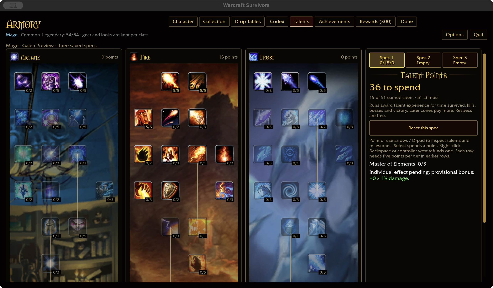
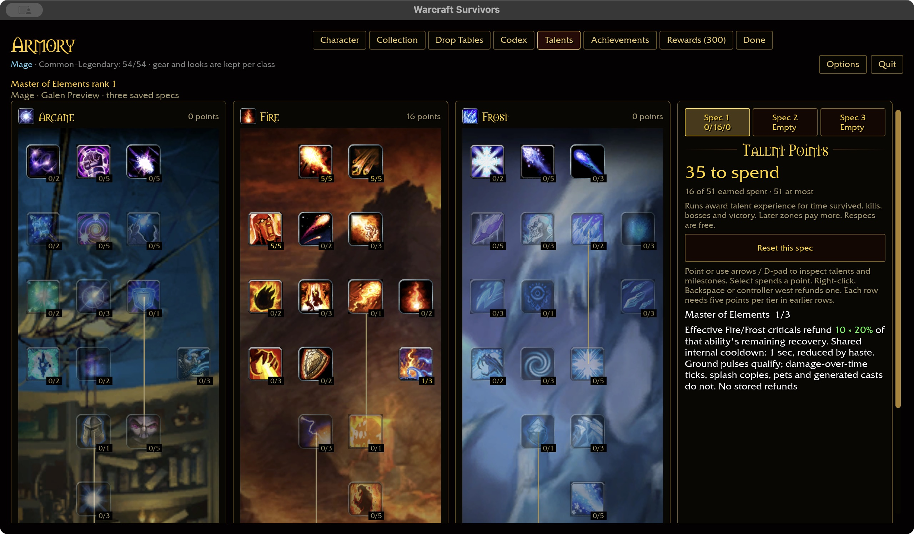
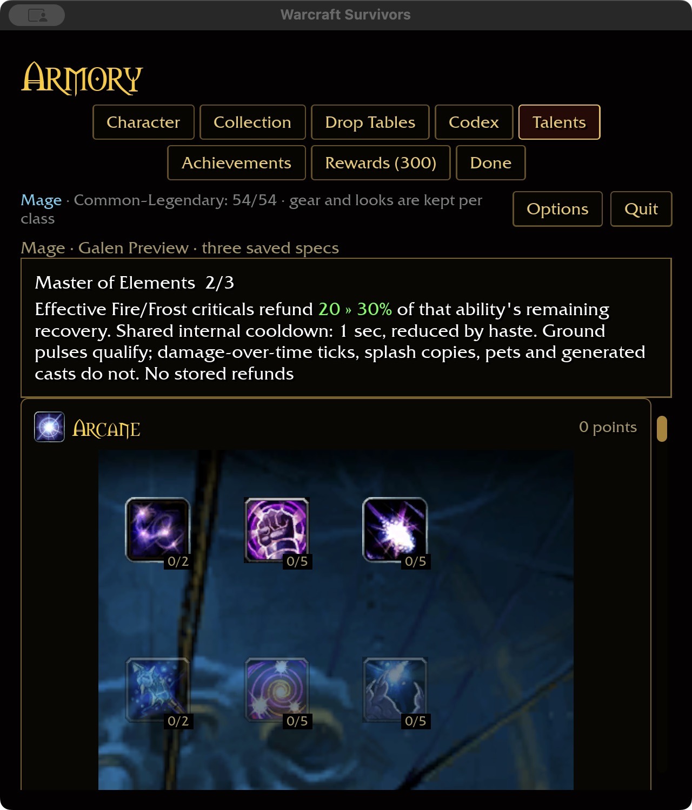

# Master of Elements — recovery conversion

The approved resource-free policy replaces node 1639's mana return with recovery.
Checkout DBC evidence confirms three ranks, Fire row 3/column 3, no prerequisite,
and original 10/20/30% base-mana refunds on Fire/Frost criticals. Survivors uses
those percentages for **remaining ability recovery**, an authored conversion;
it does not claim to reproduce the original mana mechanic.

An effective original hero Fire/Frost critical reduces its owned ability's
remaining recovery by 10/20/30%. The talent has one shared 1-second internal
cooldown, divided by `max(0.1, 1 + haste)`. This is independent of Clearcasting.
At rank three, 10 seconds remaining becomes 7 seconds; it is not a subtraction
of 30% of the spell's original recovery. Other ability timers are unchanged.

Eligible ground pulses may trigger. A multi-target attack can earn at most one
refund within the shared interval, regardless of victim count or multistrike.
Later qualifying hits may trigger again after that interval, including pulses
from an earlier cast. The policy is time-limited, not one refund per cast.
DoT ticks, splash copies, pet hits, reflected hits and generated casts do not
qualify. Zero damage, noncriticals, dead/missing targets, unowned spells and
already-ready abilities neither refund nor consume the deadline. There are no
stored refunds. Only active gameplay schedules hit settlement; the clock uses
active-run time and resets with the Run.

The definition removes the previous generic damage bonus, preserves its saved
node/ranks and shows the recovery percentage inline in green. No new ability
slot, stationary cast, resource pool or save field is introduced.

## Evidence

Core tests cover every rank through cap+1, all classes and every ability key,
shared Fire/Frost cooldown, haste boundary, invalid inputs and a fresh clock.
ECS tests exercise actual `apply_hits` settlement, ranked recovery changes,
independent ability timers, source ownership, unowned/ready spells and rejection
without spending the proc deadline. Existing splash and ground paths retain
their provenance; those end-to-end visual effects remain combat acceptance work.

Native macOS preview: bought ranks 1–3, refunded to 2, checked empty Spec 2,
returned to Spec 1 and restarted at 640×720 / 125% scale. Rank 2 and green
20 » 30% text persisted. Wide captures use 1280×720 / 100%. Isolated fixture
saved `dbc 7 1:26:5,1:30:5,1:34:5,1:1639:2||`; no player save was edited.
The app exited and its normal launcher was restored.

364 core tests passed. Native build passed in 1m42s; WebGPU passed in 54.75s
with six existing warnings. Fresh talent audit: 45/49 Mage, 325/432 overall.
Generated storage: 60.70 GiB; free volume space: 1229.09 GiB.
Scoped formatting, Clippy and tests passed across ten packages, with 31 optional-addon data skips. Attended combat, Windows and physical controller
acceptance remain open; the separate starter reload defect is not closed.

