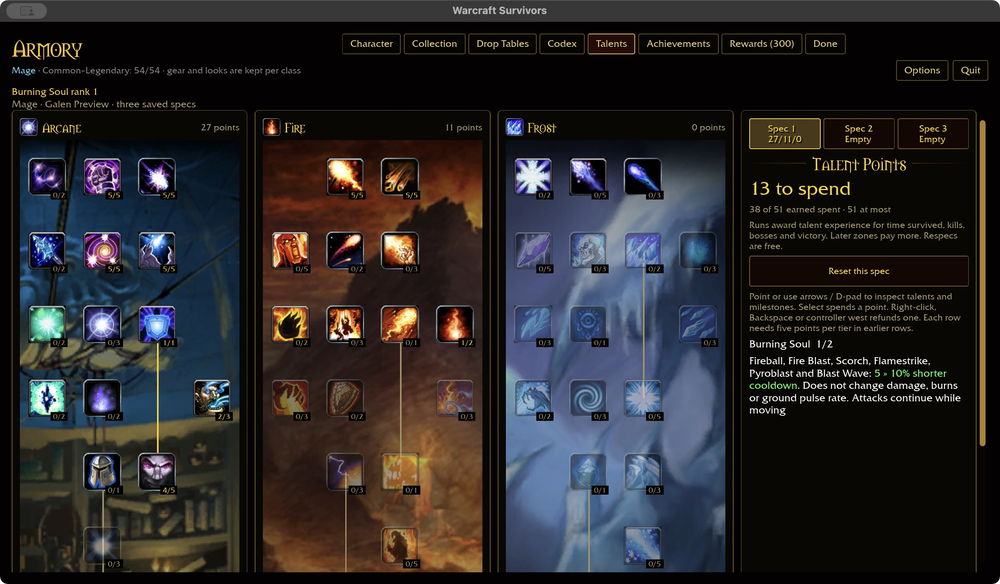
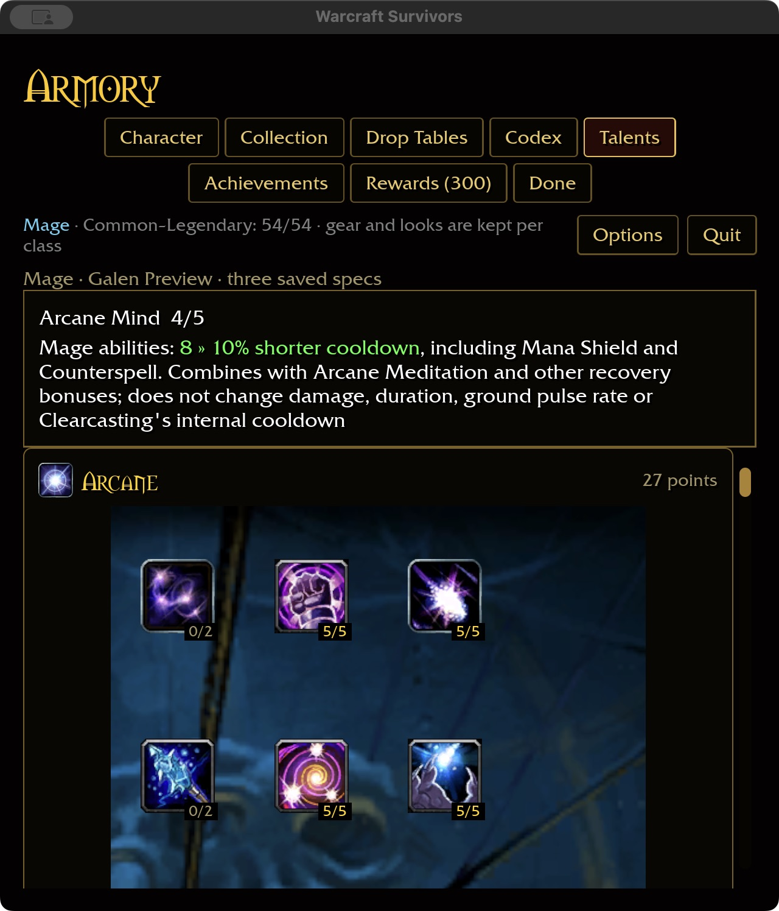
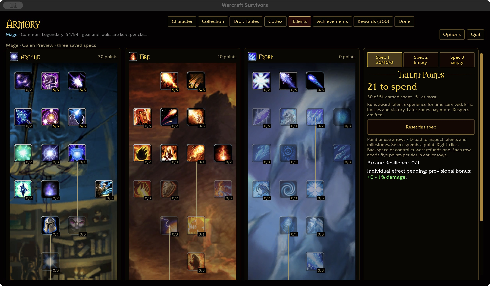

# Mage damage and recovery conversions

The approved [combat policy](../SURVIVORS-COMBAT-POLICY.md) replaces Intellect
with damage, mana with recovery, and threat with recovery or damage. These four
nodes now use explicit effects instead of the provisional one-percent damage
bonus per spent point. Saved ranks, row gates and prerequisites remain intact.

| Talent | Authored Survivors effect | Scope |
| --- | --- | --- |
| Arcane Resilience (85, 1 rank) | +5% direct and periodic damage | The twelve Mage damage abilities, including generated Arcane Missiles. No armor or shield-absorption bonus. |
| Arcane Meditation (1142, 3 ranks) | 2/4/6% shorter cooldown | All fourteen Mage abilities, including Mana Shield and Counterspell. |
| Arcane Mind (77, 5 ranks) | 2/4/6/8/10% shorter cooldown | Same Mage ability scope; still requires Arcane Resilience. |
| Burning Soul (23, 2 ranks) | 5/10% shorter cooldown | Fireball, Fire Blast, Scorch, Flamestrike, Pyroblast and Blast Wave. |

These are authored conversions, not direct vanilla values. The checkout's DBC
rows confirm the node IDs, rank caps and prerequisites: Resilience formerly
scaled armor from Intellect; Meditation retained mana regeneration during casts;
Mind increased maximum mana; Burning Soul reduced Fire pushback and threat.
No mana, threat ledger, cast interruption or stationary-casting requirement is added.

Recovery modifiers multiply existing spell recovery and combine multiplicatively:
maximum Meditation + Mind gives `0.94 × 0.90 = 0.846` of baseline recovery; adding
maximum Burning Soul makes Fire recovery `0.7614` of baseline. Gear/haste and
spell-specific training still apply through shared cast parameters. These effects
never accelerate ground pulses, shorten DoTs, change target counts or range, or
change Clearcasting's separate haste-only internal cooldown. Other-class and
neutral jewelry spells do not receive these spell-group benefits.

## Validation boundary

Shared tests cover every rank and one above the cap, all classes and ability
keys, removal of provisional damage, refund snapshots, scope agreement with the
Mage pool, modifier composition and the independent Clearcasting deadline.
Runtime checks compare real Fireball/Pyroblast hit payloads, Flamestrike ground
areas, Mana Shield absorption and actual cast recovery; parameter checks include
all abilities at ranks one/eight and unchanged ranges, durations and counts.
Validation passed: 362 core rules; scoped formatting, Clippy and tests across ten
packages (31 optional-addon skips); native build (16.62 seconds warm); WebGPU
check (6.51 seconds, six existing warnings). The first sandboxed scoped run hit
one existing mock-network socket permission failure; the permitted rerun passed.
Fresh coverage is 44/49 Mage definitions and 324/432 overall.

Native macOS preview verified purchases of all four nodes, Mind 5→4 refund,
rejection of a Resilience refund while Mind requires it, empty Spec 2 and return
to Spec 1. Restart at 640×720 and 125% scale preserved Mind 4/5 and readable
inline values. The saved fixture has Resilience 1, Mind 4, Meditation 2 and Burning
Soul 1 (27/11/0, 38 points spent). The fixture is isolated from player saves.
Wide captures use 1280×720 at 100%. The validation app exited and its normal
launcher was restored. Storage: 60.28 GiB generated, 1229.51 GiB free.

Windows, controller navigation and attended combat remain unverified for this
checkpoint. The separate starter text-reload defect remains open.

