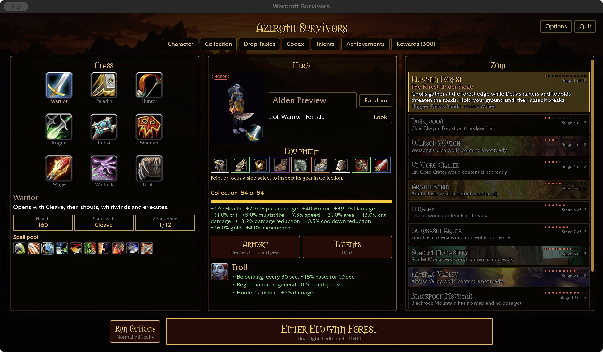
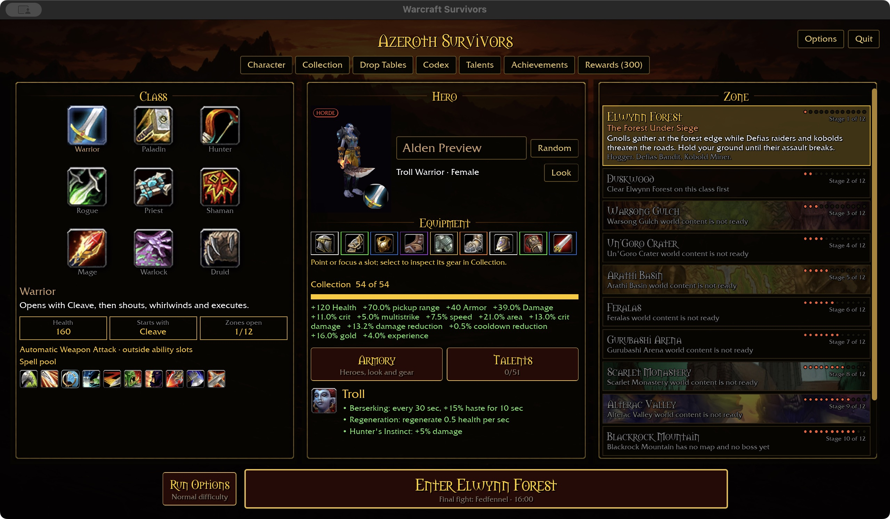
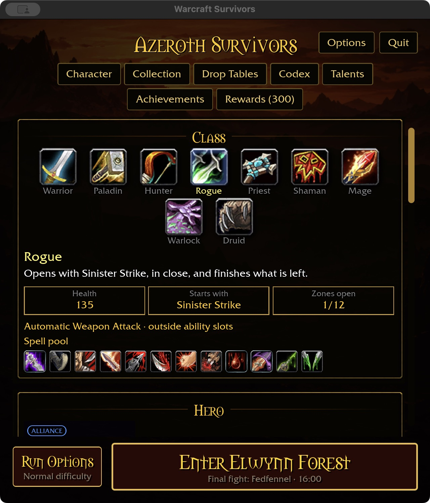
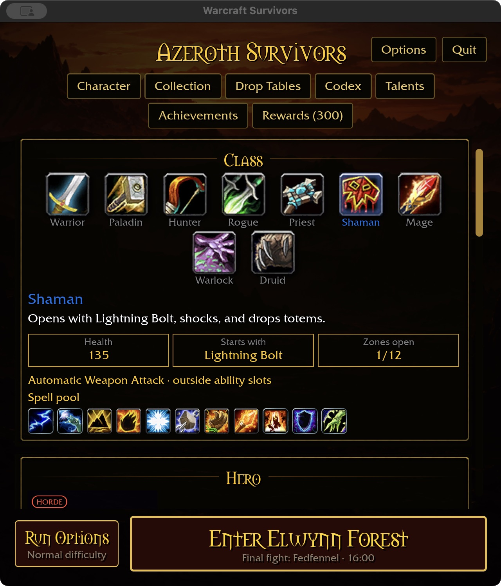

# Melee automatic attacks

## Class foundation — 2026-11-02

Warrior, Paladin, Rogue and Shaman use a worn melee weapon for an automatic
physical attack outside the acquired ability slots. Cosmetic appearances cannot
supply the weapon. Cat/Bear retain their weapon-independent Claw/Maul. Other
classes and caster Druid forms do not gain this attack.

Authored tuning is 24 damage every 2 seconds for one-handed weapons and 36 every
3 seconds for two-handed weapons: 12 base DPS in either case, before percentage
stats, criticals and haste. Item damage ranges and item swing speeds are not
inputs. Reach is 3 yards before area scaling and target radius. Existing ground,
visibility and clear-line checks apply; no eligible target spends no cooldown.
The attack uses its own timer, preserves all six acquired slots and appears
separately from the starter's “Starts with” list. No save migration is needed.

This checkpoint extends attack eligibility, not every weapon-talent consumer.
Named spell modifiers still apply only to their documented spells. Follow-up
work must deliberately integrate Warrior/Rogue weapon specializations, Battle
Shout, Flurry and Rogue burst/proc rules with automatic attacks, including
individual cooldowns and recursion protection. Shaman's current spell-critical
Flurry conversion is unchanged. Do not count this foundation as completion of
that talent audit.

## Verification

Shared-rule coverage checks all nine classes, all seven melee identities and
both weapon categories, absence of equipment, normalized DPS and unchanged
starter grants. Headless Bevy settlement checks all four weapon classes with
both cadences; existing checks retain obstruction, concealment, no-target,
pause, six-slot and feral behavior coverage.

Native starter captures and final gate results are recorded with the checkpoint
in the changelog. Attended combat and Windows remain unverified for this change.

357 shared-rule tests and the ten-package scoped gate pass (31 optional-addon
skips). Native play build: 23.36 seconds; WebGPU check: 8.21 seconds, six existing
warnings. Build output: 58.79 GiB. Native captures use an isolated existing
collection fixture: Warrior at 1280×720/100%, Rogue and Shaman at 640×720/125%.
The reference is `docs/intentions/survivors_main_menu.png`; the existing three-panel
layout and compact stacking remain intact.

Preview limitation: hot-switching the fixture from compact Rogue to Shaman left
some unchanged text missing. A fresh Shaman launch restored it. The final Shaman
capture is from that fresh launch; hot-reload text invalidation needs its own
reproduction/fix and is not resolved by this attack change.
