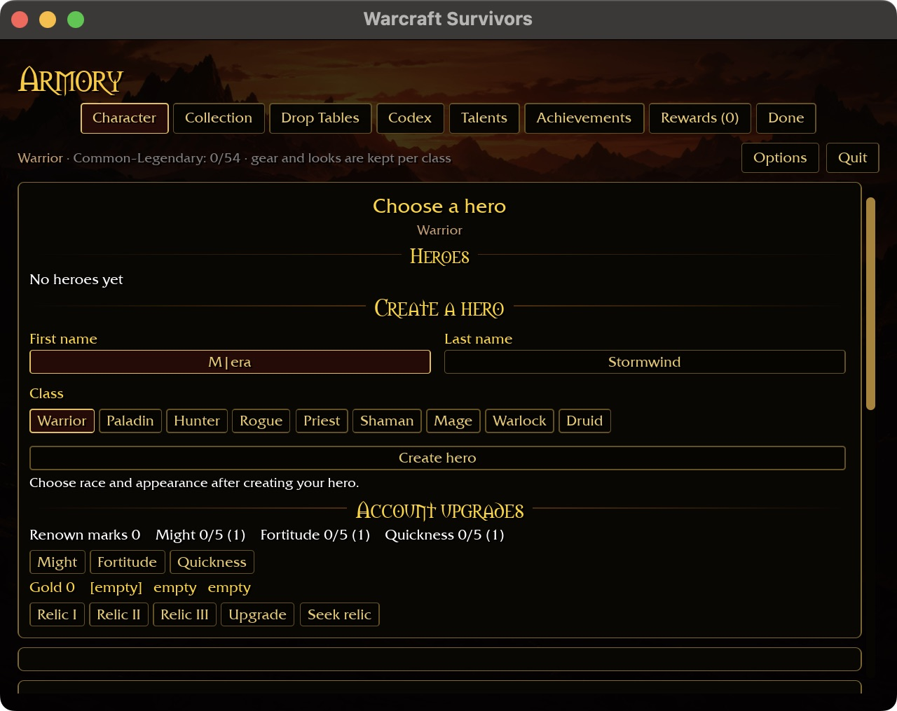
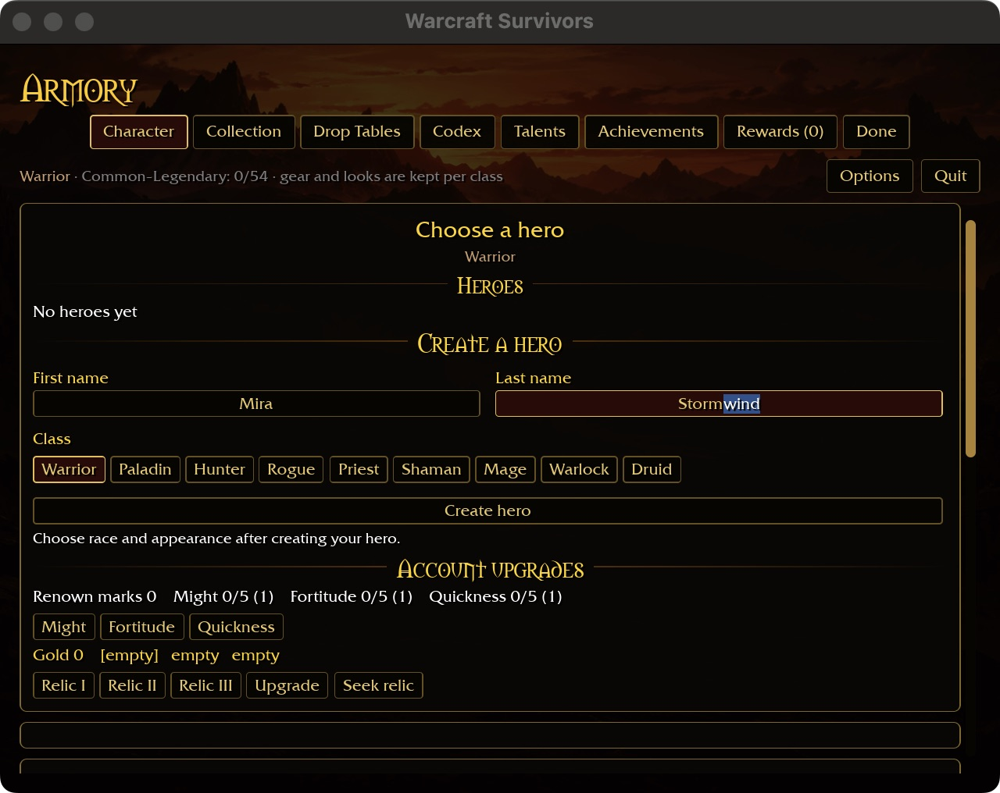
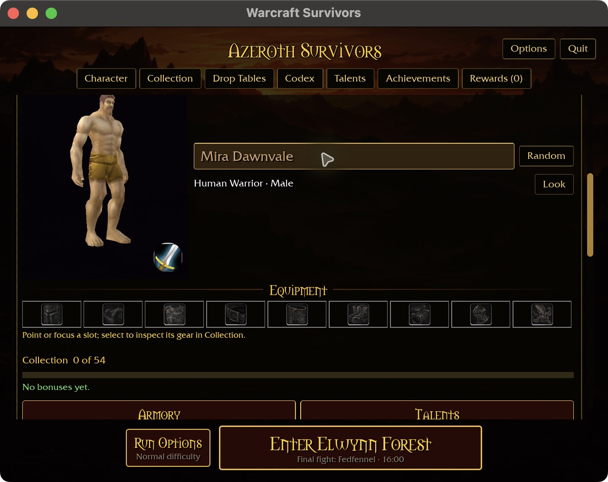
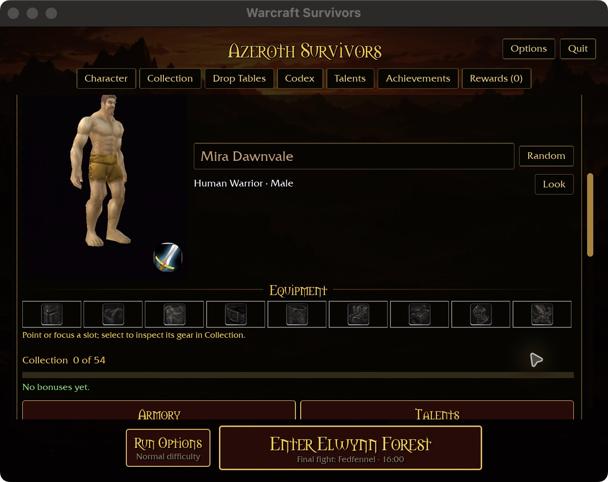

# Caret and partial name selection

Creation and starter rename fields use the shared engine edit-box core for caret
movement, selection and deletion. Left/Right move by character; Shift extends
selection. Home/End move to the field edges. Native word/edge chords use the
engine's OS keymap (Option-arrows and Command-arrows on macOS; Ctrl-arrows on
Windows/Linux). The existing Command/Ctrl-A/C/X/V shortcuts remain available.

A visible caret marks the insertion position; only selected letters receive the
blue highlight. Typing or paste replaces that selection. Copy/cut applies only
to the selected part. Backspace/Delete remove adjacent characters when there is
no selection. Tab changes fields and starts at the destination's end.

Pasting is filtered before insertion and limited to available space after the
selection is removed. This preserves the unselected suffix of a 16-character
name instead of truncating it. Empty or invalid paste preserves selection. Cut
still keeps the name if the clipboard cannot retain the selected text.

The layout follows the existing starter reference in
`docs/intentions/survivors_main_menu.png`; this changes editing inside the name
fields, not the page composition. Mouse clicks still focus at the end; mouse
caret placement and drag selection remain open. Browser clipboard is unavailable
in the existing host service. Native Windows/Linux and physical-controller
acceptance remain open.

## Validation

Twelve focused name-input tests pass, including partial copy/cut, middle insertion,
word selection and suffix preservation at the length limit. The six-package
formatting/Clippy/test gate passes with 31 optional-addon skips. Native play build
passes (2m13s), as does the WebGPU target check (existing warnings remain).

Native macOS production-page preview at 640×480 and requested 125% UI scale:
creation caret editing changes Mera to Mira; selecting only “wind” in Stormwind
and pasting “vale” creates Mira Stormvale. Starter rename selects only “Storm”
and pastes “Dawn”, saving Mira Dawnvale. Escape discards a subsequent insertion;
a full close/restart preserves Mira Dawnvale as a Human Warrior. This uses an
isolated fresh fixture, not the player's account. No combat was entered.

