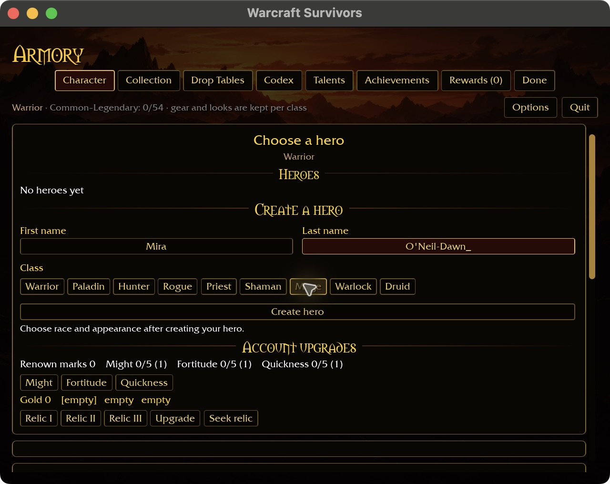
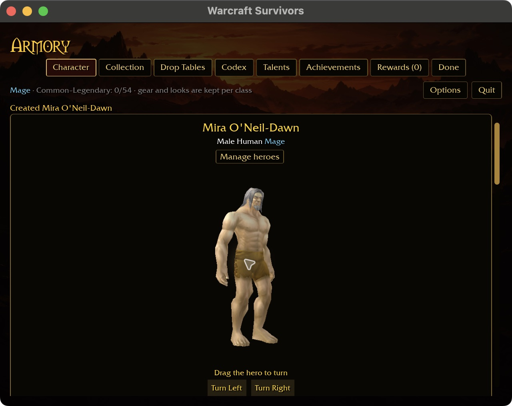
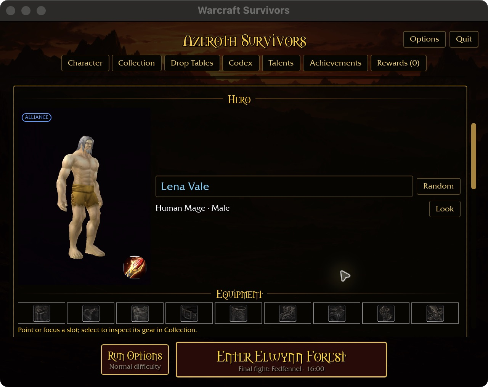

# Native name clipboard

Creation and starter rename fields use the engine's process-wide OS clipboard.
Command/Ctrl-C copies a selected name; Command/Ctrl-X cuts it; Command/Ctrl-V
pastes, replacing a selection or appending without one. Copy/cut without a
selection do nothing. The existing Command/Ctrl-A selects the whole field.

Pasted text follows typed-name rules: ASCII letters, spaces, hyphens and
apostrophes, up to 16 characters per field. Empty, non-text or entirely invalid
clipboard contents leave the selection and current name intact. Cut verifies
that the clipboard retained the selected text before clearing the draft; an
unavailable backend leaves the name intact with a message.

Editing a rename draft still requires Save/Enter, while Escape cancels it.
The starter layout remains based on `docs/intentions/survivors_main_menu.png`.
This adds input behavior, not a new page composition.

## Validation

Eight focused name-input tests pass, including copy/cut/paste across rename
fields, selection preservation for invalid/empty text, the 16-character limit,
key release/focus guards and unavailable clipboard protection. The six-package scoped formatting/Clippy/test gate passes, with 31 optional
addon-corpus skips. The native clipboard build takes 15.86 seconds after a 2m51s
initial play build following incremental-cache cleanup. Existing linker unwind
and `block` future-compatibility warnings remain. The WebGPU check exposed a pre-existing unguarded reference to the native-only
preview scale resource in `hud::apply_ui_scale`. Its parameter and override now
share the preview module's platform guard; browser builds retain the normal
saved UI-scale multiplier. Native behavior is unchanged by that guard. The WebGPU check passes in 43.91 seconds with six existing warnings; the final
six-package native gate also passes with the same 31 optional-addon skips. The
last native rebuild after the platform guard takes 14.33 seconds. Captures precede
only that guard, which leaves the compiled native scaling behavior unchanged.

Native macOS validation uses an isolated fresh account at
`target/ui-fixtures/name-clipboard-20261031`, checkout data only, 640×480 with
requested 125% scaling and automatic fitting:

1. Select the creation first name and paste `Mira123`: it becomes `Mira`.
2. Tab, select the surname and paste `O'Neil-123Dawn`: it becomes `O'Neil-Dawn`.
3. Select Mage and create: the UI confirms `Mira O'Neil-Dawn`.
4. On the starter, paste `Lena` and `Vale` into the rename fields. Ctrl-A/C/X
   cuts the surname; Ctrl-V restores it. Enter saves `Lena Vale`.
5. Paste `Discard` into a new rename draft, then Escape: `Lena Vale` remains.
6. Close and restart: the selected Mage remains `Lena Vale`. The saved account
   independently retains hero id 1, class 6 and that exact name.

Command paste and Ctrl clipboard chords were both exercised on macOS. The
initial validation build also confirmed invalid-only paste keeps the prior name
and Command cut/paste restoration. A transient computer-use `noWindowsAvailable`
error prevented finishing that first UI session; the app process remained live.
The corrected build's creation/rename/cancel/restart sequence completed.

## Limits

Only whole-field selection and append editing are supported. Cursor movement,
partial selection and mouse positioning remain open. The existing host service
has no browser clipboard backend; web paste remains unavailable, and cut leaves
the name intact. Windows and Linux backend behavior require native validation.
