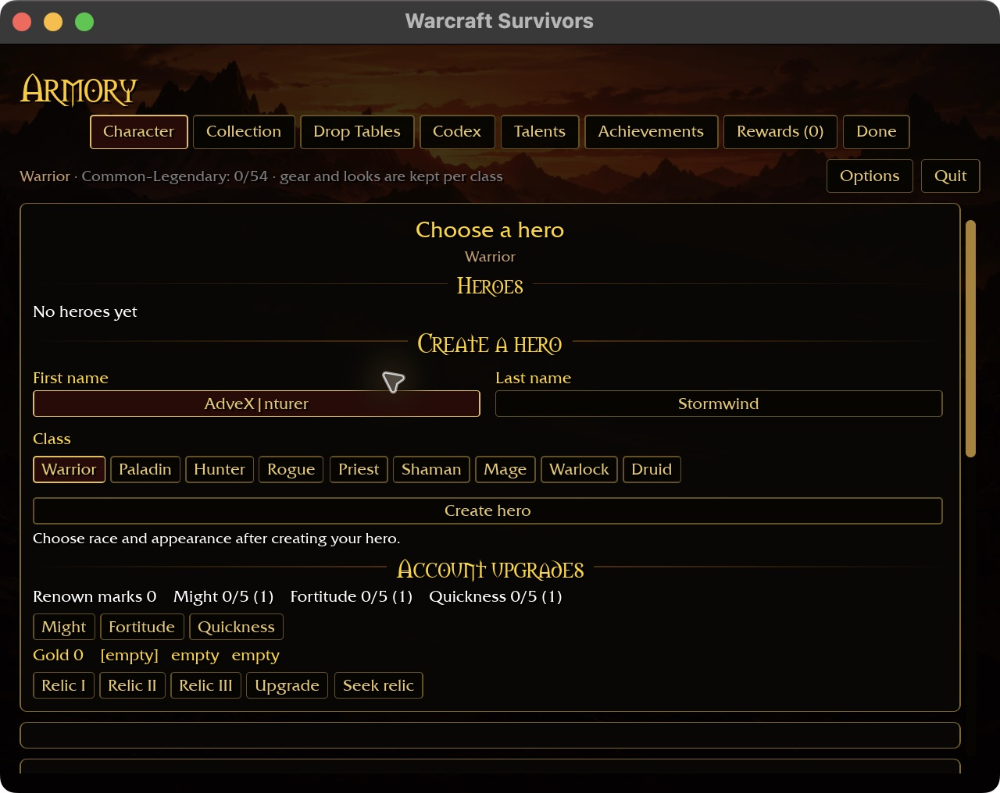
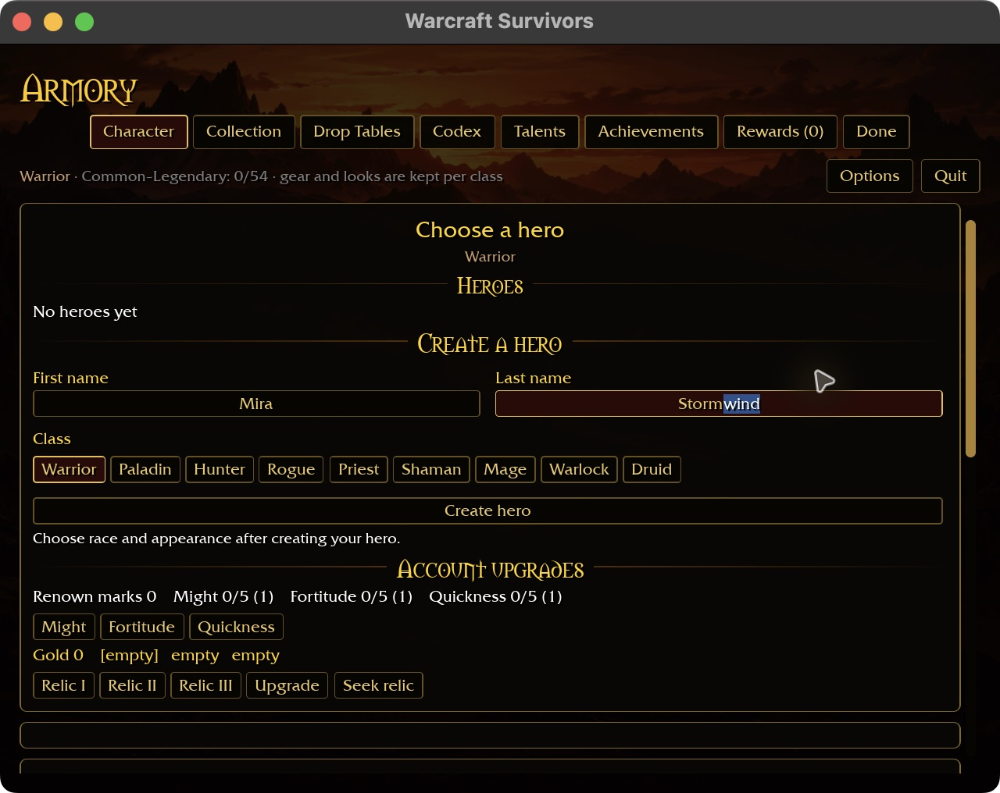
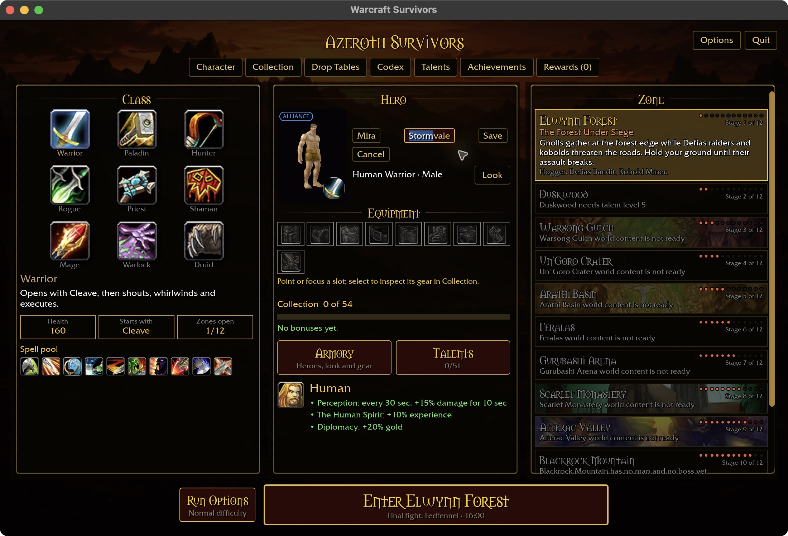
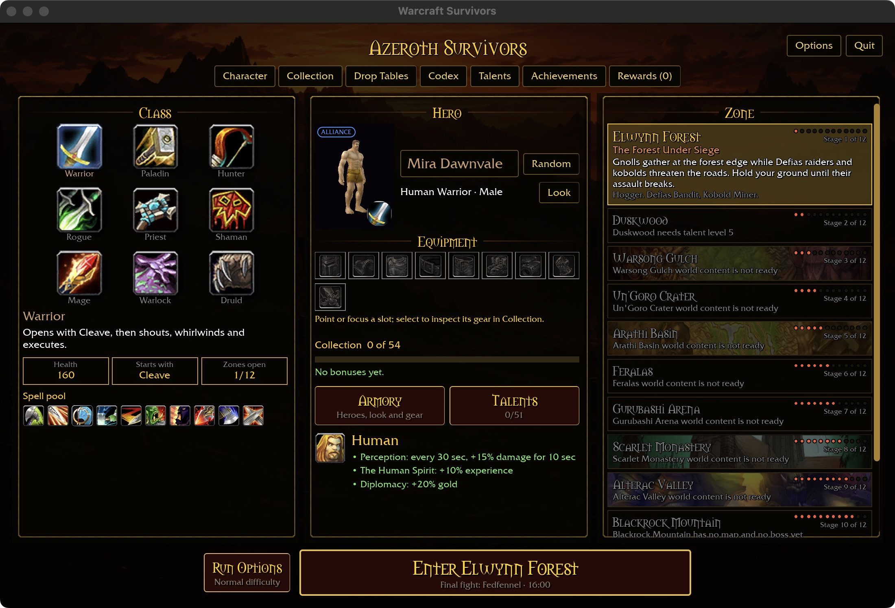

# Pointer editing for hero names

Creation and starter rename fields place the caret at the clicked letter boundary
and extend selection while dragging. Hit testing uses Bevy's shaped text advances,
including spaces, in physical screen coordinates rather than equal-width character
estimates. It therefore follows the rendered font and requested UI scale.

A press captures the original field's byte boundaries and drag anchor. Redrawing
centered text for the caret/highlight does not move those targets mid-drag.
Release ends selection without resetting it. Leaving the window, losing focus,
opening settings or leaving name editing cancels the drag. Hidden/clipped fields
cannot take a pointer press. Keyboard activation still focuses at the field end.

The starter layout remains based on `docs/intentions/survivors_main_menu.png`.
No save format or gameplay changes are involved. Double-click word selection,
Shift-click extension, browser clipboard and other-platform acceptance are not
claimed by this milestone.

## Validation

Seventeen focused name-editing tests pass. Pointer regressions cover variable-width
boundaries and spaces, reverse/outside-field drags, physical scaling, and a complete
press/drag/release delivered in one frame. Later movement preserves the released
selection and settings prevent new presses reaching the name field.

Native play build passes (2m48s). Native macOS production-page previews verify
click-to-insert inside Adventurer, then forward-drag replacement of “wind” in
Stormwind at 640×480 / requested 125% UI scale. Creation saves Mira Stormvale.
At 1100×720 / 100%, reverse dragging selects only “Storm”; pasting “Dawn” and
saving produces Mira Dawnvale, retained after a full close/restart. These are
isolated fixture accounts; no combat or player account was used.

The six-package formatting/Clippy/test gate passes with 31 optional-addon skips.
WebGPU target check passes (20.48s; six existing warnings). Windows/Linux pointer
behavior and physical-controller coexistence remain unverified.

