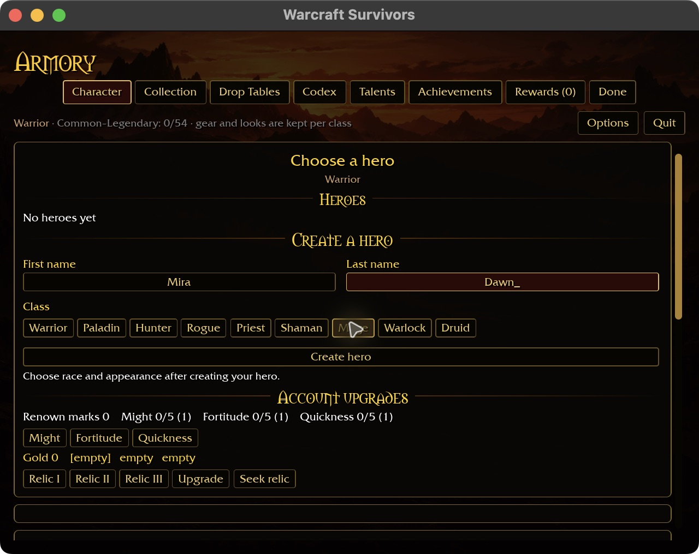
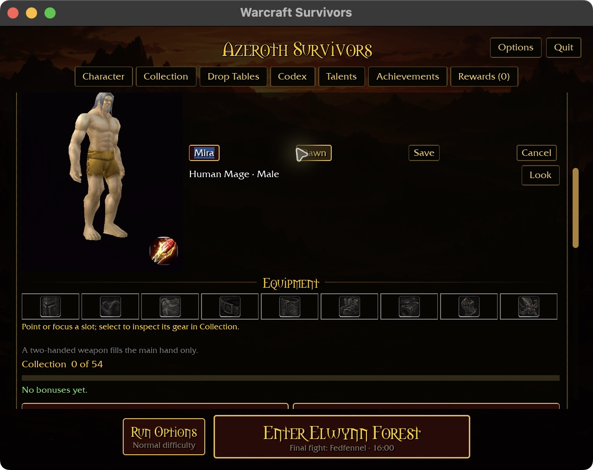
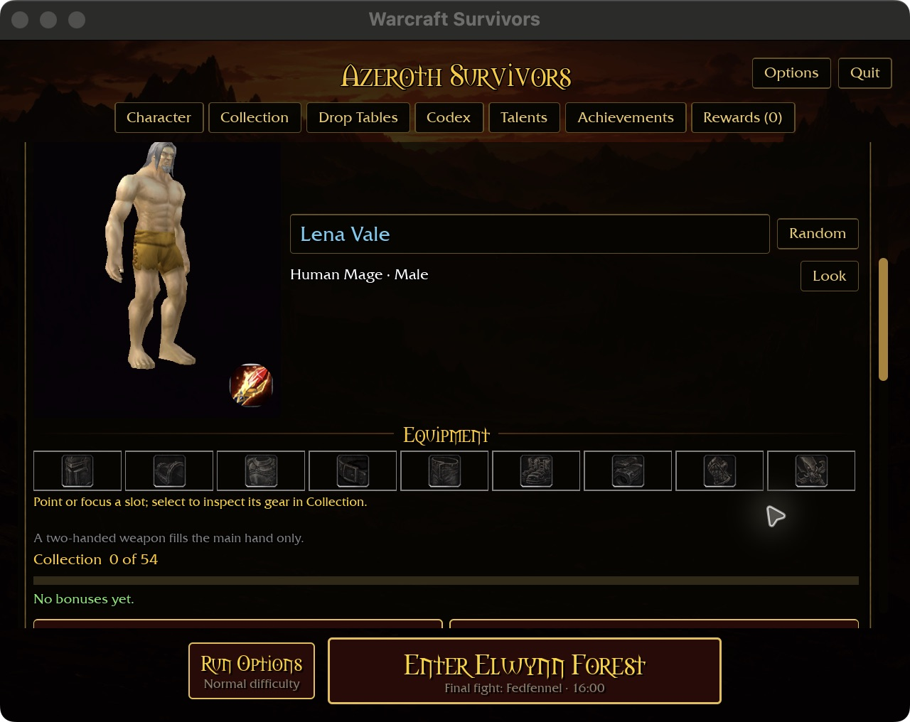

# Name-field selection

The minimum-window creation check exposed Command-A appending `a` rather than
selecting the name. Creation and starter rename fields now support selecting the
whole name with Command-A or Ctrl-A, replacing it by typing, and clearing it with
Backspace or Delete. Selected text has a blue background and white lettering.

Both fields retain the existing ASCII name filter and 16-character limit. Invalid
text does not erase the selection. Tab switches fields and clears the selection;
Escape cancels rename without saving. Other Command/Ctrl shortcut letters are
suppressed rather than inserted. Clipboard copy/paste and partial selection/cursor
editing are not implemented by this change.

Native name input reads winit modifier snapshots and key events in their original
order, including a modifier press/release in the same Bevy frame. Focus loss or
window destruction clears the modifier snapshot. Synthetic Bevy events retain a
fallback path for non-winit producers. This input handling is confined to the
Survivors name fields.

The [Character intention](../intentions/survivors_character_tab.png) remains the
layout reference; no page composition or gameplay changes are intended.

## Validation — 2026-10-31

Five focused tests pass: ordered repeated text/Tab/Enter, filtering/length caps,
whole-name replacement and deletion, invalid-input retention, equal-length error
clearing, rename cancellation, and modifier reset. Native build passes in 2m43s
with the existing linker unwind-size and dependency future-compatibility warnings.

Native macOS uses an isolated fresh account at 640×480 with 125% requested scale
and automatic short-window fit. Command-A selects Adventurer visibly; typing Mira
replaces it. Tab, Ctrl-A and Dawn replace the surname, and Mage creation succeeds.
Starter rename similarly selects Mira, replaces it with Lena, selects and deletes
the surname with Backspace, types Vale and saves with Enter. A subsequent Discard
draft is cancelled with Escape. Restart restores Lena Vale (hero ID 1, Mage),
matching the saved account; no combat session is started.

Windows, browser and physical-controller acceptance remain open. Ctrl-A was
replayed on macOS, which does not establish Windows validation. Partial selection,
cursor movement and clipboard behavior remain future text-editing work.

The six-package scoped formatting, Clippy and test gate passes. Thirty-one
optional-addon tests skip because the addon corpus is absent. Local Markdown
targets and diff formatting pass. Windows and full pre-merge gates are not
claimed by this checkpoint.

Native clipboard support follows in [the clipboard audit](NAME-CLIPBOARD.md);
its platform limits supersede this checkpoint's native clipboard gap.
