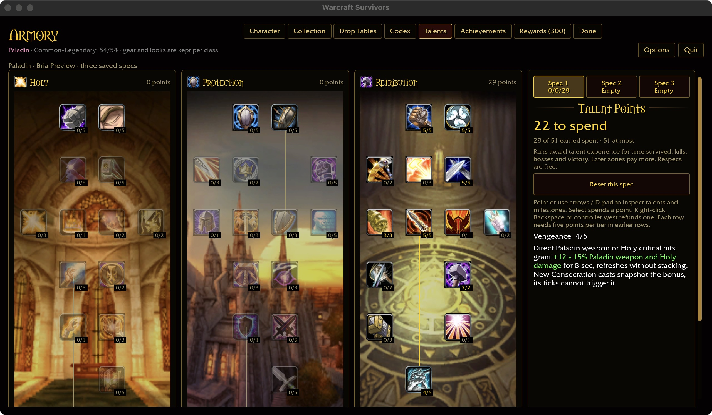
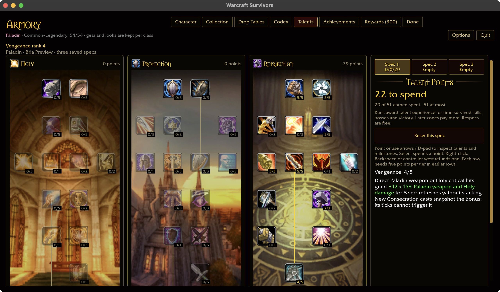
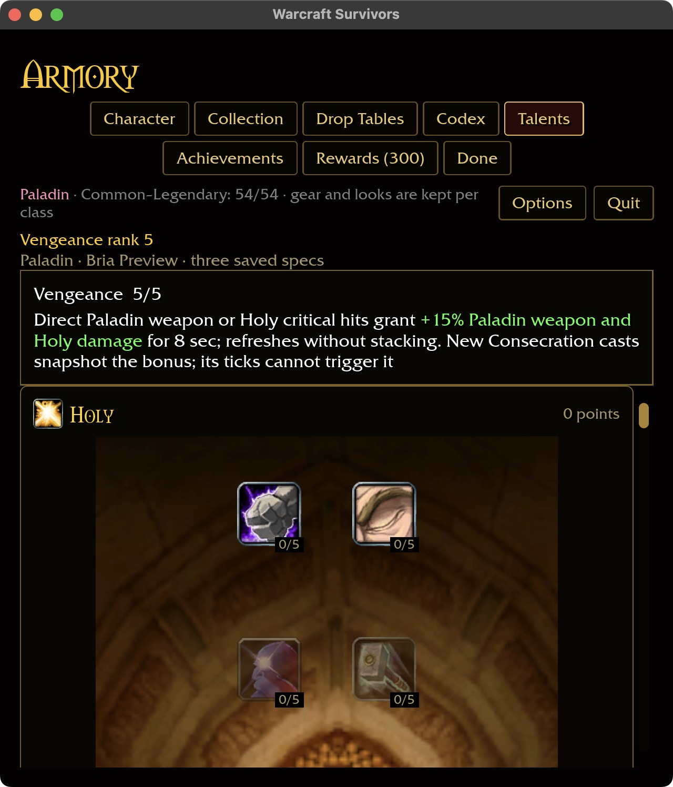

# Vengeance and automatic weapon attacks

## Reference and behavior

The checkout's talent node 1402 references spells 20049/20056/20057/20058/20059.
The tooltip includes weapon-swing criticals and both Physical and Holy damage.
Triggered spell 20055 lasts 8,000 ms and has two damage-percent auras: 15% with
school masks 1 (Physical) and 2 (Holy). Reproduce using:

```sh
target/debug/survivors-audit wow-data/Data --talent-evidence 1402
target/debug/survivors-audit wow-data/Data --spell-evidence 20055
```

Survivors previously implemented only the Holy half because Paladins had no
physical swing. With the automatic attack now present, a successful original
hero weapon critical must activate the same 3%-per-rank buff. Later weapon swings
and existing Paladin Holy spells gain its damage multiplier; the triggering hit
is not retroactively increased. Refresh resets the eight-second timer without
stacking. Existing Consecration snapshot behavior remains unchanged.

Proc settlement requires actual health removed by an original hero hit. Pets,
secondary splash, dead targets, zero damage and noncritical swings cannot activate
it. Healing, other-class spells and jewelry remain outside this authored damage
scope. The damage meter remains Weapon Attack; the HUD and green inline talent
text now disclose both weapon and Holy damage.

## Acceptance

Native macOS purchase 4→5, refund 5→4 and restart pass with an isolated Paladin
profile (25 prerequisite points, 51 earned). Screens cover 1280×720 / 100% and
640×720 / 125%, preserving the intention-based artwork/layout and green inline
12 » 15% comparison. Captures use the new native build, completed in 43.51 seconds.
The preview pin selects inspection only; pointer actions changed the real fixture
account. Restart retained the refunded rank. No real player profile was modified.









Shared rules pass 336 tests. All three targeted runtime tests pass, including
actual one-/two-handed cast damage and settlement, nonstacking refresh, expiry,
refund, pet/noncritical/zero-health/dead-target rejection. The six-package scoped
formatting/Clippy/test gate passes with 31 optional-addon corpus skips. Its
catalog-backed account regression verifies all ranks, cap, independent specs,
reload and refunds. Logs: `/tmp/vengeance-{rules,runtime,build,check}.log`.
Build storage passes at 60.99 GiB with 1,229.72 GiB free. This
change does not add a named talent: coverage remains 311/432, Paladin 30/44.
Attended combat, Windows, controller and the full talent/content contract remain
open; menu screenshots do not demonstrate live combat damage.
