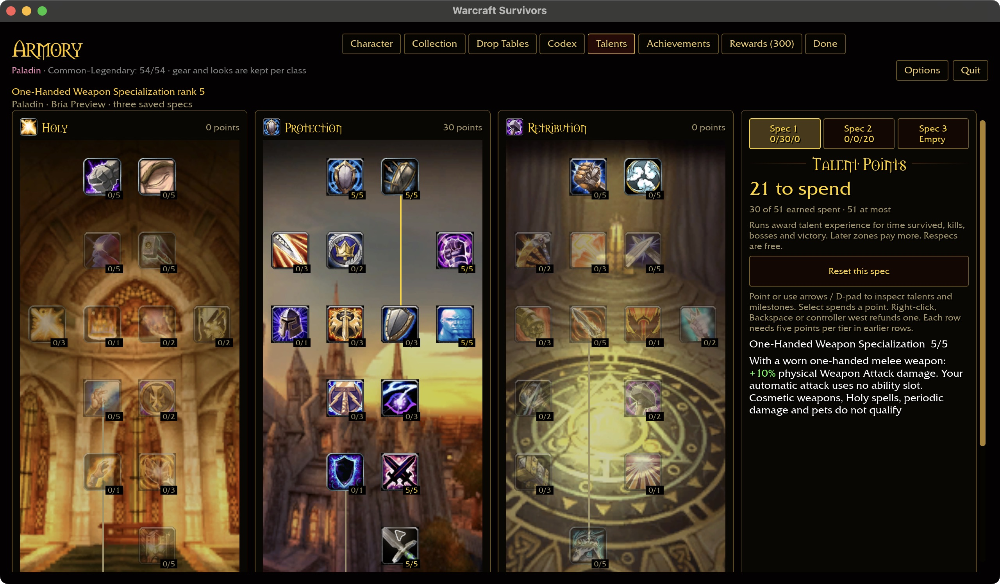
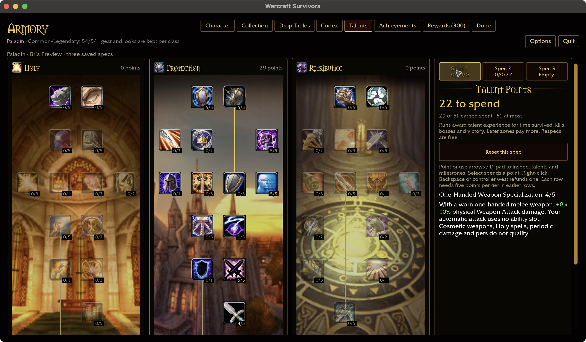
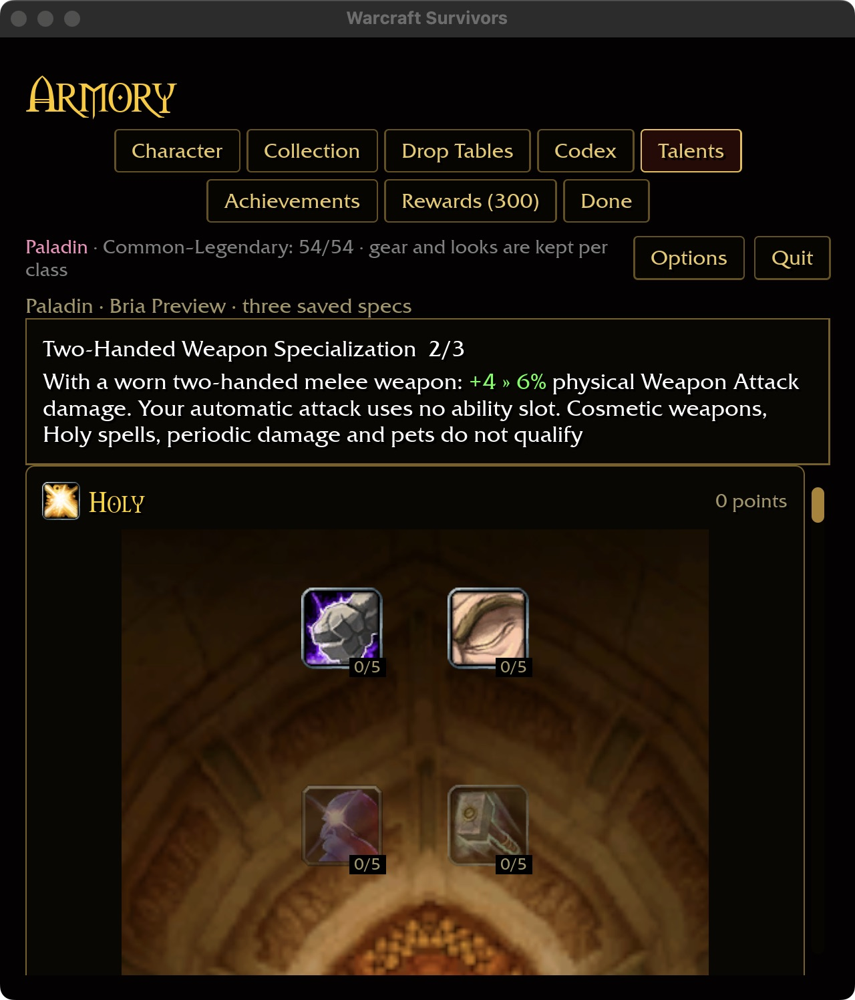
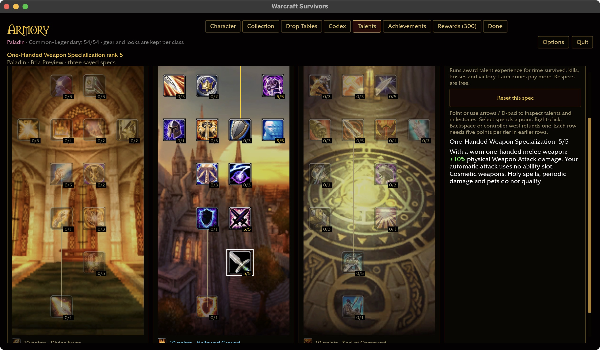

# Paladin weapon-specialization dependency

## Verified rules

Checkout Spell.dbc evidence resolves Protection node 1429 to five ranks of
One-Handed Weapon Specialization: 2/4/6/8/10% physical melee weapon damage.
Retribution node 1410 has three ranks of Two-Handed Weapon Specialization:
2/4/6%. Both use aura 79 with physical-school mask 1; the spell rows require
item class 2, with subclass masks 0xa891 and 0x21562 respectively. These facts do
not authorize boosting every spell merely because a weapon is equipped.

Reproduce with the checkout's data:

```sh
target/debug/survivors-audit wow-data/Data --talent-evidence 1429
target/debug/survivors-audit wow-data/Data --talent-evidence 1410
target/debug/survivors-audit wow-data/Data --spell-evidence 20196
target/debug/survivors-audit wow-data/Data --spell-evidence 20111
```

## Original missing runtime consumer

At the original audit, the Paladin pool in `survivors-core/src/data.rs` contained Hammer of Wrath,
Consecration, Holy Shock, Exorcism, Holy Wrath, Hammer of Justice, Divine Shield
and Judgement. Their configured spell IDs are 24275, 26573, 25912, 879, 2812,
853, 642 and 20271. Each resolves to school 1 (Holy) in checkout data. A `Strike`
ability shape only describes target selection; it does not make the hit a physical
weapon attack. There was no separate Paladin basic melee swing at this audit.

Existing Warrior specialization uses an explicit list of weapon attacks. Reusing
its one-/two-handed condition alone for Paladin would either produce no effect or
incorrectly boost Holy spells. Keep both Paladin definitions pending until their
actual physical-damage consumer exists. Coverage remains 300/432 (Paladin 25/44).

## Decision and integration

User decision (2026-10-30): Paladins start with an automatic physical attack
outside the six ability slots. Stormstrike remains a separate pending decision.

Follow-up at `fdabe73`: Repentance adds a ninth Paladin ability, but no physical
weapon attack. Coverage is now 305/432 (Paladin 26/44); both specializations remain
pending. The [complete Paladin dependency map](PALADIN-TALENT-DEPENDENCIES.md)
tracks the other missing consumers.

After resolving the attack policy:

1. Define its acquisition, range, cadence and damage source; use supported floor,
   collision and target visibility checks. Define how extra targets apply.
2. Use the selected hero's owned, worn weapon identity through
   `Loadout::melee_weapon`; appearance overrides must not supply power.
3. Apply 2% per rank only to eligible physical weapon damage, with five- and
   three-rank caps. Keep Holy abilities, periodic spells and combat pets independent.
4. Show the real conditional effect and green inline rank changes in Talents.
5. Verify purchase/refund/spec/save behavior, empty/unowned gear, one-/two-handed
   swaps, cosmetic independence, emitted hits and actual damage settlement. Capture
   native wide/compact talent previews; retain attended combat and Windows checks.

Validation: both complete talent rank reports and thirteen spell reports were
read from checkout data, including first/final specialization ranks and the actual
Holy Shock damage spell (25912). This is dependency evidence, not implementation
or visual acceptance. No installed assets are copied and no new screenshot is claimed.

Repository validation: the eight-package formatting/Clippy/test gate passes with
31 optional-addon skips. The existing rustdoc link gate also passes (150 benign
warnings). These checks do not enable or validate either missing talent.

## Weapon-damage source evidence — 2026-10-30

The [pinned MaNGOS Zero item catalog](https://github.com/mangoszero/database/blob/325948a78015794e6cc626212bc19fee70c805b2/World/Setup/FullDB/item_template.sql)
contains weapon damage ranges and millisecond attack delays, unlike the display
metadata. A fresh read of that exact upstream revision matches the cached file's
SHA-256 `cbba79ec53c0bc451d75270d3ea3bc1264a6ae49ae60e7005cd6300a374a766b`.
The SQL is read as data, never executed. This is community server evidence, not
proof of original Blizzard server formulas or Survivors balance.

[CSV](paladin-weapon-damage.csv) covers the seven current Paladin main-hand
identities (Poor plus six ordinary tiers), with Warrior Thunderfury as an explicit
mixed-school comparison. It is not an audit of every class or every weapon.

| Survivors tier | Item | Entry | Source physical damage | Source delay (ms) |
| --- | --- | ---: | ---: | ---: |
| Poor | Cracked Sledge | 1414 | 10–15 | 3300 |
| Common | Quel'Serrar | 18348 | 84–126 | 2000 |
| Uncommon | Hammer of the Grand Crusader | 18717 | 116–175 | 2700 |
| Rare | Bonereaver's Edge | 17076 | 206–310 | 3400 |
| Epic | The Untamed Blade | 19334 | 192–289 | 3400 |
| Rank 14 | Grand Marshal's Battle Hammer | 18867 | 235–353 | 3800 |
| Legendary | Corrupted Ashbringer | 22691 | 259–389 | 3600 |

These source numbers must **not** silently become Survivors stats. The Rare
identity has more base physical damage than the Epic identity at the same speed.
Source rarity also differs: Quel'Serrar is vanilla Epic but Survivors Common.
Direct import would therefore not implement the requested rarity progression.
The same catalog gives Thunderfury 44–115 physical plus 16–30 Nature damage;
collapsing all components into a physical hit would misapply school-specific
training. A weapon's proc spells are separate fields, not part of those ranges.

The next implementation must explicitly choose an authored, rarity-aware damage
policy or another approved conversion. Preserve worn identity, distinguish swing
cadence from cooldown/recovery, and retain damage-school components if using
source damage. Attack acquisition remains the outstanding Paladin choice; no
attack or talent is enabled by this audit.

Reproduce from the ignored cached catalog (or a fresh copy of the pinned URL):

```sh
python3 docs/audits/weapon-damage.py target/gear-catalog/item_template.sql \
  1414 18348 18717 17076 19334 18867 22691 19019
python3 docs/audits/test_weapon_damage.py
```

The extractor verifies the complete source hash before parsing, validates all
requested rows before output, and retains all five damage components. Two tests
cover escaped names, separate schools, hash drift, duplicate rows, missing items,
nonweapons, invalid delays/ranges and invalid schools. Both pass; regenerating the
CSV reproduces the checked-in report. No Rust/runtime/UI changed, so no new native
build, scoped gate or screenshot is claimed. Definition coverage remains unchanged.

## Automatic weapon attack — 2026-10-30

Paladins automatically swing an owned, worn melee weapon without occupying an
ability slot or appearing in level-up drafts. Empty/unowned/ranged gear does not
supply a swing; cosmetic overrides cannot supply weapon identity. The existing
selected-character run snapshot supplies that identity.

Initial Survivors tuning is 24 base damage every 2 seconds for one-handed weapons,
36 every 3 seconds for two-handed weapons (equal 12 base DPS). Existing Might,
critical chance/multiplier and haste apply; gear rarity contributes through the
existing permanent stat bonuses. This is authored baseline tuning, not imported
vanilla item damage, a new weapon-stat table, or finalized balance. Spell cooldown
reduction and area bonuses do not change the basic swing.

Targets must be alive, visible to the hero, within 3 yards plus enemy radius in
three dimensions, floor-supported and unobstructed by solid geometry. Extra-target
bonuses add nearby eligible victims; they do not create area attacks. No eligible
target spends no swing. Paused/dead simulation cannot attack or advance its clock.
The existing swing animation and hit settlement feed the Weapon Attack meter row.

Weapon-specialization talent definitions, seals and other attack-dependent talents
remain pending individual implementation and native UI evidence. No new talent
coverage or attended combat/Windows acceptance is claimed by this foundation.

Validation: five actual-runtime regressions pass for one-/two-handed settlement,
cadence, six occupied slots, pause/death, gear absence, concealment, three-dimensional
range, solid-wall occlusion, extra targets and haste. Native incremental build passes
(74 seconds); macOS linker reports its existing large-unwind-table warning.
No new native UI screenshot is claimed for this combat-only checkpoint.

The eight-package scoped formatting/Clippy/test gate passes with 31 optional-addon
corpus skips. Logs: `/tmp/paladin-auto-{test,build,check}.log`.

## Weapon specialization implementation — 2026-10-30

Protection 1429 and Retribution 1410 now multiply only the Paladin's automatic
physical Weapon Attack, by 2% per rank with five-/three-rank caps. The worn hand
must match. Cosmetic weapons, Holy spells, bleeds, pets and other classes' attacks
do not qualify. Hemorrhage now recognizes the authored basic swing as physical
and consumes one charge during actual damage settlement.

Shared-rule coverage checks all classes, absent/one-/two-handed weapons, rank
caps, source exclusions, refunds and green inline ranges. Actual cast/settlement
coverage checks damage and physical vulnerability consumption. Catalog-backed
account coverage includes purchase caps, opposite cosmetic weapon, reload,
independent specs and refunds. See validation results below.

Native macOS evidence uses a fresh isolated collected profile with 25 prerequisite
Protection points in Spec 1 and 20 Retribution points in Spec 2. Pointer purchase
0→5→4 verifies one-handed training (26→21→22 unspent); Spec 2 independently goes
0→3→2 (31→28→29 unspent). Restart retains both allocations, and returning to Spec 1
restores 4/5. Wide 1280×720 and compact 640×720 / 125% descriptions retain green
inline changes with a single percent unit, using the existing intention-based
artwork and layout. Gameplay balance, attended combat, Windows and controllers
remain open.








Additional captures: [initial one-handed](../images/screenshots/2026-10-30-paladin-weapons/one-hand-untrained.jpg),
[one-handed refund](../images/screenshots/2026-10-30-paladin-weapons/one-hand-refund.jpg),
[initial compact two-handed](../images/screenshots/2026-10-30-paladin-weapons/two-hand-compact.jpg),
[maximum two-handed](../images/screenshots/2026-10-30-paladin-weapons/two-hand-trained.jpg).

Validation after build-cache recovery: `cargo survivors-rules` passes all 336
shared-rule tests, including class/hand/source scope, caps and inline descriptions.
Formatting, full-workspace Clippy and workspace tests pass with loopback
permission (31 optional-addon skips). All 4,900 application tests pass, including
actual damage/vulnerability settlement and catalog-backed purchase/spec/reload/
refund; 10 application tests are ignored. The first sandboxed attempt failed only
because it denied the mock-login listener at `127.0.0.1`. No-install tests, documentation links, render-pass lint and player-configuration
tests also pass; the player run reports the same 31 optional-addon skips. Native screenshots above predate the
storage-only build-profile change; they are not new captures from this rebuild.


### Native keyboard follow-up

A separate disposable copy of the trained profile verifies arrow-key navigation
from the header into the Protection tree, automatic scrolling to its milestone,
and back to One-Handed Weapon Specialization. With the preview inspection pin
removed, Enter purchases rank 4→5 and Backspace refunds 5→4; focus and the green
8 » 10% description survive both rebuilds. No pointer purchase or save editing
supplied these rank changes. The native app closed normally and its running-app
inventory confirmed exit before restoring the validation launcher. This is a
1280×720 / 100% macOS check, not physical-controller or Windows acceptance.




Final validation: `WOW_DATA="$PWD/wow-data/Data" scripts/check.sh` completes the
full gate in 1,000 seconds with loopback permission. The native play build passed
in 27.34 seconds before the storage-only profile adjustment, and the keyboard
follow-up exercised that same compiled implementation. Freshly rebuilding and
running `survivors-audit --talent-coverage` reports Paladin 30/44, total 311/432,
and 81/81 milestone descriptions. These are definition counts, not full talent
or gameplay acceptance. The post-validation storage check passes at 51.35 GiB of
build output, with 1,239.54 GiB free. Logs: `/tmp/paladin-specialization-check-network.log`,
`/tmp/paladin-specialization-rules.log`, `/tmp/paladin-specialization-coverage-fresh.log`.
