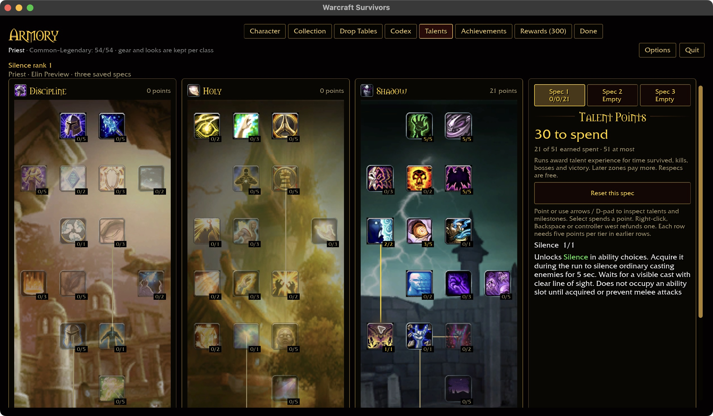
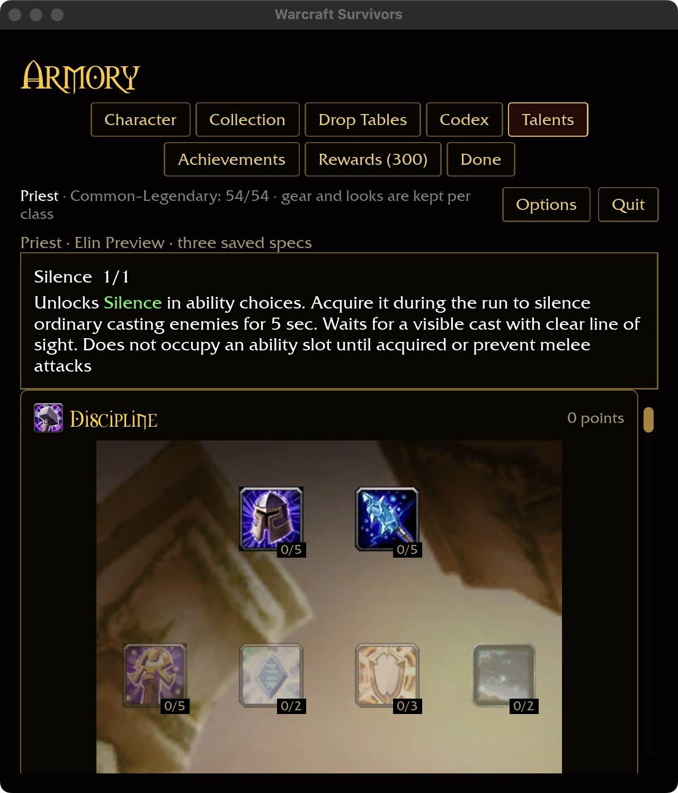
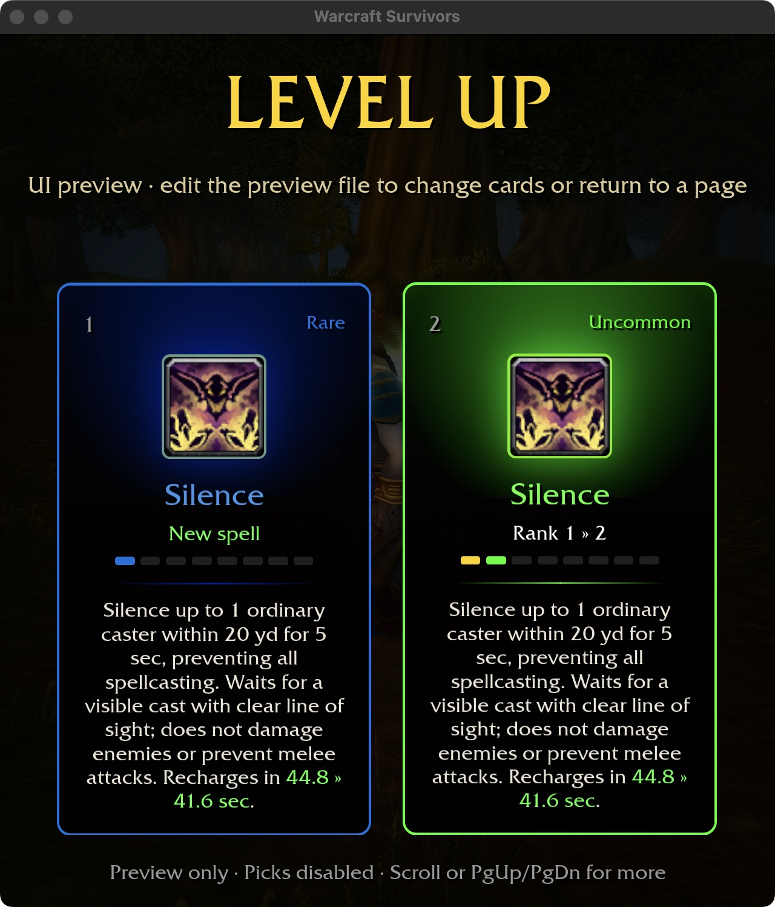
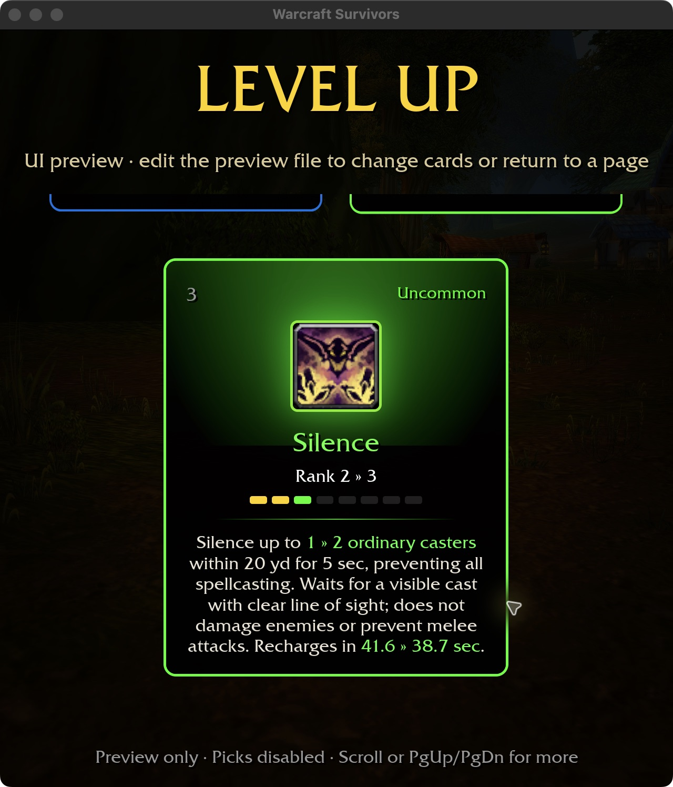

# Priest Silence

## Mechanics — 2026-10-30

Checkout data, reproduced with `survivors-audit wow-data/Data --talent-evidence
541` and `--spell-evidence 15487`, identifies the one-rank Shadow talent at row
4, column 0, requiring Improved Psychic Scream (542) rank 2. Silence lasts
5,000 ms, reaches 20 yards and recovers in 45,000 ms. The effect is an all-school
silence aura, not damage or school-specific interrupt lockout.

Training node 541 unlocks Silence in the Priest ability pool. As with Mind Flay,
the player must acquire it during the run before it occupies one of six slots.
Refunding training removes offer eligibility; existing run snapshots remain
independent of later account changes. Catalog-backed prerequisites are retained.

The automatic cast waits for an ordinary living enemy with an unfinished visible
cast, within range and clear line of sight. No eligible cast spends no recovery.
Bosses are excluded by the initial Survivors control policy. Targets use the
existing nearest-enemy order. This activation policy is an authored adaptation,
not vanilla manual-target behavior.

Silence cancels an interrupt-immune cast too, prevents every magic school for
five seconds, and then permits casting again. It creates no extra school lockout,
damage or critical hit. Pursuit and melee remain available. Shared casting state
uses active-run time; no separate wall-clock silence timer is introduced.

Ranks shorten recovery and add targets at ranks 3/5/7. Single-target bonus stats
also add recipients. The five-second control duration remains fixed, and damage
and critical bonuses do not turn this utility spell into an attack. Existing
Shadow Reach remains scoped to its documented damaging spells; Silence is not
added to the damaging-Shadow list. The source tooltip describes Shadow damage
spells, and this milestone makes no broader range-family fidelity claim.

## Evidence and limits

Three actual-system regressions pass: cancellation/expiry including interruption
immunity and continued pursuit; training, target life, concealment, range,
obstruction, boss and deadline eligibility; rank parameters without damage or
longer silence. Offer acquisition and green inline cooldown growth have a HUD
regression. The catalog-backed account matrix includes purchase, cap, independent
specs, serialization/reload and refund of node 541.

The six-package scoped formatting/Clippy/test gate passes with 31 optional
addon-corpus skips. Rustdoc link checks pass.

The native macOS build passes in 46.49 seconds, retaining the existing `block`
compatibility and large unwind-table linker warnings. An isolated Priest fixture
with 20 prerequisite points purchases, refunds and repurchases Silence through
the actual talent page. Restart retains `2:541:1` and two empty alternate specs.
Wide 1280×720 and compact 640×720 / 125% screenshots verify the unlock text and
inline card changes; compact scrolling reaches the third card. The selected
fixture's stats affect displayed recovery, so its cards show 44.8→41.6 seconds
rather than the unmodified base recovery. These are production UI previews,
not attended combat or actual level-up acquisitions.

Fresh source-data coverage is 32/47 Priest and 313/432 overall, with all 81
milestone descriptions. The remaining 119 definitions, broader enemy spell
rosters, attended combat visuals, Windows and controller acceptance remain open.
No full-game completion is claimed.

