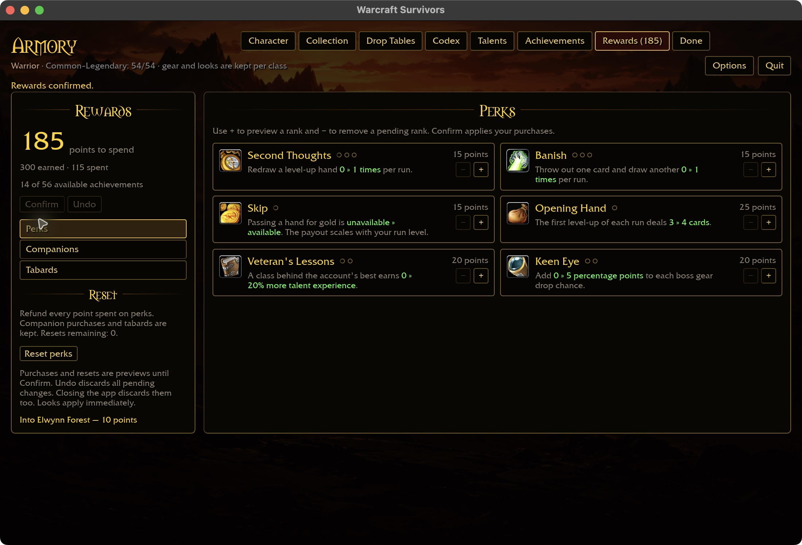
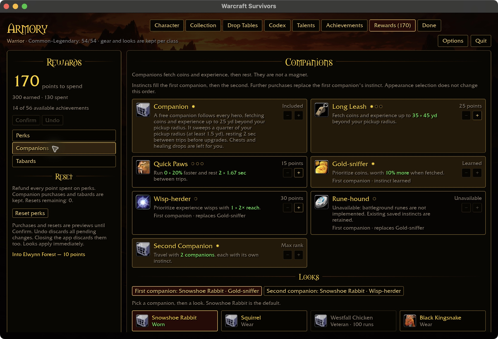
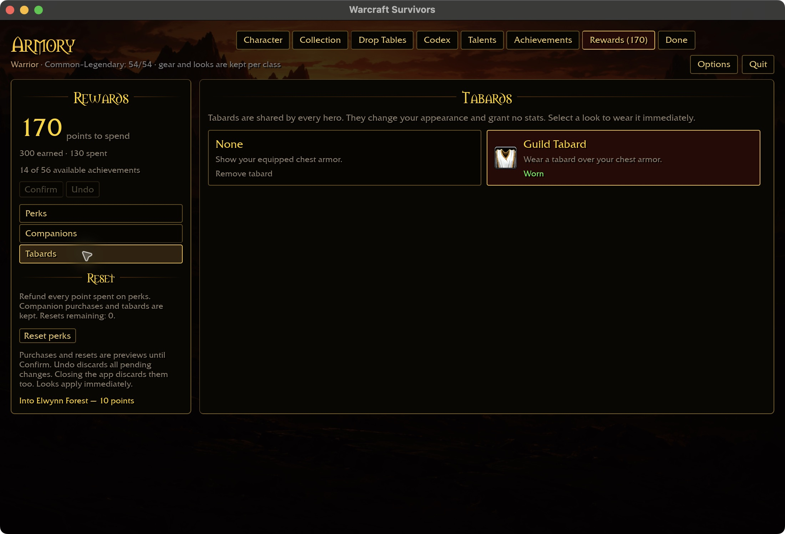
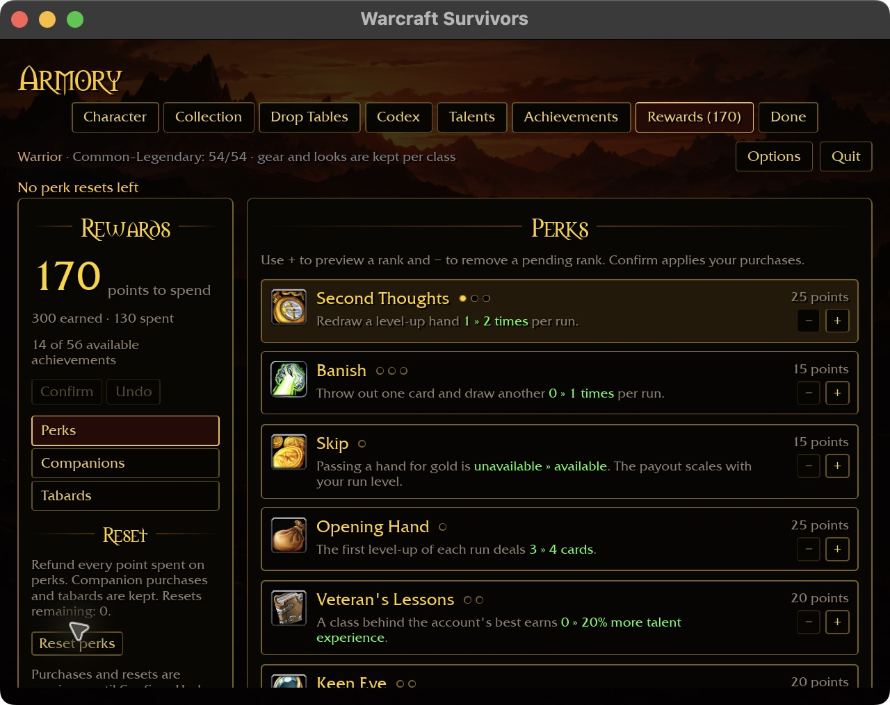

# Two perk resets: native acceptance

Verified 2026-10-31 against `e0dcf09` on macOS, using the production Rewards UI
and checkout data. No runtime code changed for this checkpoint.

Reference: `docs/intentions/survivors_rewards_tab_perks.png`. The wide page keeps
the reference's gold frame, two perk columns, shared currency, Confirm/Undo and
reset section. At 640×480 it uses one card column and scrollable content.

## Reproduction and accounting

Create an isolated collected account with:

```sh
python3 scripts/survivors-ui-fixture.py collected --output target/ui-fixtures/reward-resets-20261031 --preset rewards-perks-1100x720-100.txt
```

Launch the native UI preview with that fixture's `BENILLA_HOME` and `view.txt`.
The fixture supplies 300 achievement points; this does not prove achievement earning.
All purchases, refunds and cosmetic selection below used the actual UI.

| Action | Unspent | Perk investment | Companion investment | Resets left |
| --- | ---: | ---: | ---: | ---: |
| Initial fixture | 300 | 0 | 0 | 2 |
| Confirm Second Thoughts, Long Leash, Gold-sniffer, second companion, Wisp-herder | 170 | 15 | 115 | 2 |
| Preview first reset | 185 | 0 | 115 | 1 (preview) |
| Undo reset | 170 | 15 | 115 | 2 |
| Confirm first reset | 185 | 0 | 115 | 1 |
| Confirm Second Thoughts and Opening Hand | 145 | 40 | 115 | 1 |
| Confirm second reset | 185 | 0 | 115 | 0 |
| Confirm Second Thoughts again | 170 | 15 | 115 | 0 |
| Attempt third reset, then restart | 170 | 15 | 115 | 0 |

The first reset preview left the saved account byte-identical to its pre-preview
copy. Undo restored the balance and reset count. The third attempt reports
“No perk resets left” despite an actual refundable perk investment. The same
rejection is visible at 640×480 with requested 125% scale and automatic fitting.
Both successful resets were confirmed at 1100×720 / 100%.

After restart, Perks, Companions and Tabards all show 170 points. Long Leash rank 1,
two companions, first Gold-sniffer and second Wisp-herder remain. Guild Tabard
remains Worn. Final saved records independently agree:

```text
meta 0 0 130 15 0 1
pets 2 1 0 1 2 0 0 0
perk 1 0 0 0 0 0
```

`meta` stores runs, wins, total spending, perk spending, resets and tabard.
The 115 companion points are 15 Long Leash + 30 Gold-sniffer + 40 second
companion + 30 Wisp-herder. Tabard selection is free and cosmetic.

## Captures and limits

Original native screenshots are in `docs/images/screenshots/2026-10-31-reward-resets/`.









This closes the native two-refund purchase/persistence example, not Phase 6.
Windows, controller, actual perk effects, companion fetching during gameplay and
achievement settlement remain separate acceptance work. Rune-hound remains
unavailable until battleground rune pickups exist. No Rust build or test suite was
rerun for this documentation-only checkpoint; the existing native binary was used.
