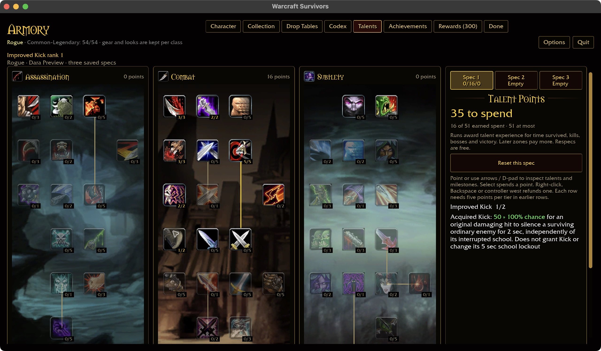
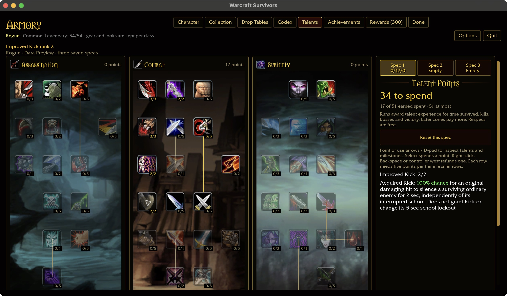
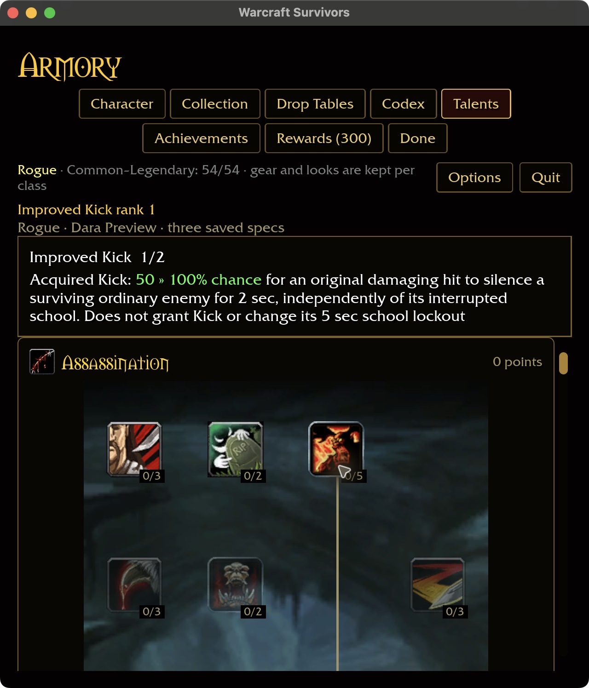
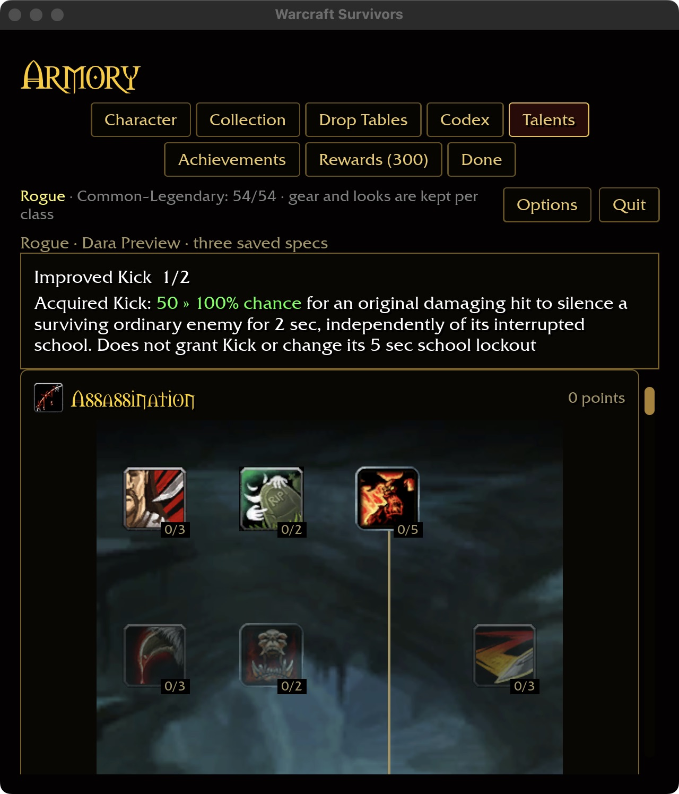
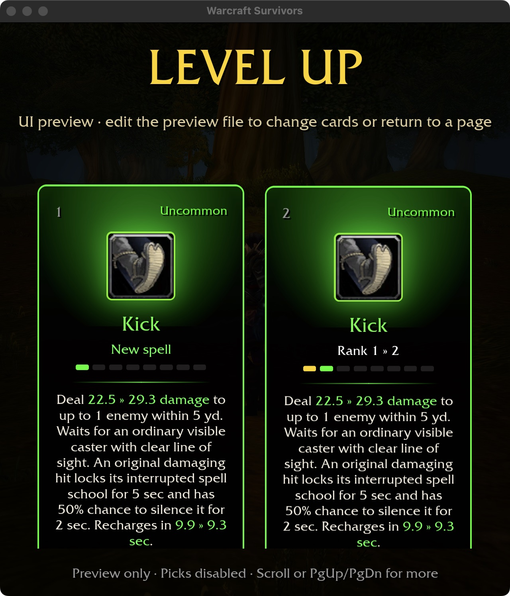
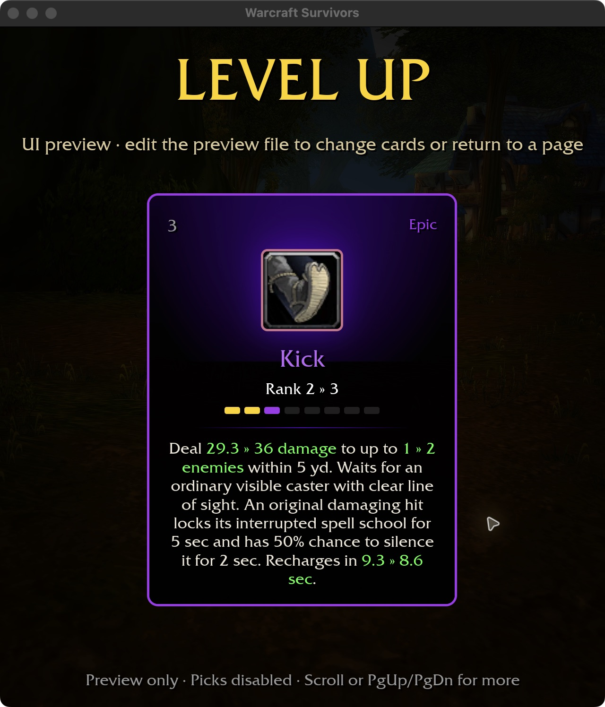

# Kick and Improved Kick

## Source evidence — 2026-10-30

Read this checkout's data with `survivors-audit wow-data/Data
--spell-evidence 1766`, `--talent-evidence 206` and `--spell-evidence 18425`.
Kick rank one has physical school 0, damage base points 14 plus one, five-yard
range, ten-second category recovery, and an interrupt with five-second school
lockout. Combat node 206 has two ranks with 50/100% proc chance; its separate
trigger 18425 is a two-second silence. No equipped-weapon class is required.

## Survivors implementation

Kick joins the Rogue ability pool and uses an ordinary acquired slot. Base damage
is 15 with the normal ability-rank damage/recovery scaling, single-target bonuses
and rank 3/5/7 target growth. The shared Rogue damage, critical and recovery
training includes Kick; explicitly weapon-only procs keep their own membership.
Five-second lockout and two-second silence remain fixed. No energy system is
introduced. These rank and automatic-activation rules are authored adaptations.

The automatic cast waits for a live ordinary enemy with an unfinished visible
cast, within five yards and clear line of sight. An interruption-immune cast is
eligible only with Improved Kick's independent silence chance. No eligible target
spends no recovery. Bosses are excluded by the existing ordinary-control policy.

Kick emits damage through the existing hit queue. At settlement, only the hero's
original hit that removes health from a surviving ordinary enemy can interrupt
and roll silence. Splash copies, pet hits, zero damage, a dead hero and dead
victims cannot produce control. A successful interrupt locks only the interrupted
school; the separate silence can stop an interruption-immune cast without adding
a school lockout. A failed silence roll still spends the successful attack's
recovery. An idle target at settlement grants no interrupt lockout; silence may
still block subsequent casting. The casting lifecycle rejects stale timestamps
rather than retroactively canceling a spell that has already completed.

Improved Kick does not grant the ability or change damage. Its chance appears
inline in green on the talent page; acquired cards show damage, targets and
recovery growth inline with units once. Training obeys installed prerequisites
and independent saved specs.

## Verified acceptance — native macOS

Shared rules pass 349 tests. Four Kick ECS regressions pass through actual cast
and hit settlement, covering control timing, five-yard/visible/live targeting,
splash exclusion, zero damage, pets and dead heroes. The card regression passes;
the nine-test `kick` filter also includes four unrelated existing tests. The
six-package scoped formatting/Clippy/test gate passes, including the installed
purchase/cap/spec/save/reload/refund matrix (31 optional-addon skips).
Native incremental build passes in 1m36s with the existing linker warning.
Fresh definition coverage is 314/432, Rogue 39/51; this is not gameplay completeness.

An isolated Rogue fixture starts with 15 legal Combat points. Native purchases
reach rank one and two; right-click refunds to one, and restart retains that rank.
The wide inspector and compact pinned inspector show the green chance inline.
Cards use the selected fixture's equipment/training, so their damage is higher
than the unmodified 15. Captures cover 1280×720 and 640×720 / 125%; scrolling
reaches the third card. No player save was modified and no combat was automated.

Attended combat visuals, Windows, controller acceptance and broader enemy caster
rosters remain open. These captures extend the existing intention-aligned talent
and card layouts, rather than establishing every page/platform acceptance cell.

