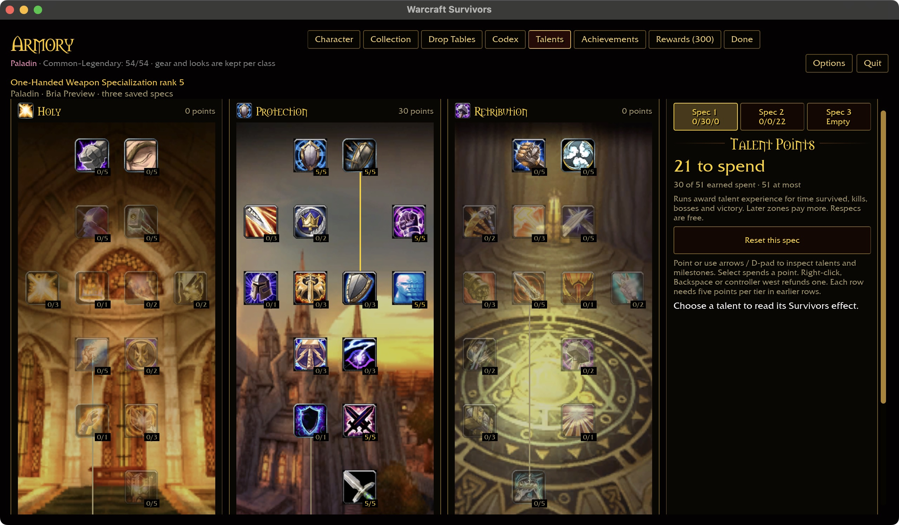
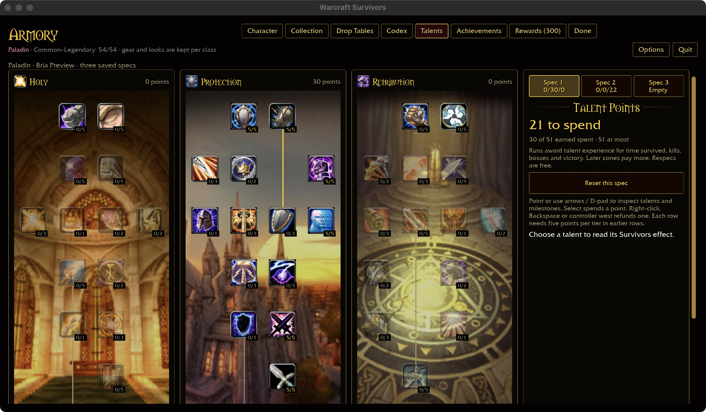
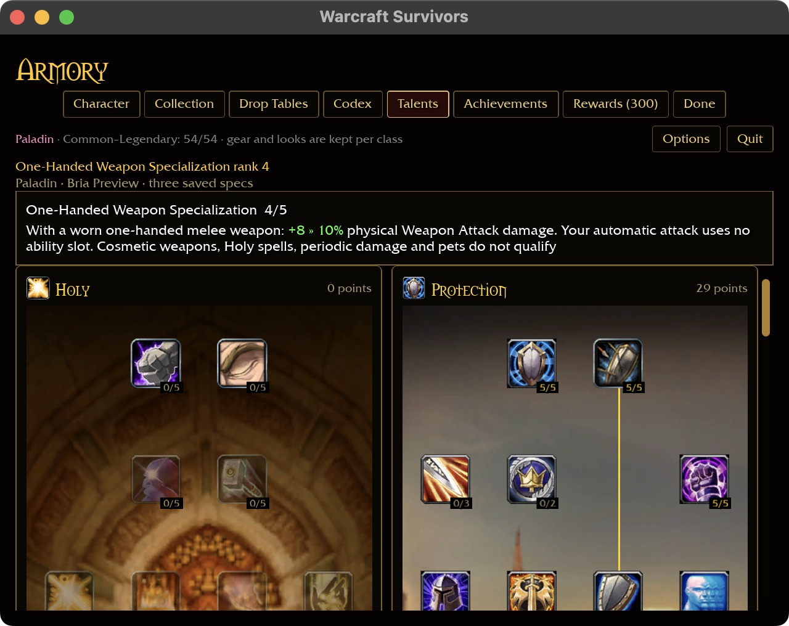
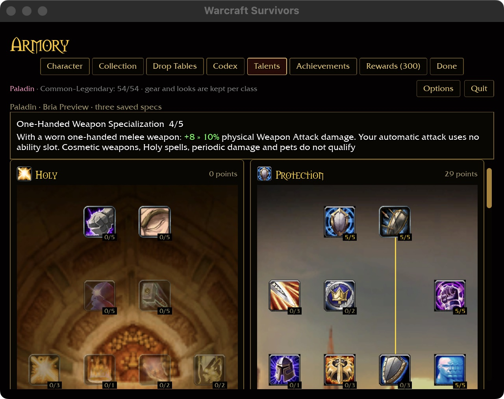

# Native keyboard save recovery — 2026-10-30

Verified on macOS at 1280×720 / 100%, using the existing native build with the
Paladin weapon-specialization implementation recorded at `4be2d99`. No runtime
code changed or rebuild was needed for this acceptance pass.

## Procedure and evidence

A copy of the synthetic Paladin keyboard fixture was isolated under
`target/ui-fixtures/paladin-save-keyboard`. An empty directory at
`benilla-config/survivors-account.tmp` blocked the atomic temporary-file write.
The real player profile was untouched.

1. Arrow keys selected One-Handed Weapon Specialization; Enter purchased 4/5 → 5/5.
   The warning appeared and the new rank remained in memory. The saved account
   remained byte-identical to the baseline.
2. Arrows reached Retry save (from Done: Down to Spec 2, Right to Spec 3, Up).
   Enter retried while the obstruction remained. Warning and keyboard focus
   persisted; the saved account was still byte-identical.
3. Removed only the empty test obstruction. Enter on Retry save cleared the warning.
   A byte comparison proved the sole persisted change was `1:1429:4` → `1:1429:5`.
4. Closed and relaunched the preview. Rank 5/5, 30 Protection points and 21 unspent
   points persisted, without a warning. The account still matched that exact change.
   Closed the preview and restored its launcher environment.

All purchases and retry actions used the keyboard. Window closing used the native
close control. Captures below are original JPEG screenshot bytes.

## Scope and limits

This closes the wide native keyboard save-recovery case in phase 1. It extends the
existing Armory layout without a design change; the talent artwork remains the
reference-aligned layout already reviewed in the class matrix. Physical controller,
Windows and browser-storage failures remain unverified;
the compact follow-up below covers keyboard retry at the minimum window size.
The prior full gate covers unchanged runtime code; this round checks documentation
and captures only. It does not prove all progression or platform acceptance.

## Minimum-window follow-up — 2026-10-30

Verified with runtime `2fb018a`, at 640×480 with requested 125% scale and automatic
short-window fitting. No runtime changes or rebuild. A separate synthetic profile
in `target/ui-fixtures/save-keyboard-compact` started at rank 5/5. A pointer refund
in the wide preview produced rank 4/5 while an empty `survivors-account.tmp`
directory blocked saving; the preview then switched to the minimum window.

Arrow keys reached Retry save through Character → Done → Options → Retry save.
Enter with the obstruction retained the warning and focus; original account bytes
were unchanged. After removing only that empty directory, Enter cleared the
warning. Byte comparison proved the sole persisted change was `1:1429:5` →
`1:1429:4`. Restart retained rank 4/5 and 29 Protection points without a warning;
the same exact byte comparison passed again. The preview was closed and its
launcher restored. The real player profile was untouched.

This verifies compact keyboard recovery, not compact keyboard refund navigation
or the full controller/platform matrix. Captures are original JPEG bytes.
The six-package scoped formatting/Clippy/test gate passes with local mock-login
socket access (31 optional-addon skips); the sandboxed attempt blocked that socket.
Build output remains 60.98 GiB, within the 100 GiB budget.

