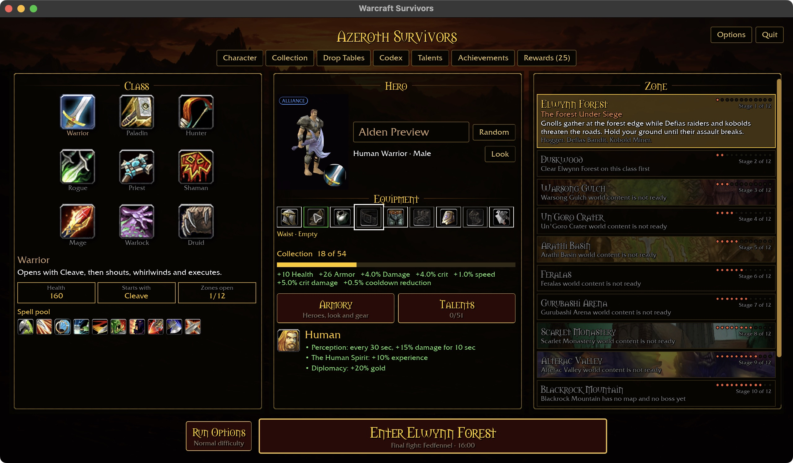
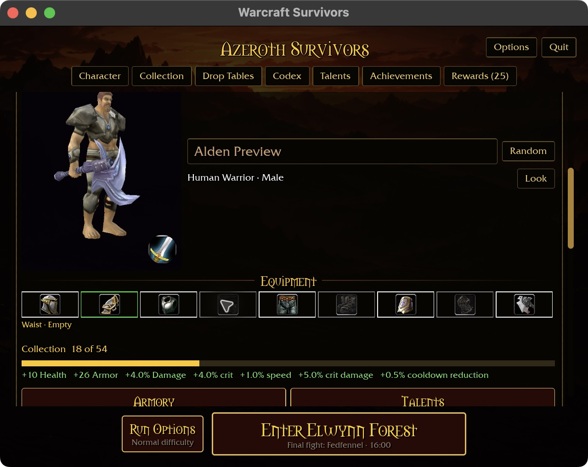

# Starter equipment acceptance — 2026-10-30

Native macOS menu-only validation of `2b9804b`; no production code changed.
Reference: the starter's nine-slot equipment strip in `docs/intentions/`.
Disposable fixture: `survivors-ui-fixture.py partial`, hero 1, using the existing
`starter-equipment-1280.txt` and `starter-equipment-640x480-125.txt` presets.
Only checkout data was used. No combat session was started.

| Check | Observed result |
| --- | --- |
| Wide pointer inspection | Shoulders identifies the worn Uncommon Spaulders of Heroism. |
| Appearance independence | Choosing Common Field Plate Pauldrons as the look changes the model, leaves worn shoulder identity and all bonuses unchanged. Collection shows separate L and E badges. |
| Keyboard priority | Focused empty Waist reads “Waist · Empty” while the pointer remains over shoulders. Moving focus to shoulders then Enter opens the worn item. |
| Compact layout | At 640×480 with 125% requested and automatic short-window fit, scrolling reaches all nine slots and their description above the fixed footer. |
| Compact pointer/reset | Worn shoulders and empty waist display their correct names; moving to blank space restores the inspection hint. |
| Compact navigation | Clicking shoulders opens the selected worn item's full-width detail panel. |

Evidence is inline in the [changelog](../CHANGELOG.md). Additional captures:

The earlier source gate passed eight packages with 31 optional-addon skips
(`/tmp/earths-grasp-check.log`). This documentation/evidence pass does not claim a
new runtime test run. The app was closed and the temporary launcher restored.
Windows, physical controllers, all race/body combinations and gameplay remain
outside this acceptance pass.
