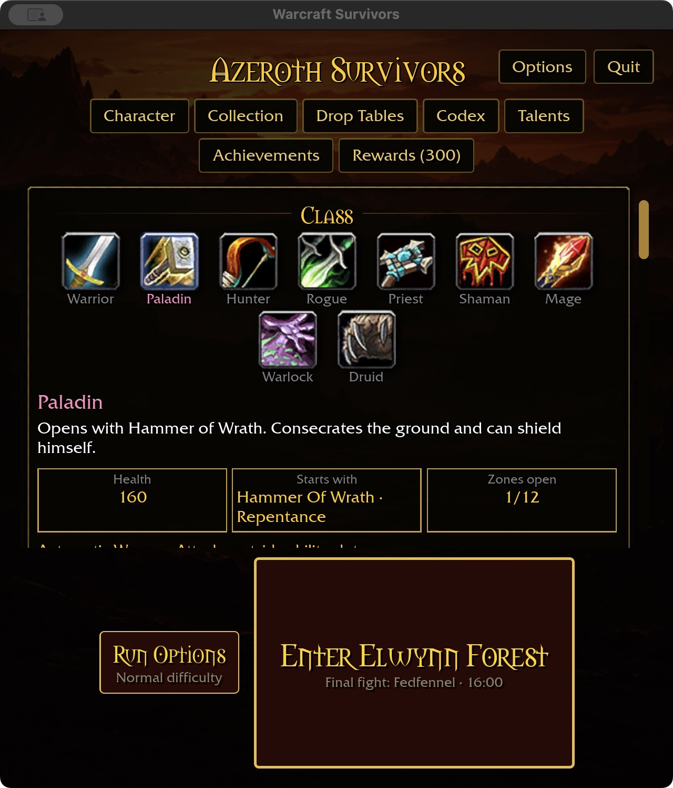
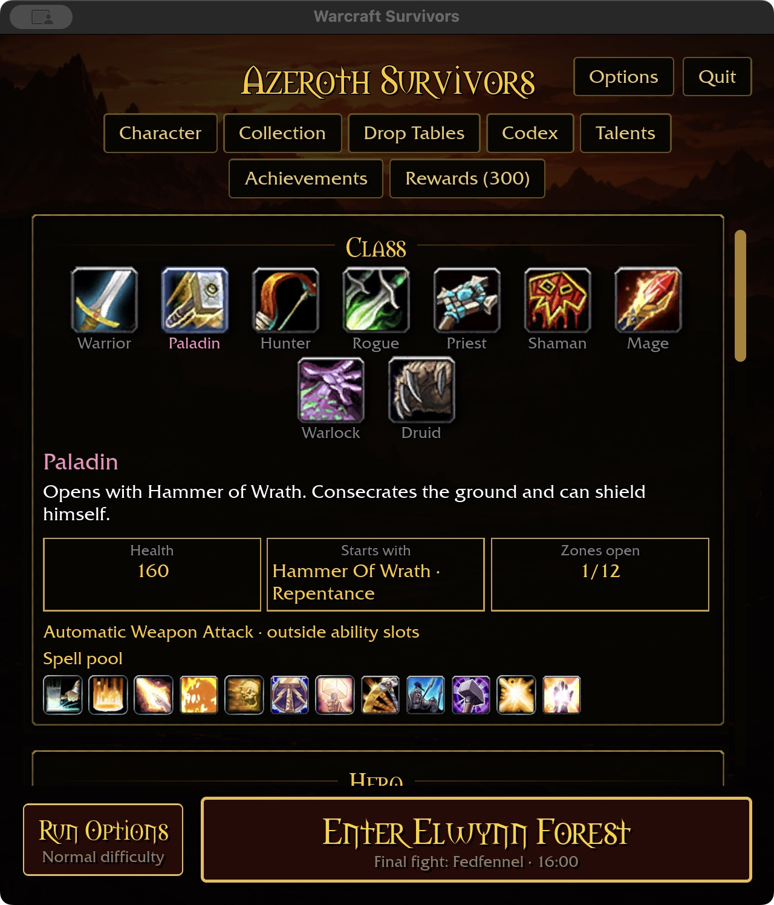
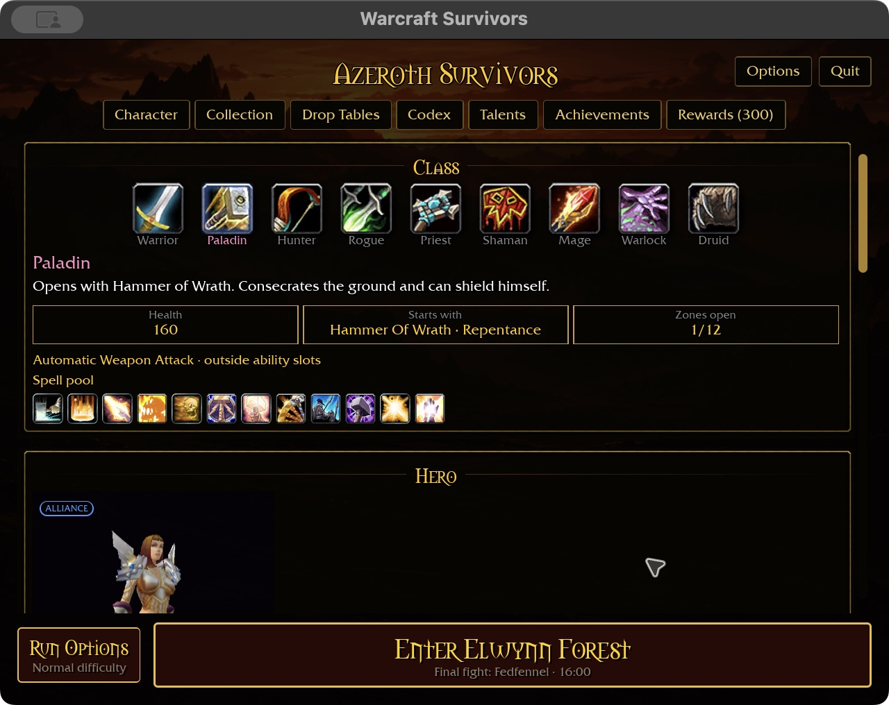
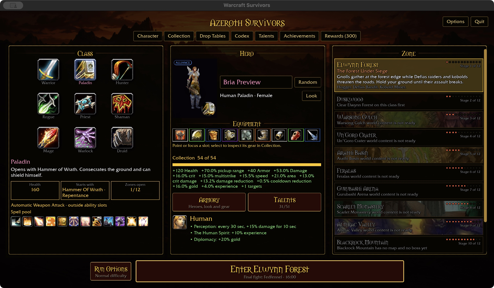
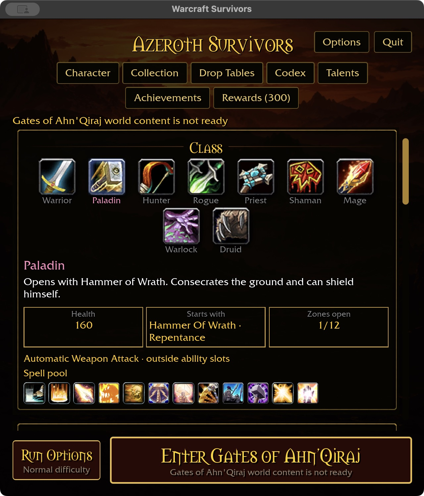

# Responsive starter footer — 2026-11-01

The native 640×720 / 125% starter reproduced an oversized Enter action: the
button occupied roughly 400 physical screenshot pixels vertically despite its
single-line title/subtitle. It crowded the automatic-attack label and spell pool
out of the initial viewport. The reference `intentions/survivors_main_menu.png`
uses a compact bottom action row, leaving the Class/Hero/Zone panels dominant.

The footer now uses two grid columns: natural-width Run Options and the remaining
width for Enter. It uses the full compact content width and 65% on wide layouts,
centered. Text still wraps and existing minimum button heights remain; no fixed
maximum height clips longer names or readiness explanations. Shared action-card
styles and run-entry behavior are unchanged. This replaces the wrapped flex row
whose percentage-sized primary action produced excess intrinsic height.

Native macOS production preview, isolated Paladin fixture:

- 640×720 / 125%: the Enter action is roughly 140 physical pixels tall; the
  complete class spell pool is now visible initially. Run Options opens and Done
  returns to the starter.
- 640×480 / requested 125%, with existing automatic short-window scaling: both
  actions fit; the class panel and part of Hero remain visible.
- 1280×720 / 100%: all three columns and the centered footer fit after a direct
  wide-size restart. An intermediate offscreen resized capture was not retained
  as acceptance evidence.
- Selecting locked Gates of Ahn'Qiraj and resizing to 640×720 preserves readable
  title and readiness explanation. No attempt to enter gameplay was made.

Five original captures are retained below. Normal launcher restored after verified
app exit. Windows, controller and translated-label coverage remain open; these
checks do not establish full starter or gameplay acceptance.

Validation: ten-package scoped formatting/Clippy/test gate passes with 31 optional
addon-corpus skips. Native play build passes in 33.98 seconds; WebGPU compilation
passes with six existing warnings. No new unit test duplicates layout declarations;
the reproduced native before/after and adjacent-size checks verify this geometry.
Inline image paths and diff checks pass. Build output: 57.29 GiB; caches retained.
