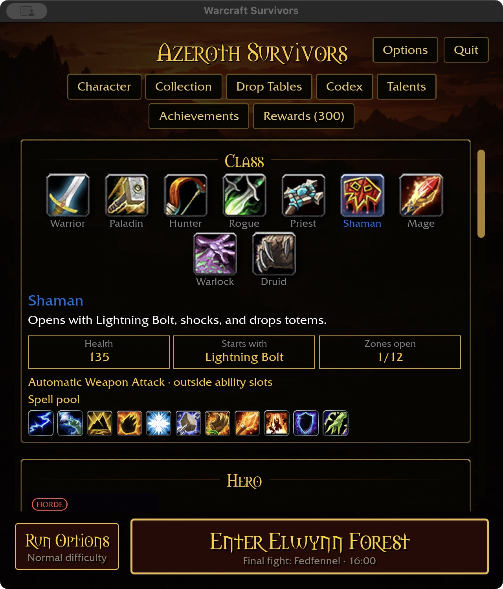

# Starter text reload investigation — 2026-11-02

**Open rendering defect; no runtime fix is claimed.** Repeated native starter
rebuilds can leave characters missing from the class description, Health value,
“Starts with” and other labels. A fresh launch can restore them. Removing outline
copies or shadows did not provide a reliable fix, so those changes were reverted.
The intended typography and all production code remain at checkpoint `c2c85f7`.



## Reproduction

Use the file-driven native preview described in [development](../SURVIVORS-DEVELOPMENT.md),
with an isolated account containing a Rogue and Shaman. The local investigation
fixture is `target/ui-fixtures/text-reload-20261102/`; hero 4 is Rogue and hero 6 is
Shaman. It is a copy of the existing preview account, not the player's live save.

Start with:

```ini
page=starter
hero=4
width=640
height=720
scale=1.25
```

Switch `hero` to 6, then back to 4, without restarting. Repeat if the first switch
is clean. No gameplay, resize or talent purchase is necessary. Inspect the entire
class description and the 135 Health value; the screenshot shows the Shaman
failure. This also occurred after changing from a wide Warrior preview to compact
Rogue and then Shaman. The first switch is not guaranteed to fail. Windows and
ordinary mouse-driven class switching have not yet been checked for this defect.

## Evidence and rejected experiments

- After a failing Shaman switch, the foreground description still had all 52
  glyphs, white alpha 1, size 761×37 physical pixels and stack index 1381. Its
  eight black outline copies occupied indices 1373–1380. Health retained all
  three glyphs, gold alpha 1, size 56×37 and foreground stack index 1405.
  Their clip rectangle included the labels. This does not prove correct render
  extraction or batching, but rules out an empty source string or missing layout.
- The CPU font atlas retained every existing pixel: zero pixels lost alpha or
  RGB values across the measured switch; 952 gained alpha as glyphs were added.
- Forcing an atlas `AssetEvent::Modified` without rebuilding the menu did not
  restore the failed text.
- Hiding all `OutlineCopy` entities restored one failing view, but replacing
  Survivors labels with a single native-shadow text tree failed on subsequent
  switches. Removing the native shadow as well also failed. Neither styling
  change is a verified fix; both were reverted.
- A temporary Bevy GPU texture readback returned 1,048,576 bytes for the 512×512
  RGBA atlas, byte-identical to the CPU image. Repeated switches were clean while
  this probe ran. It changes scheduling/resource lifetime, so this is **not**
  proof of correctness in the uninstrumented build, nor proof of a GPU race.
- Temporary probes, image dumps and experimental label code are not shipped.
  The scoped gate passed on the rejected native-shadow experiment; that result
  does not validate a fix. Production source is restored to the previously
  verified melee checkpoint.

## Next diagnostic boundary

Compare extracted foreground/shadow glyph ranges, image bindings and prepared UI
batches in a failing uninstrumented run. Capture the current texture identity,
vertex/UV/color data and batch ranges before considering a renderer change.
Test ordinary class-button switching, then repeated compact/wide preview reloads.
A fix must preserve reference styling and be demonstrated on the same failing
transition plus adjacent states; restart-only captures cannot close this issue.
